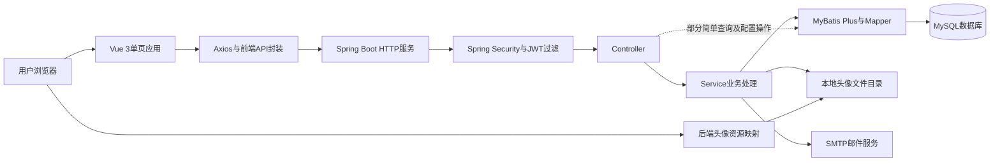
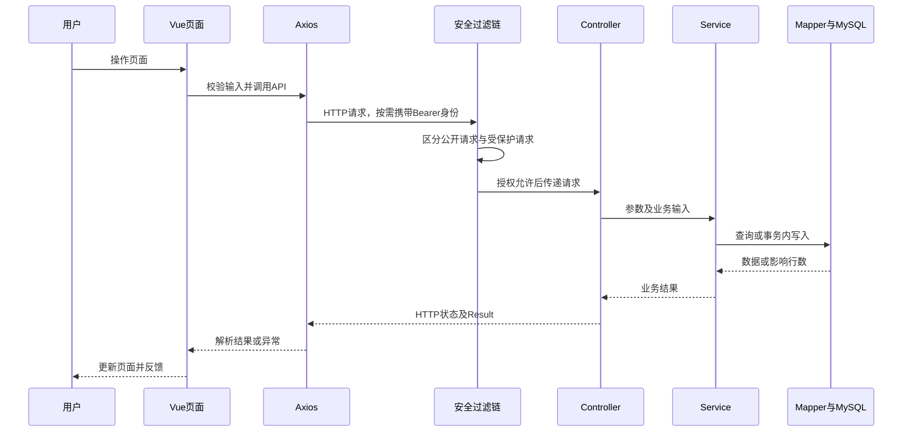
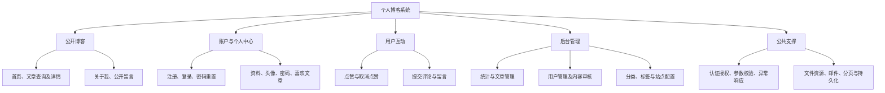
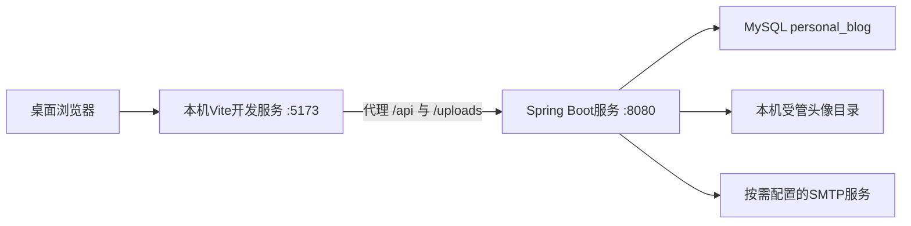

# 个人博客系统总体设计说明书

| 文档属性 | 内容 |
| --- | --- |
| 正式提交清单编号 | 12 |
| 文档版本 | v0.1，正式提交文档初稿，待最终审校 |
| 编写日期 | 2026年10月9日 |
| 需求依据 | BLOG-REQ-BL-001，SRS v1.0.0，需求基线标签 requirements-v1.0.0 |
| 需求范围 | 共80项，本期79项；BLOG-NF-012为后续版本候选；Must57 / Should22 / Could1 |
| 文档性质 | 基于已开发系统、正式需求及过程资料进行的回顾性总体设计整理 |

本说明书描述个人博客系统的总体结构、模块职责、通信方式、数据组织、安全边界及运行关系。需求基线获批不代表当前代码已全部符合要求，本文形成也不代表教师审批或学校验收完成。对于已批准目标与代码现状的差异，正文分别说明，不据此修改需求基线。

## 第一章 引言

### 1.1 编写目的

本说明书用于将已完成主体开发的个人博客系统整理为具有明确职责和可追踪依据的总体设计，为后续数据库设计、接口设计、详细设计、实现说明及测试文档提供统一的架构基础。文档重点回答系统由哪些部分组成、各部分如何协作、如何划分访问权限，以及设计如何承接正式需求，不代替具体字段字典、接口清单或算法说明。

### 1.2 项目背景

个人博客用于整理个人知识、发布技术文章和展示个人信息。与仅展示静态内容的个人主页相比，本项目需要支持文章维护、注册用户互动、评论和留言审核以及后台配置管理，因而采用前后端分离的PC Web形式。

系统主体先于正式需求与原型过程资料完成。本次总体设计属于对真实实现的规范化整理，并结合已批准需求指出待改进部分，不追溯虚构早期设计会议、原型评审或Skill指导整站开发的历史。

### 1.3 适用范围

系统面向游客、普通用户和管理员，覆盖公开博客、账户认证、个人中心和后台管理。现有前端由Vue页面及公共布局构成，后端由Spring Boot应用提供HTTP服务，MySQL负责结构化数据持久化，本地文件系统负责头像存储，SMTP邮件服务用于密码重置验证码发送。

本期以正式基线规定的桌面验收范围为准。BLOG-NF-012对应的窄屏专项增强不纳入本期必须完成的设计任务，但这不表示删除现有响应式样式或完全不支持窄屏访问。第三方登录、云存储、嵌套评论、评论及留言删除等未纳入当前实现或基线的功能不作为本说明书的既有能力。

### 1.4 参考资料与证据优先级

| 资料 | 作用 |
| --- | --- |
| [正式需求规格说明书](../../requirements/software-requirements-specification.md)、[基线登记](../../requirements/requirements-baseline-register.md) | 确定批准的需求、范围及约束 |
| [需求追踪矩阵](../../requirements/requirements-traceability-matrix.md)、[角色与业务流程](../../requirements/roles-and-business-flows.md) | 关联需求、模块和业务规则；实现状态结合最新源码复核 |
| [页面清单](../../prototype-design/page-inventory.md)、[站点地图](../../prototype-design/site-map.md) | 核对页面、布局和导航范围 |
| [系统用例图源码](../../design/use-case/系统用例图.puml) | 辅助说明参与者和系统能力，不代替接口授权配置 |
| [前端源码](../../../blog-web/src/)、[后端源码](../../../blog-server/src/main/java/)、[数据库资源](../../../blog-server/src/main/resources/) | 确定当前技术结构及实际行为 |
| [15.6-B回归测试报告](../../../skill/docs/15.6-B真实网站回归测试报告.md) | 确认公开阅读前端修复的验证范围及限制 |
| [正式提交文档整理计划](../课程设计正式提交文档整理计划.md) | 确定本文编号、交付定位和后续文档边界 |

业务目标以正式SRS为准；当前实现以本次核查的代码为准；运行结论以对应执行记录为准。既有追踪文档包含历史快照时，不将快照中的旧差异直接认定为当前仍未修复，也不因源码存在就认定测试通过。

## 第二章 系统设计目标与原则

### 2.1 系统定位与目标

系统定位为具有完整内容发布和用户互动流程的个人博客课程项目。公开前台应支持文章展示、检索、阅读及站点介绍；登录用户应能够管理个人资料并进行点赞、评论和留言；管理员应能够维护文章、用户、审核内容、分类、标签和站点配置。

总体设计首先保证公开访问与受保护操作的边界清楚，其次保证文章状态、审核状态和用户状态能够正确影响可见性及操作资格。数据库约束、业务校验与前端反馈应共同维护一致性，而不能只依赖按钮隐藏或前端输入限制。

### 2.2 设计原则

1. **职责明确。** 前端处理展示、交互和页面状态；后端负责可信业务规则、身份授权与数据访问；数据库承担持久化及结构约束。
2. **适度分层。** 采用Controller、Service、Mapper和Entity/DTO/VO等结构，但如实保留当前部分简单查询直接由Controller访问Mapper的事实，不将现状描述为完全严格分层。
3. **公开阅读优先降级。** 个人点赞状态等附属请求失败不应破坏公开正文展示；受保护写操作仍须通过服务端鉴权。
4. **安全与兼容并重。** 密码、密钥、上传文件和用户状态均有独立边界；新增密码规则不得通过静默截断或批量重置破坏历史账号。
5. **可验证、可追踪。** 将设计关联到稳定需求编号，区分需求确认、实现完成与测试通过，保留失败及未执行事项。
6. **控制项目规模。** 复用当前技术栈，不为课程文档引入未经实现的微服务、消息队列、分布式缓存或云基础设施。

### 2.3 主要约束

项目目录保持`blog-web/`和`blog-server/`现状。后端采用Java 17；数据库结构以资源目录中的`schema.sql`及迁移脚本为依据。数据库密码和JWT签名密钥必须由环境变量提供，不在可公开提交的配置中写入真实值。当前没有证据证明系统达到高并发、生产级高可用或完整安全认证要求。

## 第三章 系统总体架构

### 3.1 架构组成

系统采用浏览器单页应用、HTTP后端和关系型数据库的前后端分离结构。Vue应用负责前台与后台界面，Spring Boot以单体应用承载业务，MyBatis Plus及Mapper完成数据访问。头像文件与结构化数据分开保存，邮件发送作为外部依赖接入。

图12-1 系统总体架构图

图中虚线表示当前代码的实际例外路径：`PublicController`存在分类、标签及配置的直接Mapper查询，`AdminController`包含部分分类、配置和统计数据操作。主要文章、认证、互动及审核业务则由Service组织。此结构可用于课程规模的单体应用，但直接写入配置等路径仍需补齐事务、校验和结果判断。

### 3.2 前端内部结构

`router/`集中配置页面和访问守卫，`layouts/`提供公开前台与后台公共框架，`views/`承载页面，`components/`提供文章卡片等复用内容，`api/`封装认证、文章、互动及管理请求，`store/`使用Pinia维护身份状态，`assets/`维护样式。

前端实际接入15个末级路由页面：公开内容5页、账户及个人中心3页、后台管理6页、404状态页1页。登录与注册是同一路由中的不同状态；后台系统管理的分类、标签和配置是三个页签；文章编辑是抽屉，不另计路由页面。未接入路由的历史组件不作为正式页面能力。

### 3.3 后端内部结构

Controller负责接收HTTP输入、调用业务组件并包装响应；DTO用于请求参数约束；Service负责账户、文章、互动、审核、头像及邮件相关规则；Mapper基于MyBatis Plus执行基础数据操作，必要位置使用自定义SQL；Entity对应数据实体，VO用于组织返回数据。安全过滤、异常处理、分页和资源映射属于横向基础能力。

后端没有独立的Repository层，不应将Mapper结构重复描述为另一套Repository实现。实体也不直接等同于对外响应对象，用户资料应通过受控返回结构避免暴露密码哈希。

### 3.4 典型请求流程

图12-2 主要业务请求协作流程图

该流程适用于主要Service业务，不代表所有接口均访问数据库。校验或权限失败应提前返回；公开文章详情请求本身包含阅读量更新，因此在后续验证中也不能将其视为完全无写入的数据库操作。

## 第四章 技术架构与选型

| 技术 | 当前配置依据 | 在本项目中的作用及选用理由 |
| --- | --- | --- |
| Vue 3 | 前端依赖声明`^3.5.12` | 组件化构建公开前台、个人中心及后台，复用布局与交互状态 |
| Vite | 依赖声明`^5.4.10` | 提供开发服务、API代理与生产构建；页面按需导入 |
| Vue Router 4、Pinia 2 | 前端依赖及router/store | 管理页面跳转、身份缓存、登录态恢复与访问守卫 |
| Element Plus、Icons | 前端依赖 | 提供表单、表格、分页、抽屉、对话框等界面组件 |
| Axios | 前端API封装 | 统一请求、身份附加、响应解析与401/403反馈 |
| ECharts | 后台数据概览页面 | 展示近七日文章发布趋势 |
| marked、DOMPurify | 文章详情页面 | 将Markdown转换为HTML，并过滤不安全内容后展示 |
| Spring Boot 3.3.5、Java 17 | 后端`pom.xml` | 组织REST服务、业务组件和运行配置，适合当前单体项目规模 |
| Spring Security、JJWT 0.12.6 | 安全配置及后端依赖 | 建立无状态认证、JWT验证及管理员接口授权 |
| BCrypt | 密码编码器配置 | 保存密码哈希并验证密码，不以明文存储账户密码 |
| MyBatis Plus 3.5.8 | 后端依赖、Mapper及分页配置 | 提供实体映射、条件查询、分页、逻辑删除及基础数据操作 |
| MySQL 8、InnoDB、utf8mb4 | 数据库脚本及运行配置 | 存储结构化数据，利用事务、索引、唯一约束和外键维护数据关系 |
| Spring Boot Mail、Jakarta Validation、Lombok | 后端依赖及使用代码 | 分别支持验证码邮件、请求校验和减少样板代码 |
| Maven、npm、JUnit 5、Mockito | 构建文件与已有测试 | 构建依赖管理及后端业务测试；测试存在不代表已完成全站验收 |

前端带`^`的版本为依赖声明范围，精确解析版本以锁文件为准，不将声明值当作所有运行环境中的实际版本。当前架构满足课程项目的技术组织需要，未引入独立搜索引擎或缓存系统，关键词查询由数据库条件查询承担。

## 第五章 功能模块划分

### 5.1 模块结构

图12-3 系统功能模块结构图

### 5.2 模块职责与协作

| 模块 | 主要职责 | 主要协作关系 |
| --- | --- | --- |
| 公开博客 | 展示首页、已发布文章、详情、相邻文章、关于我与已审核留言；提供关键词、分类和标签筛选 | 读取文章、分类、标签和公开配置；正文展示与可选的个人状态读取分离 |
| 账户认证 | 注册、登录、身份查询及邮箱验证码重置密码 | 使用用户、验证码数据和邮件服务；认证结果供个人中心及互动功能使用 |
| 个人中心 | 查看及修改用户名、更新头像、修改密码、查看喜欢文章 | 从认证主体确定本人身份，联动用户数据、点赞关系及头像文件存储 |
| 用户互动 | 点赞、取消点赞、提交评论与留言 | 点赞维护关系和计数；评论、留言提交后待审核，不直接进入公开列表 |
| 后台文章管理 | 查询、创建、编辑、发布、保存草稿、置顶及逻辑删除 | 同时维护文章主体、分类引用和标签关联，影响前台可见性 |
| 后台用户管理 | 查询用户、调整角色、启用或禁用用户 | 影响后端实时授权与前端导航；禁止操作自己的角色或禁用自己 |
| 后台审核 | 跨文章查询评论并审核，查询及审核留言，支持批量处理 | 只有通过审核的内容公开；评论状态变化联动文章评论数 |
| 后台系统管理 | 分类、标签及五项站点配置维护 | 分类、标签删除受文章引用约束；配置影响首页、站点名称和关于我 |
| 数据概览 | 展示文章、用户、评论、已发布文章数量和近七日趋势 | 从业务数据查询统计，不存在独立埋点或流量分析平台 |

### 5.3 关键业务状态

文章采用`DRAFT`与`PUBLISHED`状态，前台只展示符合公开条件的文章。评论、留言采用`PENDING`、`APPROVED`、`REJECTED`，公开查询只返回审核通过内容。用户采用`USER`或`ADMIN`角色，并通过`ACTIVE`、`DISABLED`控制账户可用性。

文章删除采用逻辑删除，并清理文章标签关联；不应描述为将文章及全部评论、点赞物理级联删除。评论和留言管理当前主要为查询与审核，不因原型演示需要就新增正式删除能力。

## 第六章 系统角色与权限设计

### 6.1 角色权限分配

| 能力 | 游客 | 普通用户USER | 管理员ADMIN |
| --- | --- | --- | --- |
| 浏览公开文章、关于我和已审核留言 | 允许 | 允许 | 允许 |
| 注册、登录、找回密码入口 | 可使用 | 已登录时按页面守卫处理 | 已登录时按页面守卫处理 |
| 本人资料、头像、修改密码、喜欢文章 | 不允许 | 允许 | 允许 |
| 点赞、评论和留言提交 | 需要登录 | 允许 | 允许 |
| 后台统计、内容维护、用户管理及审核 | 不允许 | 不允许 | 允许 |

管理员在业务能力上可执行普通用户操作，但安全实现并不是自动赋予两个角色：过滤器根据数据库中的当前角色建立相应权限；普通用户操作主要要求已认证，后台要求`ADMIN`。

### 6.2 双层访问控制

前端路由通过`requiresAuth`和`roles`控制入口，后台菜单仅对相应身份展示。服务端安全配置独立保护接口：公开认证入口、密码重置入口、`/api/public/**`及头像读取资源允许匿名访问；`/api/admin/**`要求管理员；其余受保护接口要求有效身份。

前端守卫不能代替服务端授权，隐藏后台入口也不能防止直接请求接口。未认证访问受保护资源与已认证但角色不足应分别处理为401和403。本人资料及头像更新以认证主体标识为依据，不接受客户端随意指定另一用户作为操作对象。

### 6.3 失效身份与角色变化

后端对受保护请求读取当前有效用户并比较`token_version`，从数据库角色建立授权，而不是只信任JWT中签发时的角色。因此，角色变化可影响后续服务端请求；前端缓存则需要身份恢复或403后的权限刷新纠正。

公开接口在JWT过滤器中跳过认证解析，失效Bearer不应阻止公开读取。前端已区分自动附属请求与主动受保护操作：自动点赞状态读取和身份恢复使用静默认证失败处理，清理失效身份但保留公开页面；主动访问个人中心或进行互动仍应要求登录。

禁用用户在禁用期间不能通过旧Token访问受保护接口。但当前启用、禁用逻辑尚未递增Token版本，重新启用后旧Token存在恢复有效的风险，与基线要求的“禁用前旧Token永久失效”仍有差异。

## 第七章 系统数据设计概述

### 7.1 数据实体及关系

当前数据库包含以下10张主要表，具体字段、类型、索引及外键定义由后续编号13数据库设计文档展开。

| 数据表 | 总体职责 | 主要关系 |
| --- | --- | --- |
| `sys_user` | 账户、角色、状态、头像和身份版本 | 关联作者、评论、留言及点赞行为 |
| `email_verification_code` | 密码重置验证码及使用状态 | 通过邮箱建立业务联系，不应虚构其具有用户外键 |
| `blog_article` | 文章内容、状态与统计数据 | 一个作者、一个分类，可关联多个标签 |
| `blog_category` | 文章分类 | 分类与文章为一对多关系 |
| `blog_tag` | 文章标签 | 通过关联表与文章形成多对多关系 |
| `blog_article_tag` | 文章标签关联 | 记录文章和标签组合 |
| `blog_comment` | 文章评论及审核状态 | 关联文章和评论用户 |
| `blog_message` | 留言及审核状态 | 关联提交用户 |
| `blog_article_like` | 用户文章点赞关系 | 用户与文章之间的关联，限制重复组合 |
| `blog_site_config` | 站点业务配置 | 独立键值结构，公开范围应受五键白名单控制 |

### 7.2 持久化与一致性

MyBatis Plus负责常规映射、分页和逻辑删除；特殊查询使用Mapper自定义SQL。数据库通过唯一约束避免重复身份、文章别名及重复互动关系，并通过外键约束关联对象。逻辑删除与物理外键级联不是同一行为，不能据外键声明推断逻辑删除会自动删除所有子记录。

文章保存涉及主体与标签关系的协同更新；审核涉及状态与文章评论数；点赞涉及关系记录与点赞数。相关Service使用事务组织这些业务，但是否在竞争请求下始终满足计数及唯一性不变量，仍需独立测试数据库验证，不能从存在事务注解直接推定并发正确。

阅读量按成功详情读取累加，不等同于独立访客数。头像二进制文件不存入MySQL，用户记录保存相对资源路径；文件操作与数据库事务使用提交后清理、回滚补偿等方式协作，并不是跨数据库和文件系统的原子事务。

### 7.3 数据脚本管理

数据库权威脚本位于`blog-server/src/main/resources/`，包括`schema.sql`、`migration-v2.sql`和`migration-v3-email-reset.sql`。根目录`sql/`用于说明和组织数据库交付材料，不假设其中已经存在另一套权威脚本。初始化与旧库升级应分别设计验证，不在已有业务库中随意执行初始化脚本。

## 第八章 接口与通信设计概述

### 8.1 通信方式

前端通过Axios以`/api`为请求基址，通常使用JSON交互；头像上传使用`FormData`，由浏览器生成multipart边界。JWT按需要通过`Authorization: Bearer ...`发送，公开请求不依赖有效身份。后端头像读取为静态资源响应，不套用普通JSON业务响应。

接口按认证、公开、用户互动及后台管理职责组织。详细请求方式、路径和参数由编号14接口设计说明书统一维护，本文不以推测地址补齐未实现接口。

### 8.2 响应及异常

当前主要Controller使用`Result`作为统一业务响应，成功包含`code`、`message`与`data`，成功业务码为0。失败响应结合HTTP状态和业务码说明错误；空值字段可能因JSON序列化配置省略，不能要求每个失败响应都固定带`data: null`。

业务异常及参数异常主要返回400，资源不存在可返回404，未处理内部异常返回500并向客户端提供通用错误；安全层分别处理401和403。用户名或密码错误属于当前业务异常路径，不能将所有登录失败均写成401。前端还需检查HTTP成功响应中的业务码，避免把“请求成功送达”误认为“业务保存成功”。

### 8.3 公开文章与附属请求的隔离

正文和相邻文章属于公开内容，个人点赞状态属于受保护附属信息。详情页先建立正文展示，再加载评论及个人状态，并对各类失败分别反馈。个人身份失效可以降级为游客，评论加载失败应显示失败而非伪造空列表，点赞状态未知也不应假装已确认。

15.6-B修复已针对401同步清理Pinia与持久化缓存，并保护新会话不被旧请求延迟返回的401清除。该设计不降低点赞、评论或后台请求的服务端权限，也不把403转换为允许访问。

## 第九章 系统安全设计

### 9.1 认证与密码处理

系统采用无状态JWT认证，不依赖服务端HTTP Session保存登录态。签名密钥由`JWT_SECRET`提供，数据库密码由`DB_PASSWORD`提供；签发时记录身份与Token版本，校验时结合当前用户状态、角色及版本决定是否放行。

密码使用BCrypt保存哈希。正式目标要求新密码同时满足8—64个Unicode码点和UTF-8不超过72字节，且不得静默截断；该规则适用于注册、修改及邮箱重置的新密码设置，历史哈希登录验证需保留兼容。目前DTO主要采用Java字符串长度约束，不能等同于码点计数，也尚未完整落实UTF-8字节边界。

登录状态下修改密码已经递增Token版本；邮箱重置流程尚未递增，因而不能声称两种修改入口都已实现旧Token失效。本地退出登录只清理当前客户端状态，系统未因此具备服务器主动注销或所有设备即时退出能力。

### 9.2 内容及文件安全

文章正文经marked转换后由DOMPurify净化再显示，降低Markdown生成HTML带来的脚本风险。该措施不意味着整个站点已完成XSS安全验收；Token仍保存在客户端持久化存储中，防范脚本注入仍是重要边界。

头像上传限制JPG、PNG或WebP及最大5MiB，并检查扩展名、MIME和文件头；服务端使用UUID命名和受控目录保存，用户资料只保存相对路径。旧文件删除应限定于受管路径，防止删除外部URL或目录穿越目标。真实图片解析、文件系统权限及异常补偿仍需专项验证。

### 9.3 邮件和配置安全

验证码通过邮件服务发送，现有流程具有六位数字、五分钟有效期、六十秒重发限制及单次使用设计；并发发码和真实投递需要分别验证。SMTP账户与授权信息由环境变量提供，公开联系邮箱`email`不是SMTP登录账户。

站点配置目标只允许`siteName`、`siteSubtitle`、`homeIntro`、`aboutContent`和`email`五个业务键，管理员写入且公开读取仅返回白名单。当前后端读取和写入仍缺少完整白名单、字段校验及批量事务保障，不能将后台已有五个输入框等同于服务端已安全限制五键。

## 第十章 系统运行与部署架构概述

### 10.1 当前开发运行关系

图12-4 本地开发运行关系图

端口为当前默认配置，并非所有环境固定不变。Vite配置将API和头像请求代理到后端；后端跨域配置包含本机前端开发来源。后端可通过IntelliJ IDEA或Maven启动，前端通过npm脚本启动，数据库作为独立服务运行。

### 10.2 环境与配置边界

后端要求Java 17与Maven，前端需要Node.js与npm，数据库采用MySQL 8。项目没有固定Node.js和npm版本约束，不虚构统一安装版本。`DB_PASSWORD`和`JWT_SECRET`必须配置；数据库连接、用户名、服务端口、Token有效期以及SMTP相关项目按现有环境变量配置。根目录`.env.example`用于说明变量，不意味着Spring Boot会自动读取项目根目录`.env`。

头像目录可通过`AVATAR_UPLOAD_DIR`配置，默认相对路径的解析受后端工作目录影响；交付时需明确工作目录、写入权限及持久化位置。上传文件、日志、依赖缓存和真实环境文件不作为公开源码内容。

### 10.3 部署扩展边界

前端可构建为静态文件，后端可构建为可执行服务包，这是现有构建能力，不是生产部署已经完成的证明。正式部署还需确定静态资源托管、Vue History路由回退、接口地址、HTTPS、跨域来源、头像持久化及数据库备份恢复方案。目前不据代码推定已经部署Nginx、Docker、云存储或多节点服务。

## 第十一章 设计与需求对应关系

### 11.1 功能需求映射

下表保持正式需求编号，用模块聚合对应40项功能需求，不以文档覆盖代替功能验收。

| 设计模块 | 正式功能需求编号 | 总体设计承接方式 |
| --- | --- | --- |
| 账户认证与访问控制 | BLOG-F-001、BLOG-F-002、BLOG-F-003、BLOG-F-004、BLOG-F-005 | 注册登录、本人身份、客户端退出、前后端访问控制 |
| 邮箱密码重置 | BLOG-F-006、BLOG-F-007 | 验证码、邮件依赖及密码更新流程 |
| 首页与公共信息 | BLOG-F-008、BLOG-F-009、BLOG-F-014、BLOG-F-015 | 首页聚合、文章推荐、关于我及404页面 |
| 文章查询 | BLOG-F-010、BLOG-F-011 | 文章条件查询、分类标签选项及分页 |
| 文章详情 | BLOG-F-012、BLOG-F-013 | 公开正文、阅读量及相邻文章导航 |
| 点赞及喜欢文章 | BLOG-F-016、BLOG-F-017 | 用户文章关系、计数及本人喜欢文章列表 |
| 评论业务 | BLOG-F-018、BLOG-F-019、BLOG-F-036、BLOG-F-037 | 公开评论、登录提交、跨文章后台查询及审核 |
| 个人资料 | BLOG-F-020、BLOG-F-021、BLOG-F-022 | 本人资料、头像文件与密码维护 |
| 留言业务 | BLOG-F-023、BLOG-F-024、BLOG-F-038、BLOG-F-039 | 公开留言、提交及后台审核 |
| 数据概览 | BLOG-F-025 | 业务数量及近七日趋势查询 |
| 文章管理 | BLOG-F-026、BLOG-F-027、BLOG-F-028、BLOG-F-029、BLOG-F-030 | 列表、抽屉编辑、发布草稿、逻辑删除及置顶 |
| 分类与标签 | BLOG-F-031、BLOG-F-032 | 系统管理页签及文章引用约束 |
| 用户管理 | BLOG-F-033、BLOG-F-034、BLOG-F-035 | 查询、角色调整及账户状态维护 |
| 站点配置 | BLOG-F-040 | 五键业务配置及前台展示；目标校验与事务尚待落实 |

### 11.2 非功能及业务规则承接

| 需求或规则 | 对应总体设计 | 当前判断与验证边界 |
| --- | --- | --- |
| BLOG-NF-001—BLOG-NF-007 | 密码、身份、HTML、头像、秘密配置、Token及一致性 | 有相关实现基础，密码边界和Token失效等仍有差异 |
| BLOG-NF-008、BLOG-NF-009 | 分页、限量查询、按需加载与性能验收 | 分页等存在；性能达标必须依据正式参数实测 |
| BLOG-NF-010、BLOG-NF-011 | 明确反馈和桌面浏览器界面 | 需要区分失败、空数据和真实零值；双浏览器专项未由本文验证 |
| BLOG-NF-013—BLOG-NF-016 | 分层、异常处理、可复现运行与恢复 | 当前配置及结构提供基础；完整初始化、升级及恢复待验证 |
| BLOG-BR-002、BLOG-BR-003 | 身份一致性及密码兼容 | 用户名、邮箱规范化和新密码规则存在实现差异 |
| BLOG-BR-004、BLOG-BR-009 | 当前用户授权与Token版本 | 公开读取隔离已实施前端修复；禁用再启用及邮箱重置失效仍待落实 |
| BLOG-BR-010—BLOG-BR-018 | 文章状态、关联、排序、阅读量及点赞 | 当前业务有实现；停用关联、排序稳定性及并发需进一步核对或修复 |
| BLOG-BR-019—BLOG-BR-022 | 评论留言审核、去重及计数 | 采用待审、唯一约束和审核事务，竞争场景尚不能据静态代码认定通过 |
| BLOG-BR-023、BLOG-BR-024 | 头像及五键站点配置 | 文件安全有实现；配置白名单、字段校验和原子性需补齐 |

BLOG-NF-012仅作为后续候选，不混入本期必须验收项。完整80项确认状态仍由正式SRS及追踪矩阵管理，本文仅提供总体设计承接关系，不重新批准、排除或编号需求。

## 第十二章 设计限制、验证策略与待确认事项

### 12.1 当前实现与目标的主要差异

| 事项 | 当前代码情况 | 已批准目标及后续处理 |
| --- | --- | --- |
| 身份输入约束 | 注册用户名上限50，登录DTO上限30；字符串长度不等同于码点数；注册邮箱未统一规范化 | 统一身份比较与Unicode计数，核对历史账号冲突后实施，不擅自改历史数据 |
| 密码边界 | 新密码主要采用字符串长度校验 | 独立实现码点及UTF-8字节约束，设计旧哈希兼容测试，不静默截断 |
| 旧Token永久失效 | 禁用期间可拒绝，但启用未更新版本；邮箱重置未递增版本 | 完善相应失效路径并回归，保留现有客户端退出 |
| 停用分类标签 | 分类主要检查存在；编辑文章标签要求全部有效，可能拒绝保留历史停用关联 | 拒绝新关联，允许保留未改变的历史关联 |
| 文章列表URL与排序 | 已初始化查询参数并更新URL，但缺少完整历史恢复；部分排序缺少稳定同值次序 | 按基线补齐导航恢复和确定性排序，不把HTML原型演示认定为网站实现 |
| 站点配置 | 读取未完整限制白名单；保存缺字段级校验和批量事务保障 | 五键、部分更新、缺失保留旧值、非法输入拒绝及批量原子性按基线实施 |
| 写入与统计反馈 | 部分更新未核对影响行数；统计失败仍可能保留初始化零值 | 区分业务写入结果和请求成功，失败不能伪装真实0或保存成功 |

上述为代码与正式目标对照，不是本轮执行测试产生的失败记录。本说明书不修复这些差异，也不将其改写为新的需求。

### 12.2 已有验证证据及适用范围

15.5针对HTML原型旧成功提示残留完成的12组回归，只证明指定原型的模拟行为，不证明真实博客后端正确。15.6-B针对真实Vue前端公开阅读中断完成隔离验证：原15组计划执行14组并通过，1组后端安全链未执行；另有1组相邻自动化回归通过，因此自动化脚本共15个通过子测试，不能将其写成原15组全部执行通过。

15.6-B另记录6类实际浏览器模拟HTTP检查和前端生产构建成功，构建存在Element Plus及ECharts分包体积警告。这些证据不包含真实MySQL事务、真实JWT签名验证、SMTP投递或完整桌面兼容性验收。本轮仅引用历史证据，没有重新执行功能、浏览器、数据库或性能测试。

### 12.3 后续验证策略

| 层次 | 重点对象 | 安全与证据要求 |
| --- | --- | --- |
| 静态与构建 | 路由、请求策略、配置、依赖及前端构建 | 记录实际版本和构建结果，体积警告与编译失败分开 |
| 单元及隔离测试 | 身份清理、密码边界、验证码、关联规则、响应反馈 | 使用替身明确覆盖边界，不替代数据库及外部服务 |
| 服务端安全链与接口集成 | 公开跳过失效JWT、受保护401、普通用户403、角色和状态变化 | 记录是否调用业务组件及是否写库，不只观察前端跳转 |
| 独立数据库验证 | 点赞、审核、验证码竞争、配置回滚、初始化与旧库升级 | 按已确认范围使用独立测试库；最小竞争场景2并发、10轮，不解释为高并发认证 |
| 浏览器与性能验收 | 正式桌面范围、筛选历史、抽屉反馈、性能目标 | 使用基线批准参数及实际Chrome/Edge版本，保留操作、截图和失败证据 |
| 邮件与交付验证 | 真实收件、运行说明、头像持久化、备份恢复 | SMTP及数据操作另行授权，凭证脱敏，不用模拟邮件证明投递成功 |

具体用例、输入、预期及覆盖矩阵留给编号17、18文档，不在本文伪造测试执行表。后端已有JUnit 5和Mockito测试代码可复用，但测试代码存在本身不是本轮通过证据。

### 12.4 待确认与审校事项

正式需求范围已经由基线确定，本文不重新开放已确认业务规则。尚需补充的是运行与交付证据，包括实际部署目标、数据库初始化和升级验证、真实SMTP收件、Chrome及Edge版本、性能执行环境、历史数据兼容情况和恢复操作证据。学校是否要求统一封面、Word/PDF、具体版式及签署页仍需依据真实要求确认，不自行填入教师审批结论。

本文可进入用户检查与最终审校阶段。后续应按已确认整理计划继续编号13数据库设计，逐份完成至18；23—25暂缓，26—27取消。本文不自动触发后续编写、代码改造、数据库操作或Git提交。

---

**版本记录：**2026年10月9日，形成v0.1总体设计说明书。仅完成本文编写及文档静态一致性检查；未修改网站、Skill、数据库或需求基线，未执行新的系统测试，未进行Git暂存、提交或推送。
