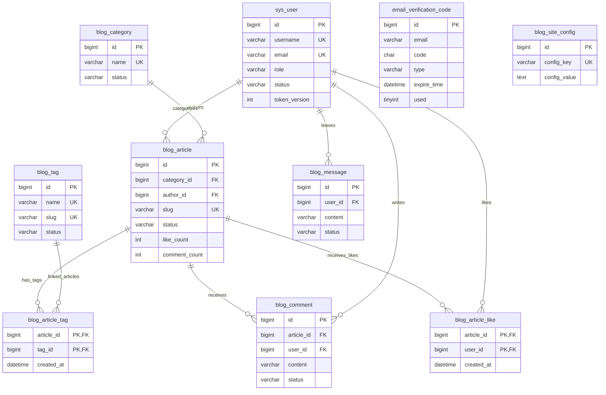

# 个人博客系统数据库设计说明书

| 文档属性 | 内容 |
| --- | --- |
| 正式提交编号 | 13 |
| 文档版本 | v0.1，待审校稿 |
| 编写日期 | 2026年10月9日 |
| 需求依据 | BLOG-REQ-BL-001 / SRS v1.0.0 |
| 对应总体设计 | 第12份《个人博客系统总体设计说明书》v0.1 |
| 核查范围 | 初始化与迁移SQL、10个实体及Mapper、相关Service、Controller和持久化配置 |
| 证据性质 | 当前文件静态核查；未连接真实MySQL，未执行初始化、迁移、并发或性能测试 |

## 第一章 引言

### 1.1 编写目的

本说明书对个人博客系统的数据库实体、表结构、关系、索引及业务数据处理进行规范化整理，为接口、详细设计、实现说明和测试用例提供数据依据。正文以当前SQL的实际定义为准，并结合Java代码说明数据的使用方式，不以常见博客功能推测字段。

本项目主体开发早于正式过程文档，本说明书属于回顾性设计整理。文档版本v0.1与正式需求版本v1.0.0分别管理，不表示数据库已经验收，也不形成教师审批记录。

### 1.2 设计依据

| 依据资料 | 用途 |
| --- | --- |
| [正式需求规格说明书](../../requirements/software-requirements-specification.md) | 业务范围、数据约束及验收目标 |
| [需求追踪矩阵](../../requirements/requirements-traceability-matrix.md) | 关联功能、非功能与业务规则；历史实现描述结合当前代码复核 |
| [总体设计说明书](12_个人博客系统总体设计说明书.md) | 模块、持久化及安全边界 |
| [schema.sql](../../../blog-server/src/main/resources/schema.sql) | 10张表的完整字段、索引、约束与初始化数据，主要结构依据 |
| [migration-v2.sql](../../../blog-server/src/main/resources/migration-v2.sql)、[migration-v3-email-reset.sql](../../../blog-server/src/main/resources/migration-v3-email-reset.sql) | 旧版本升级内容及执行条件 |
| [数据库脚本索引](../../../sql/README.md) | 确认权威脚本仍位于后端资源目录，并非sql目录中另有副本 |
| [实体目录](../../../blog-server/src/main/java/com/example/blog/entity/)、[Mapper目录](../../../blog-server/src/main/java/com/example/blog/mapper/)、[业务实现目录](../../../blog-server/src/main/java/com/example/blog/service/impl/) | 核对映射、查询、写入、事务及逻辑删除 |
| [正式文档整理计划](../课程设计正式提交文档整理计划.md) | 确定本说明书编号及后续文档边界 |

### 1.3 适用范围与说明口径

文档覆盖当前10张业务表，不包含MySQL内部系统表、上传图片二进制文件、运行日志或Skill文档。未读取运行数据库的实际DDL，故本说明书描述的是仓库脚本目标结构，不能证明本机旧数据库已经与脚本一致。

“数据库约束”专指SQL中的主键、非空、唯一、外键及CHECK等；“业务校验”指Java或前端执行的规则；“正式目标”指SRS已经批准但当前代码不一定满足的要求。三者不得相互替代。

## 第二章 数据库设计目标与原则

数据库需要支持用户认证、文章发布与阅读、分类标签、点赞、评论留言审核、后台统计及站点配置。设计目标是在课程项目规模下保证结构清晰、关联有效、重复数据受控，并支持后续回顾与验证。

主要原则如下：

1. 按业务实体建表，文章与标签、用户与文章点赞通过关联表表达多对多关系。
2. 使用主键识别记录，使用唯一约束约束身份、别名和重复互动，不只依赖写入前查询。
3. 对历史内容采用逻辑删除或状态保留；逻辑删除与物理删除分别说明。
4. 对跨表写入使用事务组织，对冗余计数单独分析一致性和并发风险。
5. 密码使用哈希，连接凭证使用环境变量，文档不公开真实秘密和业务数据库备份。
6. 不虚构SQL中没有的字段、索引、触发器、存储过程或自动清理任务。

## 第三章 数据库环境与技术选型

### 3.1 环境及参数

| 项目 | 仓库中的定义 |
| --- | --- |
| 数据库产品 | MySQL 8 |
| 数据库名 | personal_blog |
| 存储引擎 | 全部10表为InnoDB |
| 字符集 | utf8mb4 |
| 排序规则 | utf8mb4_unicode_ci |
| 持久化组件 | MyBatis Plus 3.5.8、MySQL JDBC驱动 |
| 后端环境 | Spring Boot 3.3.5、Java 17 |
| 实体映射 | 下划线字段转驼峰；Entity使用@TableName指定表 |
| 分页 | MybatisConfig配置MySQL方言分页拦截器 |
| 主键策略 | 8表单列自增主键；2表联合主键 |
| 逻辑删除配置 | deleted=0正常、deleted=1删除，适用实体有@TableLogic |

InnoDB提供事务与外键基础；utf8mb4支持多字节Unicode文本。VARCHAR长度是字符容量，不是UTF-8字节数；Java String.length()、Unicode码点数和数据库容量也不应直接等同。排序规则参与字符串比较及唯一判定，不应把当前去重解释为逐字节相等；大小写、尾随空白和其他等价情况需在实际MySQL环境验证。

### 3.2 运行配置边界

后端通过DB_URL、DB_USERNAME和DB_PASSWORD建立连接，密码必须由本地环境提供。开发连接参数不代表已经具备生产传输加密或最小权限账户。本文不输出实际配置值，也不假定Spring Boot会自动读取根目录.env。

MySQL 8的具体小版本尚未由本轮运行核实。CHECK能否按预期强制执行，应在初始化验证中记录实际版本与行为，不能仅以“MySQL 8”概括所有小版本的执行能力。

## 第四章 数据库概念结构设计

### 4.1 主要实体

用户是文章作者及互动参与者；文章是内容核心，必须引用一个分类和一个作者，可关联多个标签；评论属于具体文章，留言独立于文章；点赞由文章与用户组合识别。验证码按邮箱服务于密码重置；站点配置独立保存公开业务信息。

### 4.2 ER图

下图覆盖全部10表，只展示关系关键字段，完整字段见第六章。图中的连线均来自实际物理外键，验证码与用户之间仅存在邮箱业务匹配，因此刻意不画成外键。

图13-1 个人博客系统数据库实体关系图

图中每个子记录必须具有对应父记录，而父记录可以没有子记录。文章标签和点赞的唯一性为联合主键；评论和留言的组合唯一键在第七章说明，不能从图中的简化字段标记推导为单字段唯一。逻辑删除不会消除物理行，图中的参照关系不等于业务可见关系。

## 第五章 数据库逻辑结构设计

| 表名 | Java实体 | Mapper | 职责与关键关系 |
| --- | --- | --- | --- |
| sys_user | User | UserMapper | 用户身份、状态、角色、头像及Token版本 |
| email_verification_code | EmailVerificationCode | EmailVerificationCodeMapper | 邮箱验证码，按email匹配账户，无用户外键 |
| blog_category | Category | CategoryMapper | 分类，一对多关联文章 |
| blog_tag | Tag | TagMapper | 标签，通过关联表连接文章 |
| blog_article | Article | ArticleMapper | 文章主体，引用分类和作者 |
| blog_article_tag | ArticleTag | ArticleTagMapper | 文章标签多对多关系 |
| blog_comment | Comment | CommentMapper | 评论，引用文章及用户 |
| blog_message | Message | MessageMapper | 留言，仅引用用户 |
| blog_article_like | ArticleLike | ArticleLikeMapper | 文章与用户的点赞关系 |
| blog_site_config | SiteConfig | SiteConfigMapper | 站点配置键值数据 |

各Mapper继承BaseMapper。UserMapper的身份查重查询和ArticleMapper的slug查重查询使用自定义SQL，刻意包含逻辑删除记录，以配合数据库唯一约束。不能将这些查询误写为所有自定义SQL都会自动附带逻辑删除条件。

使用逻辑删除的实体为User、Category、Tag、Article、Comment、Message，共6个；验证码、配置及两个关系实体没有deleted字段。联合主键实体没有@TableId声明，不应虚构复合主键注解或独立id；当前代码主要通过条件Wrapper查询和删除这些关系，不依赖单一ID操作。

## 第六章 数据表详细设计

以下逐表完整列出78个字段。长度栏仅对VARCHAR及CHAR显示声明长度；数值类型、DATETIME、TEXT和LONGTEXT以“—”表示不具有此类固定字符长度，而非没有容量限制。UNSIGNED保留在类型栏。无显式默认值的必填字段须由插入操作提供；自增主键由数据库生成。时间默认值与自动更新时间均按SQL记录，Java实体未配置为自动填充的字段不能据类定义推断应用一定主动赋值。

### 6.1 系统用户表 `sys_user`

| 字段名称 | SQL数据类型 | 长度 | 主键 | 非空 | 默认值及自动行为 | 含义 |
| --- | --- | --- | --- | --- | --- | --- |
| `id` | BIGINT UNSIGNED | — | 是 | 是 | AUTO_INCREMENT；无显式默认值 | 用户主键 |
| `username` | VARCHAR | 50 | 否 | 是 | 无显式默认值 | 登录用户名 |
| `password` | VARCHAR | 100 | 否 | 是 | 无显式默认值 | BCrypt 加密密码 |
| `nickname` | VARCHAR | 50 | 否 | 是 | 无显式默认值 | 展示昵称 |
| `email` | VARCHAR | 100 | 否 | 是 | 无显式默认值 | 用户邮箱 |
| `avatar` | VARCHAR | 500 | 否 | 否 | NULL | 头像地址 |
| `role` | VARCHAR | 20 | 否 | 是 | 'USER' | 角色：ADMIN 管理员，USER 普通用户 |
| `status` | VARCHAR | 20 | 否 | 是 | 'ACTIVE' | 状态：ACTIVE 正常，DISABLED 禁用 |
| `token_version` | INT | — | 否 | 是 | 0 | 令牌版本，修改密码后递增以使旧令牌失效 |
| `created_at` | DATETIME | — | 否 | 是 | CURRENT_TIMESTAMP | 创建时间 |
| `updated_at` | DATETIME | — | 否 | 是 | CURRENT_TIMESTAMP；更新时CURRENT_TIMESTAMP | 更新时间 |
| `deleted` | TINYINT | — | 否 | 是 | 0 | 逻辑删除：0 否，1 是 |

`password`保存BCrypt哈希，不是原始密码。`nickname`是独立字段，但现有注册和修改资料会使其与用户名同步，不代表系统已提供独立昵称编辑。`avatar`可为空，新上传头像保存受管相对路径。`token_version`为应用控制的身份版本，数据库不会自动递增。

### 6.2 邮箱验证码表 `email_verification_code`

| 字段名称 | SQL数据类型 | 长度 | 主键 | 非空 | 默认值及自动行为 | 含义 |
| --- | --- | --- | --- | --- | --- | --- |
| `id` | BIGINT UNSIGNED | — | 是 | 是 | AUTO_INCREMENT；无显式默认值 | 验证码主键 |
| `email` | VARCHAR | 100 | 否 | 是 | 无显式默认值 | 接收验证码的邮箱 |
| `code` | CHAR | 6 | 否 | 是 | 无显式默认值 | 6位数字验证码 |
| `type` | VARCHAR | 30 | 否 | 是 | 无显式默认值 | 验证码类型：RESET_PASSWORD |
| `expire_time` | DATETIME | — | 否 | 是 | 无显式默认值 | 验证码失效时间 |
| `used` | TINYINT | — | 否 | 是 | 0 | 是否已使用或失效：0 否，1 是 |
| `create_time` | DATETIME | — | 否 | 是 | CURRENT_TIMESTAMP | 创建时间 |

`used=1`同时表示已使用或被新验证码失效处理，不单独区分两者。验证码当前以原值保存；六位数字格式、五分钟有效期和六十秒重发限制由Java逻辑实施，CHAR(6)及CHECK本身并未实现这些全部规则。`create_time`与其他表的`created_at`命名不同，实体已对应处理。

### 6.3 文章分类表 `blog_category`

| 字段名称 | SQL数据类型 | 长度 | 主键 | 非空 | 默认值及自动行为 | 含义 |
| --- | --- | --- | --- | --- | --- | --- |
| `id` | BIGINT UNSIGNED | — | 是 | 是 | AUTO_INCREMENT；无显式默认值 | 分类主键 |
| `name` | VARCHAR | 50 | 否 | 是 | 无显式默认值 | 分类名称 |
| `description` | VARCHAR | 255 | 否 | 否 | NULL | 分类描述 |
| `sort_order` | INT | — | 否 | 是 | 0 | 排序值，数值越小越靠前 |
| `status` | VARCHAR | 20 | 否 | 是 | 'ACTIVE' | 状态：ACTIVE 启用，INACTIVE 停用 |
| `created_at` | DATETIME | — | 否 | 是 | CURRENT_TIMESTAMP | 创建时间 |
| `updated_at` | DATETIME | — | 否 | 是 | CURRENT_TIMESTAMP；更新时CURRENT_TIMESTAMP | 更新时间 |
| `deleted` | TINYINT | — | 否 | 是 | 0 | 逻辑删除：0 否，1 是 |

分类描述可为空。`status=INACTIVE`不等于逻辑删除，仍保留历史实体。数据库外键只检查分类记录存在，不检查是否启用或逻辑删除；新的关联资格必须由业务层判断。

### 6.4 文章标签表 `blog_tag`

| 字段名称 | SQL数据类型 | 长度 | 主键 | 非空 | 默认值及自动行为 | 含义 |
| --- | --- | --- | --- | --- | --- | --- |
| `id` | BIGINT UNSIGNED | — | 是 | 是 | AUTO_INCREMENT；无显式默认值 | 标签主键 |
| `name` | VARCHAR | 50 | 否 | 是 | 无显式默认值 | 标签显示名称 |
| `slug` | VARCHAR | 80 | 否 | 是 | 无显式默认值 | 标签 URL 别名 |
| `description` | VARCHAR | 255 | 否 | 否 | NULL | 标签描述 |
| `status` | VARCHAR | 20 | 否 | 是 | 'ACTIVE' | 状态：ACTIVE 启用，INACTIVE 停用 |
| `created_at` | DATETIME | — | 否 | 是 | CURRENT_TIMESTAMP | 创建时间 |
| `updated_at` | DATETIME | — | 否 | 是 | CURRENT_TIMESTAMP；更新时CURRENT_TIMESTAMP | 更新时间 |
| `deleted` | TINYINT | — | 否 | 是 | 0 | 逻辑删除：0 否，1 是 |

标签名称与slug分别唯一，逻辑删除不会释放唯一值。`INACTIVE`标签与历史文章的关系是否允许保留由业务规则决定，不能由外键CASCADE推导停用即删除关系。

### 6.5 博客文章表 `blog_article`

| 字段名称 | SQL数据类型 | 长度 | 主键 | 非空 | 默认值及自动行为 | 含义 |
| --- | --- | --- | --- | --- | --- | --- |
| `id` | BIGINT UNSIGNED | — | 是 | 是 | AUTO_INCREMENT；无显式默认值 | 文章主键 |
| `title` | VARCHAR | 200 | 否 | 是 | 无显式默认值 | 文章标题 |
| `slug` | VARCHAR | 220 | 否 | 是 | 无显式默认值 | 文章 URL 别名 |
| `summary` | VARCHAR | 500 | 否 | 否 | NULL | 文章摘要 |
| `content` | LONGTEXT | — | 否 | 是 | 无显式默认值 | 文章正文，存储 Markdown 或 HTML |
| `cover_url` | VARCHAR | 500 | 否 | 否 | NULL | 封面图片地址 |
| `category_id` | BIGINT UNSIGNED | — | 否 | 是 | 无显式默认值 | 所属分类主键 |
| `author_id` | BIGINT UNSIGNED | — | 否 | 是 | 无显式默认值 | 作者用户主键 |
| `status` | VARCHAR | 20 | 否 | 是 | 'DRAFT' | 状态：DRAFT 草稿，PUBLISHED 已发布 |
| `is_top` | TINYINT | — | 否 | 是 | 0 | 是否置顶：0 否，1 是 |
| `view_count` | INT UNSIGNED | — | 否 | 是 | 0 | 阅读次数 |
| `like_count` | INT UNSIGNED | — | 否 | 是 | 0 | 点赞次数冗余统计 |
| `comment_count` | INT UNSIGNED | — | 否 | 是 | 0 | 已通过评论数冗余统计 |
| `published_at` | DATETIME | — | 否 | 否 | NULL | 发布时间，草稿为空 |
| `created_at` | DATETIME | — | 否 | 是 | CURRENT_TIMESTAMP | 创建时间 |
| `updated_at` | DATETIME | — | 否 | 是 | CURRENT_TIMESTAMP；更新时CURRENT_TIMESTAMP | 更新时间 |
| `deleted` | TINYINT | — | 否 | 是 | 0 | 逻辑删除：0 否，1 是 |

SQL注释允许正文保存Markdown或HTML，当前前端主要按Markdown解析并净化展示；数据库没有内容格式校验。`cover_url`是地址，不代表已有封面本地上传功能。计数字段为冗余统计，发布时间与状态的一致性主要由Service维护，SQL未设置“草稿发布时间必须为空”的跨字段CHECK。

### 6.6 文章标签关联表 `blog_article_tag`

| 字段名称 | SQL数据类型 | 长度 | 主键 | 非空 | 默认值及自动行为 | 含义 |
| --- | --- | --- | --- | --- | --- | --- |
| `article_id` | BIGINT UNSIGNED | — | 是（联合） | 是 | 无显式默认值 | 文章主键 |
| `tag_id` | BIGINT UNSIGNED | — | 是（联合） | 是 | 无显式默认值 | 标签主键 |
| `created_at` | DATETIME | — | 否 | 是 | CURRENT_TIMESTAMP | 关联创建时间 |

联合主键中的两个字段共同标识关联，无独立自增id。该表没有逻辑删除字段；文章保存替换标签关系、文章逻辑删除清理标签关系时，对关联行执行物理删除。

### 6.7 文章评论表 `blog_comment`

| 字段名称 | SQL数据类型 | 长度 | 主键 | 非空 | 默认值及自动行为 | 含义 |
| --- | --- | --- | --- | --- | --- | --- |
| `id` | BIGINT UNSIGNED | — | 是 | 是 | AUTO_INCREMENT；无显式默认值 | 评论主键 |
| `article_id` | BIGINT UNSIGNED | — | 否 | 是 | 无显式默认值 | 被评论文章主键 |
| `user_id` | BIGINT UNSIGNED | — | 否 | 是 | 无显式默认值 | 评论用户主键 |
| `content` | VARCHAR | 500 | 否 | 是 | 无显式默认值 | 评论内容 |
| `status` | VARCHAR | 20 | 否 | 是 | 'PENDING' | 状态：PENDING 待审核，APPROVED 已通过，REJECTED 已拒绝 |
| `created_at` | DATETIME | — | 否 | 是 | CURRENT_TIMESTAMP | 创建时间 |
| `updated_at` | DATETIME | — | 否 | 是 | CURRENT_TIMESTAMP；更新时CURRENT_TIMESTAMP | 更新时间 |
| `deleted` | TINYINT | — | 否 | 是 | 0 | 逻辑删除：0 否，1 是 |

评论直接关联文章，没有父评论ID、回复层级或图片字段。相同文章、用户和内容组合受唯一约束，约束不包含deleted，因此逻辑删除也不会释放该组合。

### 6.8 博客留言表 `blog_message`

| 字段名称 | SQL数据类型 | 长度 | 主键 | 非空 | 默认值及自动行为 | 含义 |
| --- | --- | --- | --- | --- | --- | --- |
| `id` | BIGINT UNSIGNED | — | 是 | 是 | AUTO_INCREMENT；无显式默认值 | 留言主键 |
| `user_id` | BIGINT UNSIGNED | — | 否 | 是 | 无显式默认值 | 留言用户主键 |
| `content` | VARCHAR | 500 | 否 | 是 | 无显式默认值 | 留言内容 |
| `status` | VARCHAR | 20 | 否 | 是 | 'PENDING' | 状态：PENDING 待审核，APPROVED 已通过，REJECTED 已拒绝 |
| `created_at` | DATETIME | — | 否 | 是 | CURRENT_TIMESTAMP | 创建时间 |
| `updated_at` | DATETIME | — | 否 | 是 | CURRENT_TIMESTAMP；更新时CURRENT_TIMESTAMP | 更新时间 |
| `deleted` | TINYINT | — | 否 | 是 | 0 | 逻辑删除：0 否，1 是 |

留言不关联文章，不能把留言表解释为文章评论表。用户与内容组合永久去重，无时间窗口字段；逻辑删除同样不释放唯一组合。

### 6.9 文章点赞记录表 `blog_article_like`

| 字段名称 | SQL数据类型 | 长度 | 主键 | 非空 | 默认值及自动行为 | 含义 |
| --- | --- | --- | --- | --- | --- | --- |
| `article_id` | BIGINT UNSIGNED | — | 是（联合） | 是 | 无显式默认值 | 被点赞文章主键 |
| `user_id` | BIGINT UNSIGNED | — | 是（联合） | 是 | 无显式默认值 | 点赞用户主键 |
| `created_at` | DATETIME | — | 否 | 是 | CURRENT_TIMESTAMP | 点赞时间 |

联合主键保证同一用户与文章组合最多一行。取消点赞物理删除关联行，不设置deleted标记；已取消后可以重新点赞。点赞时间不等同于文章更新时间。

### 6.10 站点配置表 `blog_site_config`

| 字段名称 | SQL数据类型 | 长度 | 主键 | 非空 | 默认值及自动行为 | 含义 |
| --- | --- | --- | --- | --- | --- | --- |
| `id` | BIGINT UNSIGNED | — | 是 | 是 | AUTO_INCREMENT；无显式默认值 | 配置主键 |
| `config_key` | VARCHAR | 80 | 否 | 是 | 无显式默认值 | 配置键 |
| `config_value` | TEXT | — | 否 | 否 | NULL | 配置值 |
| `description` | VARCHAR | 255 | 否 | 否 | NULL | 配置说明 |
| `updated_at` | DATETIME | — | 否 | 是 | CURRENT_TIMESTAMP；更新时CURRENT_TIMESTAMP | 最后更新时间 |

`config_value`在SQL层允许NULL；五个公开配置键及各自非空、长度、邮箱格式限制不是当前表结构的CHECK。五键白名单和批量保存原子性必须在应用层落实，不能将种子数据的五行视为数据库自动禁止其他键。

## 第七章 索引、唯一约束和关联关系设计

### 7.1 索引清单

以下为SQL显式声明的全部索引：10个主键、9个非主键唯一索引、14个普通索引，共33项。该统计不额外计入数据库可能内部生成的结构。

| 表名 | 索引名称 | 类型 | 字段及顺序 |
| --- | --- | --- | --- |
| `sys_user` | PRIMARY | 主键 | `id` |
| `sys_user` | `uk_user_username` | 唯一索引 | `username` |
| `sys_user` | `uk_user_email` | 唯一索引 | `email` |
| `email_verification_code` | PRIMARY | 主键 | `id` |
| `email_verification_code` | `idx_email_code_lookup` | 普通索引 | `email`, `type`, `code`, `used` |
| `email_verification_code` | `idx_email_send_limit` | 普通索引 | `email`, `type`, `create_time` |
| `email_verification_code` | `idx_email_expire_time` | 普通索引 | `expire_time` |
| `blog_category` | PRIMARY | 主键 | `id` |
| `blog_category` | `uk_category_name` | 唯一索引 | `name` |
| `blog_category` | `idx_category_status_sort` | 普通索引 | `status`, `sort_order` |
| `blog_tag` | PRIMARY | 主键 | `id` |
| `blog_tag` | `uk_tag_name` | 唯一索引 | `name` |
| `blog_tag` | `uk_tag_slug` | 唯一索引 | `slug` |
| `blog_tag` | `idx_tag_status` | 普通索引 | `status` |
| `blog_article` | PRIMARY | 主键 | `id` |
| `blog_article` | `uk_article_slug` | 唯一索引 | `slug` |
| `blog_article` | `idx_article_category` | 普通索引 | `category_id` |
| `blog_article` | `idx_article_author` | 普通索引 | `author_id` |
| `blog_article` | `idx_article_status_published` | 普通索引 | `status`, `published_at` |
| `blog_article` | `idx_article_top` | 普通索引 | `is_top` |
| `blog_article_tag` | PRIMARY | 主键 | `article_id`, `tag_id` |
| `blog_article_tag` | `idx_article_tag_tag` | 普通索引 | `tag_id` |
| `blog_comment` | PRIMARY | 主键 | `id` |
| `blog_comment` | `uk_comment_article_user_content` | 唯一索引 | `article_id`, `user_id`, `content` |
| `blog_comment` | `idx_comment_article_status_time` | 普通索引 | `article_id`, `status`, `created_at` |
| `blog_comment` | `idx_comment_user_time` | 普通索引 | `user_id`, `created_at` |
| `blog_message` | PRIMARY | 主键 | `id` |
| `blog_message` | `uk_message_user_content` | 唯一索引 | `user_id`, `content` |
| `blog_message` | `idx_message_status_time` | 普通索引 | `status`, `created_at` |
| `blog_article_like` | PRIMARY | 主键 | `article_id`, `user_id` |
| `blog_article_like` | `idx_article_like_user` | 普通索引 | `user_id` |
| `blog_site_config` | PRIMARY | 主键 | `id` |
| `blog_site_config` | `uk_site_config_key` | 唯一索引 | `config_key` |

联合索引顺序具有查询意义。例如评论索引以article_id开头，适合单篇文章按状态与时间查询，不能据此断言后台跨文章审核查询已经充分优化。标题使用LIKE检索，但SQL未声明全文索引；热门文章按阅读量、点赞量和发布时间排序，也没有与该完整排序一致的专用联合索引。是否增设索引应由实际执行计划、数据规模和写入成本决定，本说明书不新增索引。

### 7.2 外键与参照动作

| 外键名称 | 子表字段 | 引用父表字段 | ON DELETE | ON UPDATE |
| --- | --- | --- | --- | --- |
| fk_article_category | blog_article.category_id | blog_category.id | RESTRICT | RESTRICT |
| fk_article_author | blog_article.author_id | sys_user.id | RESTRICT | RESTRICT |
| fk_article_tag_article | blog_article_tag.article_id | blog_article.id | CASCADE | RESTRICT |
| fk_article_tag_tag | blog_article_tag.tag_id | blog_tag.id | CASCADE | RESTRICT |
| fk_comment_article | blog_comment.article_id | blog_article.id | RESTRICT | RESTRICT |
| fk_comment_user | blog_comment.user_id | sys_user.id | RESTRICT | RESTRICT |
| fk_message_user | blog_message.user_id | sys_user.id | RESTRICT | RESTRICT |
| fk_article_like_article | blog_article_like.article_id | blog_article.id | CASCADE | RESTRICT |
| fk_article_like_user | blog_article_like.user_id | sys_user.id | CASCADE | RESTRICT |

共9个物理外键。CASCADE仅在父记录物理删除时适用，且仍可能被其他RESTRICT外键阻止；设置deleted=1或者status=INACTIVE/DISABLED不会触发CASCADE。分类或标签被文章引用时的禁止逻辑删除，需要Java业务查询，而不由外键自动保证。

### 7.3 CHECK约束

| 表 | 约束名称与取值 |
| --- | --- |
| sys_user | ck_user_role：ADMIN/USER；ck_user_status：ACTIVE/DISABLED；ck_user_deleted：0/1 |
| email_verification_code | ck_email_code_type：RESET_PASSWORD；ck_email_code_used：0/1 |
| blog_category | ck_category_status：ACTIVE/INACTIVE；ck_category_deleted：0/1 |
| blog_tag | ck_tag_status：ACTIVE/INACTIVE；ck_tag_deleted：0/1 |
| blog_article | ck_article_status：DRAFT/PUBLISHED；ck_article_top：0/1；ck_article_deleted：0/1 |
| blog_comment | ck_comment_status：PENDING/APPROVED/REJECTED；ck_comment_deleted：0/1 |
| blog_message | ck_message_status：PENDING/APPROVED/REJECTED；ck_message_deleted：0/1 |

SQL共声明16个CHECK。没有密码强度CHECK、邮箱格式CHECK、配置五键CHECK或自动计数触发器，也没有数据库存储过程。文章计数非负的类型基础来自INT UNSIGNED，不是另外声明的计数CHECK；模式及越界行为需实测。

## 第八章 数据字典及关键字段说明

### 8.1 状态与标志

| 字段或值域 | 业务含义 | 保证方式 |
| --- | --- | --- |
| sys_user.role | USER普通用户、ADMIN管理员；游客不是第三种持久化角色 | SQL CHECK与授权逻辑 |
| sys_user.status | ACTIVE可用、DISABLED禁用 | SQL CHECK与鉴权查询；历史互动不因此自动删除 |
| 分类/标签status | ACTIVE启用、INACTIVE停用 | SQL CHECK；关联新旧资格由业务判断 |
| blog_article.status | DRAFT草稿、PUBLISHED发布 | SQL CHECK；公开查询限定发布且未逻辑删除 |
| 评论/留言status | PENDING待审、APPROVED公开、REJECTED拒绝 | SQL CHECK；创建及审核Service控制 |
| deleted | 0有效、1逻辑删除 | SQL CHECK、MyBatis Plus及业务查询 |
| used | 0未消耗、1已使用或失效 | SQL CHECK及验证码条件更新 |
| is_top | 0未置顶、1置顶 | SQL CHECK及列表排序 |
| token_version | JWT声明与当前数据库版本比较 | Java比较与版本更新，不是数据库乐观锁注解 |

### 8.2 时间与计数

created_at、create_time和updated_at均使用DATETIME，不包含时区标记。数据库CURRENT_TIMESTAMP与Java LocalDateTime依赖各自时钟和运行时区；应用、连接及数据库时间需要协调，不能仅因JSON配置时区就认定持久化时间一致。

published_at是当前发布状态关联的时间，不是不可更改的发布事件历史。代码从草稿转发布时生成时间，保持发布时保留原时间，转草稿清空，再发布重新生成。因此近七日趋势基于当前已发布记录，不代表历史每日发布事件日志。

view_count表示成功公开详情读取次数；like_count应与点赞关系数匹配；comment_count应对应已通过且未逻辑删除的文章评论。后两项为目标一致性不变量，当前是否在种子、异常与并发场景均成立，须验证。

### 8.3 五项配置字典：正式目标与存储能力

| 配置键 | 含义 | 正式目标校验 | 当前数据库层能力 |
| --- | --- | --- | --- |
| siteName | 博客名称 | 去首尾空白后1—50个Unicode码点，必填、非null | 通用TEXT，可NULL，无字段级CHECK |
| siteSubtitle | 副标题 | 可空字符串，最多100码点，非null | 同上 |
| homeIntro | 首页简介 | 可空字符串，最多500码点，非null | 同上 |
| aboutContent | 关于我 | 可空字符串，最多5000码点，非null | 同上 |
| email | 公开联系邮箱 | 可空字符串，非空须合理邮箱格式，最多254码点，非null | 同上；不同于sys_user.email的VARCHAR(100) |

五键白名单、未知键拒绝、部分提交保留未提交字段、显式空字符串与缺失字段区分以及批量原子性属于已批准目标，当前Controller未完整落实。种子值只是初始化样例，不等于请求缺失字段时自动写默认值的协议，现有不合规数据也不得未经批准自动改写。

## 第九章 主要业务数据流与数据库操作关系

| 业务 | 主要读取 | 新增、修改或删除 | 代码依据 |
| --- | --- | --- | --- |
| 注册与登录 | sys_user身份及状态 | 注册插入用户、BCrypt哈希、USER/ACTIVE、版本0；登录查询而非创建数据库会话 | UserServiceImpl.register/login、UserMapper |
| 资料与头像 | sys_user当前有效用户 | 更新username/nickname或avatar路径；图片在文件系统 | UserServiceImpl.updateProfile/updateAvatar |
| 修改密码 | 当前用户与哈希 | 更新password并递增token_version | UserServiceImpl.changePassword |
| 邮箱重置 | 用户及验证码最近记录 | 旧码used置1、插入新码；消费验证码并更新密码 | PasswordResetServiceImpl |
| 文章检索和详情 | article/category/user/tag及关系 | 列表不增阅读量；成功公开详情view_count加1 | ArticleServiceImpl |
| 文章新增和编辑 | 分类、标签、slug与原文章 | 写主体、删除旧标签关系并插入新关系 | createArticle/updateArticle/replaceTags |
| 文章删除 | 文章记录 | 物理删除标签关联，文章deleted置1；保留评论与点赞行 | ArticleServiceImpl.deleteArticle |
| 点赞与取消 | 发布文章及点赞组合 | 插入/删除点赞关系并维护like_count | InteractionServiceImpl.like/unlike |
| 评论及留言提交 | 文章或用户相关数据 | trim内容后新增PENDING；重复约束失败转业务提示 | InteractionServiceImpl |
| 评论审核 | 待操作评论及原状态 | 更新状态，并按是否跨越APPROVED维护comment_count | CommentAdminServiceImpl.review |
| 留言审核 | 待操作留言 | 批量更新审核状态，无文章计数维护 | MessageAdminServiceImpl.review |
| 分类与标签维护 | 分类/标签及文章引用 | 创建、修改、停用、受引用限制的逻辑删除 | AdminController、TagAdminServiceImpl |
| 用户管理 | 用户信息 | 更新role/status；当前启停未递增token_version | AdminUserServiceImpl |
| 配置与统计 | 配置及文章等业务表 | 当前配置按键逐条插入/更新；统计不创建统计快照表 | AdminController、PublicController |

喜欢文章由用户点赞关系筛出文章ID，再查询符合公开条件的文章，不存在独立收藏夹表。评论查询当前没有公开分页，留言查询有分页；不能为了文档完整性补出评论分页字段或后台删除流程。

## 第十章 数据完整性、一致性及事务设计

### 10.1 事务边界的代码依据

| 方法范围 | 当前事务组织 | 保证意图与限制 |
| --- | --- | --- |
| UserServiceImpl.register/updateProfile/changePassword | @Transactional | 单用户写入；修改密码版本与哈希共同提交，但部分方法未核对影响行数 |
| UserServiceImpl.updateAvatar | @Transactional及事务同步回调 | 数据库成功后删旧文件，回滚后删新文件；文件系统不参与数据库事务 |
| ArticleServiceImpl.getPublicArticle | @Transactional | 读取有效发布文章、原子加阅读量并组织返回 |
| createArticle/updateArticle/deleteArticle | @Transactional | 主体与标签关系整体处理，删除为“清标签+逻辑删除文章” |
| InteractionServiceImpl.createComment/like/unlike | @Transactional | 评论插入或点赞关系与计数协作；createMessage为单条插入，未声明该方法事务注解 |
| CommentAdminServiceImpl.review | @Transactional | 批量存在性检查、状态和计数更新 |
| MessageAdminServiceImpl.review | @Transactional | 批量审核整体处理 |
| TagAdminServiceImpl.create/update/delete | @Transactional | 唯一性、更新与引用检查相关操作 |
| PasswordResetServiceImpl.sendResetCode/resetPassword | @Transactional | 失效旧码、创建新码；消费码与密码写入协作 |
| AdminController.saveConfigs | 未声明批量事务边界 | 逐键处理可能部分已写入，尚不满足Q12原子性目标 |

Spring事务用于同一数据库资源的操作，默认异常回滚语义不等于所有业务失败都会自动抛异常。若update返回0但未被检查，业务可能仍返回成功；不能笼统宣称“所有失败都完整回滚”。本文未改变隔离级别，也没有发现需要写成既有机制的显式行锁或数据库乐观锁版本字段；token_version用途是身份失效而非通用乐观锁。

### 10.2 点赞、审核与验证码竞争

点赞关系联合主键拦截同组合重复插入；代码插入后通过数据库表达式增加like_count，重复键捕获后不重复计数。取消点赞根据删除影响行数决定是否递减，并限制大于0。此设计提供幂等基础，但交错点赞与取消、异常回滚及计数最终一致性仍需实测。

评论审核先读旧状态再更新目标，重复设置同一状态在顺序执行时跳过；跨越APPROVED时增减计数。当前未以旧状态作为条件更新或显式加锁，两个请求可能读取同一旧值，存在重复计数风险。批量事务并不自动消除此类竞争。

重置密码采用id与used=0条件消费验证码并检查影响行数，避免同一验证码被重复消费的基础路径。发码限流先查询最近发送时间再插入，单靠普通索引与事务不能证明并发请求无法绕过六十秒限制。邮件发送位于数据库事务内，但已经发出的外部邮件不能随数据库回滚撤回。

### 10.3 逻辑删除及引用完整性

6个实体的逻辑删除由应用及MyBatis Plus过滤维护，物理外键无法拒绝引用deleted=1的父记录，应用必须检查可见性。用户逻辑删除仍占用username/email唯一值；文章逻辑删除仍占用slug；评论留言的唯一组合不含deleted，重复约束继续存在。

分类删除通过当前有效文章查询限制，标签删除检查文章标签关系。文章删除先清理标签关系，因此后续标签引用结果可能变化；分类则仍被物理保留的文章外键引用。若未来新增物理清理流程，需另行分析RESTRICT、CASCADE和历史数据保留，不可直接沿用逻辑删除的推断。

## 第十一章 数据安全与敏感信息保护

用户密码仅保存BCrypt哈希，User.password声明@JsonIgnore且对外使用VO，但这不等于哈希可以公开。邮箱、头像及内容可能涉及个人信息，数据库导出、日志、截图和课程附件应使用脱敏或明确演示数据。

验证码当前为数据库中的原值，具有认证敏感性；应避免出现在公开响应、日志和提交材料中。当前脚本没有验证码自动清理任务，保留周期和安全清理应在维护设计中明确，未经授权不清理真实记录。

JWT签名密钥、SMTP授权信息和数据库密码不存入blog_site_config。公开配置读取必须使用五键白名单；当前读取范围未完整限制，不应往该表写入内部秘密来依赖前端隐藏。

头像仅保存受管路径，数据库备份并不包含实际图片，恢复需要同时考虑文件备份。开发数据库账户的最小权限、传输安全、磁盘加密及定期备份属于部署维护应核实内容，不能描述为当前已配置完成。

## 第十二章 数据库初始化、迁移与维护说明

### 12.1 脚本用途及执行顺序

| 场景 | 脚本及前提 | 注意事项 |
| --- | --- | --- |
| 全新数据库 | schema.sql创建personal_blog、10张表并插入演示数据 | 面向新库；CREATE TABLE IF NOT EXISTS不更新已有表结构 |
| 早期库升级至含Token版本 | migration-v2.sql新增sys_user.token_version、将留言默认状态改为PENDING | 新增字段语句无自动重复检测，重复执行会失败；脚本本身未写USE，应先确认目标库 |
| 增加邮箱重置表 | migration-v3-email-reset.sql创建验证码表 | CREATE TABLE IF NOT EXISTS可重复跳过已存在表，但不能修复既有错误结构；需确认目标库 |
| 已按当前schema初始化 | 不重复执行v2新增字段 | 当前schema已经包含v2/v3结构，不应机械依次执行全部脚本 |

代码配置未显式建立自动执行这些脚本的版本化迁移流程，未发现Flyway/Liquibase迁移管理实现，不应写成启动时必然自动升级。手工执行前须另行授权、检查连接目标、结构及备份，本文没有执行上述任何脚本。

### 12.2 初始化数据及风险

schema.sql包含本地课程演示用户、分类、标签、文章、评论、点赞、留言和五键配置。演示账号仅用于本地课程展示，不得用于生产，正式部署必须修改默认账号和密码；本说明书不重复公开演示哈希或任何真实凭证。

脚本使用ON DUPLICATE KEY UPDATE及INSERT IGNORE提供一定可重复执行性，但不代表重复执行不会改变数据。用户种子会覆盖密码、角色、状态并恢复deleted；文章和配置种子也会覆盖部分已有内容，故不可当作无副作用维护脚本使用。

静态核查发现：第二篇示例发布文章的初始comment_count为1，但其对应种子评论为PENDING，而不是APPROVED；在全新按脚本插入这些样例的条件下，该值与已通过评论数量不一致。这是脚本文本推导出的数据问题，未在本轮数据库动态复现，也未修改脚本。点赞样例计数与关系仍应统一核对，不能据部分样例正确就声称种子整体一致。

### 12.3 维护建议

建议在独立库分别验证新库初始化、旧库升级和重复执行行为，核对表结构、约束、演示数据及应用启动。升级前记录源结构与备份，升级后检查Token版本、留言默认值和验证码表；回退方案需同时考虑DDL与数据，不将普通业务事务视为整份DDL脚本回滚保障。

维护时应检查冗余计数、孤立或不可见关联、逻辑删除后唯一值占用、验证码积累、头像路径与文件一致性。备份恢复、历史邮箱规范化冲突及配置不合规数据的处理均需授权方案，本文不提出未经批准的自动改写或物理清理操作。

## 第十三章 数据库设计与正式需求对应关系

| 数据对象/设计 | 正式需求编号 | 设计承接及未完成边界 |
| --- | --- | --- |
| 用户与认证版本 | BLOG-F-001、BLOG-F-002、BLOG-F-003、BLOG-F-020、BLOG-F-022、BLOG-F-033、BLOG-F-034、BLOG-F-035；BLOG-BR-001、BLOG-BR-002、BLOG-BR-003、BLOG-BR-004、BLOG-BR-009 | 身份、哈希、角色与状态；新密码边界及部分失效路径仍待实现 |
| 验证码及密码更新 | BLOG-F-006、BLOG-F-007；BLOG-BR-007、BLOG-BR-008、BLOG-BR-009 | 邮箱匹配、限流、失效与消费；并发与真实投递未验证 |
| 文章及分类标签关系 | BLOG-F-009、BLOG-F-010、BLOG-F-011、BLOG-F-012、BLOG-F-013、BLOG-F-026、BLOG-F-027、BLOG-F-028、BLOG-F-029、BLOG-F-030、BLOG-F-031、BLOG-F-032；BLOG-BR-010—BLOG-BR-017 | 发布、搜索、关联、置顶、逻辑删除；停用关联目标、稳定排序及历史兼容待完善 |
| 点赞关系与计数 | BLOG-F-016、BLOG-F-017；BLOG-BR-018 | 联合主键、喜欢列表、增减计数；竞争验证待执行 |
| 评论与审核 | BLOG-F-018、BLOG-F-019、BLOG-F-036、BLOG-F-037；BLOG-BR-019—BLOG-BR-022 | 文章用户关联、永久组合去重、审核与计数 |
| 留言与审核 | BLOG-F-023、BLOG-F-024、BLOG-F-038、BLOG-F-039；BLOG-BR-019、BLOG-BR-020、BLOG-BR-021 | 用户内容唯一、待审及公开列表 |
| 头像路径 | BLOG-F-021；BLOG-BR-023 | 数据库相对路径与文件系统协作，不存二进制 |
| 站点配置 | BLOG-F-008、BLOG-F-014、BLOG-F-040；BLOG-BR-024 | 五键展示；服务端校验和原子保存未完整实现 |
| 数据统计与查询 | BLOG-F-025；BLOG-NF-007、BLOG-NF-008、BLOG-NF-009 | 当前业务表统计、分页及索引；不声称达到性能指标 |
| 数据安全与运行维护 | BLOG-NF-001、BLOG-NF-005、BLOG-NF-006、BLOG-NF-013、BLOG-NF-015、BLOG-NF-016 | 密码保护、秘密配置、身份失效、可维护运行及恢复验证 |

这里只映射数据库相关需求，不要求退出登录、404等非数据库功能各自建表。本期79项范围保持不变，BLOG-NF-012仍是后续版本候选，本文不修改其状态。

## 第十四章 设计限制、实现差异及待验证事项

### 14.1 SQL与Java实体核对结果

| 核查内容 | 结论及影响 |
| --- | --- |
| 表名及字段映射 | 10个实体均可对应SQL表；78个字段均有相应Java属性，未发现字段遗漏或额外持久化字段；驼峰映射对应下划线 |
| 类型表达差异 | SQL的BIGINT UNSIGNED映射Java Long，INT UNSIGNED计数映射Integer；Java有符号范围小于SQL无符号范围，不等于全范围兼容，边界需验证 |
| 关系主键 | SQL有两组联合主键，实体无@TableId；当前Wrapper操作可按组合处理，不宜据BaseMapper继承推定单ID接口可用 |
| 长度、默认值及CHECK | Entity未重复声明所有数据库约束，默认时间及自增依赖数据库；规则缺少Java注解不代表SQL缺少约束，反之亦然 |
| 逻辑删除 | 6表deleted与@TableLogic对应，其余4表无逻辑删除；SQL唯一索引不排除逻辑删除行 |
| 校验与结构 | DTO的用户名/密码字符串长度、邮箱格式等属于应用校验；数据库不独立实现所有正式业务要求 |
| 时间映射 | DATETIME对应LocalDateTime；邮箱验证码create_time命名与实体createTime一致，未错写createdAt |

因此，未发现表名或字段名称上的直接缺漏，但存在类型范围、联合主键使用及约束表达层次上的差异，不能简单概括为“SQL与实体完全无差异”。

### 14.2 正式目标与当前实现差异

1. 用户名三入口应统一至50个Unicode码点，当前登录上限与注册不同，Java长度口径也未完整统一。邮箱注册原值保存、重置规范化查询存在口径差异；历史冲突尚未审计。
2. 新密码须满足8—64码点且UTF-8不超过72字节，当前校验不能证明符合；旧哈希必须兼容保留，不可借数据库设计批量重置。
3. 禁用再启用应保持旧Token永久失效，邮箱重置也应失效旧Token；当前相关版本更新仍有缺口。
4. 停用分类和标签应拒绝新关联并允许保留原历史关联；当前分类仅检查存在，标签编辑要求全部ACTIVE，仍不符合完整目标。
5. 配置表允许NULL及未知键，现有读写缺少完整应用限制和批量事务；这与正式目标有差异，不是本轮新增规则。
6. 种子评论数存在上述静态不一致，审核竞争和发码竞争未获真实验证；部分更新结果未检查，不能宣称所有写入失败均能正确反馈。
7. 标题模糊查询、热门排序、相邻文章全量读取及逐条组织VO可能存在性能成本，但未执行EXPLAIN、压力测试或容量验证，不能写成已观测性能故障。

### 14.3 后续验证清单

| 待验证项目 | 应取得的证据 | 当前状态 |
| --- | --- | --- |
| 仓库DDL与运行库一致性 | 实际版本、SHOW CREATE TABLE或等价结构对照 | 本轮未执行 |
| 新库初始化与旧库迁移 | 独立库脚本结果、约束、数据、启动记录 | 本轮未执行 |
| CHECK、唯一和外键 | 非法状态、重复组合、删除限制的实际错误与回滚结果 | 本轮未执行 |
| 字符、排序规则及类型边界 | Unicode、身份比较、整数范围和SQL模式记录 | 本轮未执行 |
| 点赞、审核、验证码竞争 | 独立测试库下2并发、每场景10轮的最终记录/计数检查，按批准范围设计 | 本轮未执行；不等于高并发认证 |
| 配置批量原子性 | 合法全成功及中途失败全回滚证据 | 当前实现尚需完善，未验证 |
| 真实密码与Token流程 | 历史哈希兼容、两类改密、禁用启用的安全验证 | 本轮未执行 |
| 查询性能 | 批准数据规模和参数下执行计划、时间统计及通过判定 | 本轮未执行 |
| 备份恢复与头像一致性 | 授权环境中数据库及文件恢复记录 | 本轮未执行 |
| 邮件投递及异常边界 | 脱敏发送/收件时间、验证码消费和失败补偿记录 | 不以Mock证明真实SMTP通过 |

### 14.4 文档检查与结论

本说明书按当前schema.sql完整整理10表78字段、33项显式索引、9个外键和16个CHECK，并以实体及业务代码核对其用途。ER图连线只表示实际外键，邮箱匹配和配置使用作为业务关系另行说明。文档可进入用户审校，不代表运行数据库已经符合全部结构或验收标准。

本轮只新增本说明书，不修改第12份、正式SRS、SQL、代码、Skill或其他过程资料，不执行数据库操作、功能测试及Git暂存、提交或推送。后续编号14接口设计说明书须等待用户指令。

---

**版本记录：**2026年10月9日形成v0.1待审校稿，依据仓库SQL和Java静态证据整理；未编造真实MySQL联调、性能结果或教师审批。

