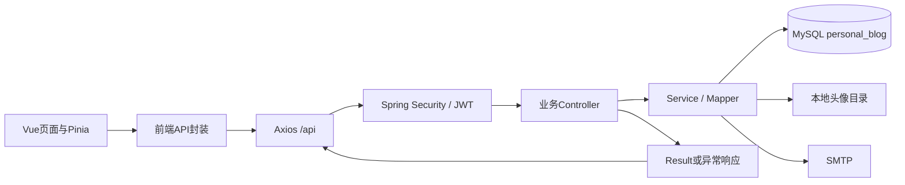
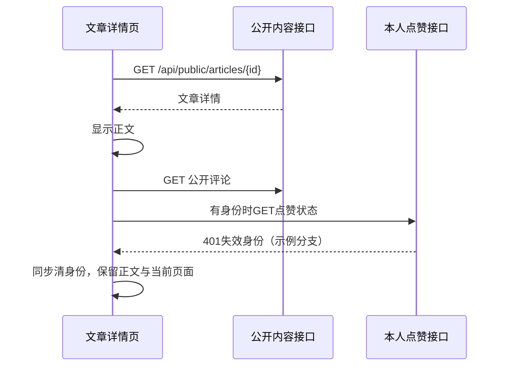

# 个人博客系统接口设计说明书

| 文档属性 | 内容 |
| --- | --- |
| 正式提交编号 | 14 |
| 文档版本 | v0.1，待审校稿 |
| 编写日期 | 2026年10月9日 |
| 需求依据 | BLOG-REQ-BL-001 / SRS v1.0.0 |
| 关联文档 | 第12份总体设计v0.1、第13份数据库设计v0.1 |
| 核查口径 | 11个业务Controller、52个映射处理方法、53个HTTP方法与路径组合 |
| 验证性质 | 源码和文档静态核对；本轮未启动服务、未调用真实接口、未连接数据库或SMTP |

## 第一章 引言与编写依据

### 1.1 编写目的

本说明书规定个人博客系统现有前后端接口的请求方式、参数来源、数据结构、认证权限和异常反馈，为详细设计、前后端维护及测试设计提供可核对的契约。正文依据当前运行代码的定义整理，而非根据页面名称推测接口。

项目主体开发早于正式文档，本文为回顾性整理。已批准需求与当前实现不一致的部分单独记录，不借文档编写改变基线，也不把接口定义存在视为真实联调通过。

### 1.2 依据与适用范围

| 资料 | 用途 |
| --- | --- |
| [正式提交整理计划](../课程设计正式提交文档整理计划.md) | 编号14及本轮单文档交付范围 |
| [总体设计](12_个人博客系统总体设计说明书.md)、[数据库设计](13_个人博客系统数据库设计说明书.md) | 模块、通信及数据边界 |
| [正式SRS](../../requirements/software-requirements-specification.md)、[追踪矩阵](../../requirements/requirements-traceability-matrix.md) | 需求编号、批准目标与历史实现差异 |
| [Controller目录](../../../blog-server/src/main/java/com/example/blog/controller/)、[DTO目录](../../../blog-server/src/main/java/com/example/blog/dto/)、[VO目录](../../../blog-server/src/main/java/com/example/blog/vo/) | 请求与响应契约 |
| [Service实现目录](../../../blog-server/src/main/java/com/example/blog/service/impl/) | 实际业务规则及错误条件 |
| [SecurityConfig](../../../blog-server/src/main/java/com/example/blog/security/SecurityConfig.java)、[JwtFilter](../../../blog-server/src/main/java/com/example/blog/security/JwtFilter.java) | 认证授权及公开接口隔离 |
| [Result](../../../blog-server/src/main/java/com/example/blog/common/Result.java)、[全局异常处理](../../../blog-server/src/main/java/com/example/blog/config/GlobalExceptionHandler.java) | 响应包装、HTTP状态和业务错误码 |
| [前端API目录](../../../blog-web/src/api/)、[请求封装](../../../blog-web/src/utils/request.js)、[身份状态](../../../blog-web/src/store/auth.js)、[路由](../../../blog-web/src/router/index.js) | 请求映射、会话恢复及401/403策略 |
| [15.6-B回归报告](../../../skill/docs/15.6-B真实网站回归测试报告.md) | 已有隔离验证范围，不能替代真实后端联调 |

本文统计自定义业务Controller，不将框架错误入口、CORS预检、静态头像资源及SPA页面路由算入业务接口数。API-001至API-053仅为本说明书的检索编号，不是新增需求编号、接口版本或正式测试用例ID。

## 第二章 系统接口架构与统一总表

### 2.1 通信架构

Vue页面通过api封装调用Axios，以/api为基址访问Spring Boot。服务端安全过滤后进入Controller，主要业务交由Service和Mapper处理；部分分类、配置、统计接口直接在Controller组织数据。MySQL保存结构化数据，头像使用本地文件资源，密码重置通过后端接入SMTP，不存在前端直接访问数据库的设计。



图14-1 系统接口协作结构图

### 2.2 统计与分类

| Controller | 接口组合数量 | 主要职责 |
| --- | --- | --- |
| PublicArticleController | 6 | 公开文章分页、详情、置顶兼容、热门、最新、相邻文章 |
| PublicController | 3 | 公开分类、标签和配置 |
| AuthController | 6 | 注册、登录、两项密码重置和两个身份读取别名 |
| InteractionController | 7 | 公开评论及留言、登录互动 |
| UserProfileController | 4 | 本人资料、头像、密码和喜欢文章 |
| ArticleAdminController | 5 | 后台文章查询及维护 |
| AdminController | 8 | 分类、配置及数据概览 |
| TagAdminController | 4 | 标签维护 |
| UserAdminController | 4 | 用户查询、统计、角色与状态 |
| CommentAdminController | 3 | 评论分页、统计与审核 |
| MessageAdminController | 3 | 留言分页、统计与审核 |
| 合计 | 53 | 52个处理方法；身份读取方法具有两个路径 |

按权限分类为15项允许匿名接口、11项要求登录的用户接口、27项管理员接口。允许匿名包括注册、登录与密码重置，并不全部属于文章展示接口；管理员也可使用已认证用户接口。

### 2.3 接口总表

所有URL均为相对服务根地址的完整后端路径，不能再重复加/api。Q1—Q4为第五章公共查询参数，D1—D15为第五章请求体模型。返回列表示Result.data类型；统一包装、字段定义和错误参见第三、五、十三章。

| 编号 | Controller | 方法 | 完整接口路径 | 功能 | 权限 | 参数来源及结构 | 成功data |
| --- | --- | --- | --- | --- | --- | --- | --- |
| API-001 | PublicArticleController | GET | `/api/public/articles` | 公开文章分页 | 公开 | Query：ArticleQuery（Q1） | Page<ArticleSummaryVO> |
| API-002 | PublicArticleController | GET | `/api/public/articles/{id}` | 公开文章详情 | 公开 | Path：id（Long） | ArticleDetailVO |
| API-003 | PublicArticleController | GET | `/api/public/articles/featured` | 置顶文章兼容查询 | 公开 | 无 | ArticleSummaryVO[]，最多3篇 |
| API-004 | PublicArticleController | GET | `/api/public/articles/hot` | 热门文章 | 公开 | Query：limit，int，默认5，截取到1—20 | ArticleSummaryVO[] |
| API-005 | PublicArticleController | GET | `/api/public/articles/latest` | 最新文章 | 公开 | Query：limit，int，默认5，截取到1—20 | ArticleSummaryVO[] |
| API-006 | PublicArticleController | GET | `/api/public/articles/adjacent/{id}` | 相邻文章 | 公开 | Path：id（Long） | 对象previous/next，值为ArticleSummaryVO或空 |
| API-007 | PublicController | GET | `/api/public/categories` | 公开分类 | 公开 | 无 | Category[] |
| API-008 | PublicController | GET | `/api/public/tags` | 公开标签 | 公开 | 无 | Tag[] |
| API-009 | PublicController | GET | `/api/public/site-config` | 公开站点配置 | 公开 | 无 | Map<String,String> |
| API-010 | AuthController | POST | `/api/auth/register` | 注册普通用户 | 公开 | Body：RegisterRequest（D1） | UserVO |
| API-011 | AuthController | POST | `/api/auth/login` | 用户及管理员登录 | 公开 | Body：LoginRequest（D2） | LoginVO |
| API-012 | AuthController | POST | `/api/auth/password/reset-code` | 发送重置验证码 | 公开 | Body：SendResetCodeRequest（D3） | Void |
| API-013 | AuthController | POST | `/api/auth/password/reset` | 验证码重置密码 | 公开 | Body：ResetPasswordRequest（D4） | Void |
| API-014 | AuthController | GET | `/api/auth/me` | 读取本人身份 | USER或ADMIN | 无客户端userId；认证主体 | UserVO |
| API-015 | AuthController | GET | `/api/auth/profile` | 本人身份兼容别名 | USER或ADMIN | 同/auth/me | UserVO |
| API-016 | InteractionController | GET | `/api/public/articles/{articleId}/comments` | 读取已通过评论 | 公开 | Path：articleId（Long），无分页参数 | CommentVO[] |
| API-017 | InteractionController | POST | `/api/articles/{articleId}/comments` | 提交文章评论 | USER或ADMIN | Path：articleId；Body：ContentRequest（D5） | Void |
| API-018 | InteractionController | GET | `/api/articles/{articleId}/like` | 读取本人点赞状态 | USER或ADMIN | Path：articleId；认证主体userId | 对象liked:boolean |
| API-019 | InteractionController | POST | `/api/articles/{articleId}/like` | 点赞文章 | USER或ADMIN | Path：articleId，无Body | Void |
| API-020 | InteractionController | DELETE | `/api/articles/{articleId}/like` | 取消点赞 | USER或ADMIN | Path：articleId，无Body | Void |
| API-021 | InteractionController | GET | `/api/public/messages` | 公开留言分页 | 公开 | Query：page默认1、size默认20（Q2） | Page<MessageVO> |
| API-022 | InteractionController | POST | `/api/messages` | 提交留言 | USER或ADMIN | Body：ContentRequest（D5）；认证主体userId | Void |
| API-023 | UserProfileController | PUT | `/api/users/me` | 修改本人资料 | USER或ADMIN | Body：UpdateProfileRequest（D6） | UserVO |
| API-024 | UserProfileController | POST | `/api/users/me/avatar` | 上传本人头像 | USER或ADMIN | multipart/form-data；必需file文件部分 | AvatarVO；message为头像修改成功 |
| API-025 | UserProfileController | PUT | `/api/users/me/password` | 修改本人密码 | USER或ADMIN | Body：ChangePasswordRequest（D7） | Void |
| API-026 | UserProfileController | GET | `/api/users/me/likes` | 本人喜欢文章分页 | USER或ADMIN | Query：page默认1、size默认6（Q2） | Page<ArticleSummaryVO> |
| API-027 | ArticleAdminController | GET | `/api/admin/articles` | 后台文章分页 | ADMIN | Query：ArticleQuery（Q1） | Page<ArticleSummaryVO> |
| API-028 | ArticleAdminController | GET | `/api/admin/articles/{id}` | 后台文章详情 | ADMIN | Path：id（Long） | ArticleDetailVO |
| API-029 | ArticleAdminController | POST | `/api/admin/articles` | 新增文章 | ADMIN | Body：ArticleSaveRequest（D8）；作者取认证主体 | ArticleDetailVO |
| API-030 | ArticleAdminController | PUT | `/api/admin/articles/{id}` | 编辑文章 | ADMIN | Path：id；Body：ArticleSaveRequest（D8） | ArticleDetailVO |
| API-031 | ArticleAdminController | DELETE | `/api/admin/articles/{id}` | 逻辑删除文章 | ADMIN | Path：id，无Body | Void |
| API-032 | AdminController | GET | `/api/admin/categories` | 后台分类列表 | ADMIN | 无 | Category[] |
| API-033 | AdminController | POST | `/api/admin/categories` | 新增分类 | ADMIN | Body：CategoryRequest（D9） | Category |
| API-034 | AdminController | PUT | `/api/admin/categories/{id}` | 修改分类 | ADMIN | Path：id；Body：CategoryRequest（D9） | Category |
| API-035 | AdminController | DELETE | `/api/admin/categories/{id}` | 删除未被引用分类 | ADMIN | Path：id，无Body | Void |
| API-036 | TagAdminController | GET | `/api/admin/tags` | 后台标签列表 | ADMIN | 无 | Tag[] |
| API-037 | TagAdminController | POST | `/api/admin/tags` | 新增标签 | ADMIN | Body：TagRequest（D10） | Tag |
| API-038 | TagAdminController | PUT | `/api/admin/tags/{id}` | 修改标签 | ADMIN | Path：id；Body：TagRequest（D10） | Tag |
| API-039 | TagAdminController | DELETE | `/api/admin/tags/{id}` | 删除未被引用标签 | ADMIN | Path：id，无Body | Void |
| API-040 | UserAdminController | GET | `/api/admin/users` | 后台用户分页 | ADMIN | Query：page默认1、size默认10、keyword可选（Q3） | Page<AdminUserVO> |
| API-041 | UserAdminController | GET | `/api/admin/users/stats` | 用户总数 | ADMIN | 无 | 对象total:Long |
| API-042 | UserAdminController | PATCH | `/api/admin/users/{id}/role` | 修改用户角色 | ADMIN | Path：id；Body：RoleRequest（D11） | Void |
| API-043 | UserAdminController | PATCH | `/api/admin/users/{id}/status` | 启用或禁用用户 | ADMIN | Path：id；Body：UserStatusRequest（D12） | Void |
| API-044 | CommentAdminController | GET | `/api/admin/comments` | 跨文章评论分页 | ADMIN | Query：page1、size10、status默认PENDING、keyword可选（Q4） | Page<AdminCommentVO> |
| API-045 | CommentAdminController | PATCH | `/api/admin/comments/status` | 批量审核评论 | ADMIN | Body：CommentReviewRequest（D13） | Void |
| API-046 | CommentAdminController | GET | `/api/admin/comments/stats` | 评论状态统计 | ADMIN | 无 | 对象total/pending/approved/rejected:Long |
| API-047 | MessageAdminController | GET | `/api/admin/messages` | 留言审核分页 | ADMIN | Query：page1、size10、status默认PENDING、keyword可选（Q4） | Page<AdminMessageVO> |
| API-048 | MessageAdminController | GET | `/api/admin/messages/stats` | 留言状态统计 | ADMIN | 无 | 对象total/pending/approved/rejected:Long |
| API-049 | MessageAdminController | PATCH | `/api/admin/messages/status` | 批量审核留言 | ADMIN | Body：MessageReviewRequest（D14） | Void |
| API-050 | AdminController | GET | `/api/admin/site-config` | 后台配置记录 | ADMIN | 无 | SiteConfig[] |
| API-051 | AdminController | PUT | `/api/admin/site-config` | 按键保存配置 | ADMIN | Body：Map<String,String>（D15） | Void |
| API-052 | AdminController | GET | `/api/admin/dashboard/overview` | 文章及分类概览 | ADMIN | 无 | 对象articleCount/categoryCount/publishedCount/draftCount:Long |
| API-053 | AdminController | GET | `/api/admin/dashboard/publish-trend` | 近七日发布趋势 | ADMIN | 无 | 对象dates:String[]、counts:Long[] |

## 第三章 HTTP通信与统一数据格式

### 3.1 请求约定

普通请求使用JSON，查询条件置于URL查询参数，资源标识置于路径。上传头像使用multipart/form-data和名为file的文件部分。前端默认请求超时10000毫秒；FormData请求移除预设Content-Type，由浏览器生成multipart边界。

API没有版本前缀/v1，也没有现成Swagger生成文档的依据。GET公开文章详情会增加阅读量，因此不能把所有GET都视为无数据库写入。POST、PUT、DELETE成功当前均由Controller返回普通Result，不是统一201或204响应。

开发地址通常为前端localhost:5173和后端localhost:8080，Vite代理/api及/uploads。WebConfig当前允许的开发跨域来源为http://localhost:5173，支持GET、POST、PUT、PATCH、DELETE、OPTIONS；不等于任意来源或生产域名已配置。

### 3.2 Result包装与空值

| 字段 | 类型 | 含义 |
| --- | --- | --- |
| code | Integer | 0成功，非0失败 |
| message | String | 默认成功为success；头像成功为头像修改成功；失败提供业务或安全说明 |
| data | 泛型业务载荷 | VO、实体、集合、分页、Map或Void；空值受non_null序列化策略影响 |

当前配置省略空值属性，Void成功及失败通常不输出data，而非承诺始终存在data:null。以下为依据代码构造的格式示例，不是实际请求结果：

```json
{"code":0,"message":"success","data":{"liked":true}}
```

```json
{"code":0,"message":"success"}
```

```json
{"code":4010,"message":"登录状态已失效"}
```

Axios响应拦截器成功时直接返回body.data，故页面读取的是分页对象或VO本身，不应再访问result.data.data。HTTP成功但业务码非0仍拒绝Promise；此分支产生的错误不等同于HTTP401，也不自动进入安全失败跳转。

### 3.3 分页及时间

分页采用MyBatis Plus IPage/Page，前端主要依赖records、total、current、size；pages等分页属性以实际Page序列化为准，不能要求所有接口具有手工定义的同一分页DTO。数组接口如公开评论、分类和标签不包装成分页。

时间字段为LocalDateTime，主要返回createdAt、updatedAt、publishedAt等。Jackson配置包含时区及日期格式，但Java时间类型的最终表示应通过真实序列化确认，不仅凭date-format推断全部为同一种字符串；当前前端能够处理含T的时间及截取日期。

## 第四章 认证授权与JWT传递机制

### 4.1 服务端规则

SecurityConfig对注册、登录、/api/auth/password/**、/api/public/**及/uploads/avatars/**等配置permitAll；/api/auth/me和/profile要求认证；/api/admin/**要求ADMIN；其余请求要求认证。JwtFilter对上述公开路径跳过JWT解析，因此携带失效Token的公开请求也不应被过滤器拒绝。

受保护请求采用Authorization的Bearer形式。后端校验签名与时效后查询当前ACTIVE、未删除用户，比较token_version，并依据数据库当前角色构建权限。JWT使用HMAC签名密钥，文档不提供真实Token或密钥，也不猜测固定签名算法名称。管理员在能力上可执行用户操作，但不是由前端菜单隐藏完成授权。

### 4.2 前端身份状态

Pinia保存token与user，并使用localStorage键personal-blog-access-token和personal-blog-current-user持久化。public请求、登录、注册和密码重置请求不自动附加Bearer；其他请求在有Token时附加。身份更新通过store与持久化协同处理。

恢复身份调用GET /api/auth/me，不是GET /api/users/me；后者当前只实现PUT。保护路由强制核实身份，公开路由允许失效恢复降级。退出登录只清理客户端，没有/logout、/refresh或服务器注销接口。

### 4.3 15.6-B后的401与403

| 场景 | 当前源码处理 |
| --- | --- |
| 自动点赞状态查询401 | interactionApi.likeState设置authFailure:silent；清除当前失效身份，不强制离开文章 |
| /auth/me恢复401 | restoreSession使用silent及refreshPermissions:false；错误经公开路由分支处理，不阻断公开阅读 |
| 主动点赞、取消点赞、评论等401 | 默认策略同步清身份，并跳转/login附带redirect；不执行成功后的本地计数更新 |
| 当前会话清理 | 请求封装clearAuthStorage并调用Pinia.logout，内存与持久化同步 |
| 旧会话延迟401/403 | 比较请求记录的authToken与当前Token，避免旧错误清理新会话；标记staleSession |
| 403 | 尝试重新读取当前权限，后台路径返回公开首页；不把403转为允许访问，不必无条件删除仍有效Token |
| 网络故障 | 不当作身份过期；保护路由不能核实权限时取消进入，公开阅读继续按内容请求处理 |

以上来自当前request.js、store/auth.js、router/index.js及ArticleDetail.vue，而非根据原型推断。15.6-B仅在隔离自动化和真实Vue浏览器模拟HTTP环境中验证相关路径，不能据此认定真实签名、数据库及Spring Security链均已验收。

## 第五章 接口参数与响应模型规范

### 5.1 路径与查询公共规则

路径id/articleId为Java Long且必须出现在URL中，当前未统一声明@Positive；非法数字类型与资源不存在应区别。必需JSON请求体通过@RequestBody接收，DTO是否可选以字段注解和业务逻辑为准，不根据数据库非空直接补写接口@NotNull。

| 查询模型 | 字段、类型及默认值 | 当前校验与使用 |
| --- | --- | --- |
| Q1 ArticleQuery | page:long=1；size:long=10；keyword:String可选；categoryId/tagId:Long可选；status:String可选 | Service将page限制至少1、size限制1—100；标题LIKE及分类标签过滤。未设置查询状态枚举校验，无sort字段 |
| Q2 常规分页 | page:long；size:long；各接口默认见总表 | page至少1、size限制1—100；公开留言默认20、喜欢文章默认6 |
| Q3 用户分页 | page=1、size=10、keyword可选 | keyword匹配username/nickname/email；无正式role/status查询参数 |
| Q4 审核分页 | page=1、size=10、status=PENDING、keyword可选 | Controller对status声明默认值PENDING；Service仅在status有非空白文本时添加等值条件，无查询枚举校验。不能据此推定省略参数或传空字符串一定查询全部状态，实际参数绑定须集成核验；keyword匹配内容，不是文章ID |

这些限制多为Service截取而非参数超界即400。未知查询参数不代表新增筛选能力，例如articleId或role没有被对应Controller绑定，就不能宣称支持该筛选。

### 5.2 账户与互动请求体

下表长度为当前Jakarta Validation对Java字符串的约束，不能等同Unicode码点；正式新密码目标另见第十六章。

| 模型 | 字段 | 类型与必填性 | 当前校验或业务规则 |
| --- | --- | --- | --- |
| D1 RegisterRequest | username | String，必填 | NotBlank、最大50；Service trim后查重 |
| D1 | password | String，必填 | NotBlank、长度8—64 |
| D1 | confirmPassword | String，必填 | NotBlank，必须等于password |
| D1 | email | String，必填 | NotBlank、Email、最大100；当前原值保存 |
| D2 LoginRequest | username | String，必填 | NotBlank、最大30；当前未统一trim |
| D2 | password | String，必填 | NotBlank、最大64，未声明最小8 |
| D3 SendResetCodeRequest | email | String，必填 | NotBlank、Email、最大100；Service trim并小写化 |
| D4 ResetPasswordRequest | email | String，必填 | 同D3 |
| D4 | code | String，必填 | 六位数字正则；匹配、时效和使用状态由Service检查 |
| D4 | newPassword | String，必填 | NotBlank、长度8—64；不能与原密码相同 |
| D4 | confirmPassword | String，必填 | NotBlank、必须与newPassword相同 |
| D5 ContentRequest | content | String，必填 | NotBlank、最大500；Service trim后保存PENDING |
| D6 UpdateProfileRequest | username | String，必填 | NotBlank、最大50，trim、查重并同步nickname |
| D7 ChangePasswordRequest | currentPassword | String，必填 | NotBlank，BCrypt校验 |
| D7 | newPassword | String，必填 | NotBlank、长度8—64，不能与旧密码相同 |
| D7 | confirmPassword | String，必填 | NotBlank、与newPassword相同 |

请求体不提供可控制的role、status、authorId或userId来注册管理员、替他人修改资料或提交互动；认证主体在Controller中注入。未确认或未实现的邮箱修改入口不加入契约。

### 5.3 后台请求体

| 模型 | 字段 | 类型、必填及当前校验 |
| --- | --- | --- |
| D8 ArticleSaveRequest | title | String必填、NotBlank、最大200 |
| D8 | slug | String必填、最大220；小写字母数字分段、单连字符连接，不能首尾连字符 |
| D8 | summary | String可选，最大500 |
| D8 | content | String必填、NotBlank，DTO未声明长度上限 |
| D8 | coverUrl | String可选，最大500，当前未要求URL格式注解 |
| D8 | categoryId | Long必填NotNull；Service检查分类存在 |
| D8 | status | String必填，只允许DRAFT/PUBLISHED |
| D8 | isTop | Integer可选；等于1保存1，否则保存0，非仅DTO枚举校验 |
| D8 | tagIds | List<Long>可选；去重后校验存在且ACTIVE；没有元素@NotNull注解 |
| D9 CategoryRequest | name | String必填NotBlank；没有最大50的DTO校验，数据库字段另有限制 |
| D9 | description | String可选；无DTO长度校验，数据库容量255 |
| D9 | sortOrder | Integer可选，缺失时0 |
| D9 | status | String可选，等于INACTIVE才停用，其余含null当前转ACTIVE |
| D10 TagRequest | name | String必填NotBlank、最大50；Service trim |
| D10 | slug | String必填、最大80、小写数字和连字符规则；Service trim |
| D10 | description | String可选、最大255；非null时trim |
| D10 | status | String可选；非null须ACTIVE/INACTIVE；null时Service默认ACTIVE |
| D11 RoleRequest | role | String必填NotNull，只允许ADMIN/USER |
| D12 UserStatusRequest | status | String必填NotNull，只允许ACTIVE/DISABLED |
| D13 CommentReviewRequest | ids | List<Long>必填且非空，最多100项，每个元素非null；Service去重 |
| D13 | status | String必填NotBlank，仅APPROVED/REJECTED |
| D14 MessageReviewRequest | ids/status | 与D13同结构；处理对象为留言 |
| D15 配置Map | 动态键及值 | Map<String,String>；当前无@Valid字段模型、五键校验或批量事务；目标见第十二章 |

文章新增作者由当前管理员确定，编辑保留原作者。更新文章不是仅传title的部分更新接口，必填字段仍需完整提交；tagIds省略会清空原标签关系，不得将其解释为自动保留。

### 5.4 响应载荷数据字典

| 数据模型 | 完整业务字段或主要分页结构 |
| --- | --- |
| UserVO | id:Long、username/nickname/email/avatar/role:String；无password、status、tokenVersion或deleted |
| LoginVO | accessToken:String、tokenType:String（Bearer）、expiresIn:long（秒）、user:UserVO；不是token字段 |
| AvatarVO | avatar:String，受管相对路径 |
| TagVO | id:Long、name:String、slug:String |
| ArticleSummaryVO | id:Long；title/slug/summary/coverUrl:String；categoryId:Long；categoryName/authorName/status:String；isTop/viewCount/likeCount/commentCount:Integer；publishedAt/createdAt:时间；tags:TagVO[] |
| ArticleDetailVO | Summary全部字段，另有content:String、authorId:Long、updatedAt:时间 |
| CommentVO / MessageVO | id:Long、content:String、userId:Long、nickname:String、avatar:String、createdAt:时间；MessageVO没有articleId |
| AdminCommentVO | id/articleId/userId:Long；articleTitle/username/nickname/avatar/content/status:String；createdAt:时间 |
| AdminMessageVO | id/userId:Long；username/nickname/avatar/content/status:String；createdAt:时间 |
| AdminUserVO | id:Long；username/nickname/email/avatar/role/status:String；createdAt:时间 |
| Category实体 | id:Long、name/description/status:String、sortOrder:Integer、createdAt/updatedAt:时间、deleted:Integer |
| Tag实体 | id:Long、name/slug/description/status:String、createdAt/updatedAt:时间、deleted:Integer |
| SiteConfig实体 | id:Long、configKey/configValue/description:String、updatedAt:时间 |
| Page<T> | records:T[]、total/current/size及Page支持的其他分页属性 |
| 点赞状态 | liked:boolean |
| 相邻文章 | previous、next；值为ArticleSummaryVO或空，空值可能省略 |
| 用户统计 | total:Long |
| 评论/留言统计 | total、pending、approved、rejected:Long |
| 后台概览 | articleCount、categoryCount、publishedCount、draftCount:Long；用户/评论数来自另两个统计请求 |
| 发布趋势 | dates:String[]、counts:Long[]，对应最近七个日期 |
| 公开配置 | 以配置键为属性的字符串Map，不是SiteConfig[] |

公开Category/Tag查询当前直接返回实体，不是TagVO或精简筛选DTO。新增实体返回时，数据库默认时间可能未回填到Java对象，且null省略，因此不能承诺每次新增响应都具备createdAt/updatedAt。

## 第六章 公开博客接口设计

API-001—API-009及API-016、API-021形成公开内容读取。文章分页在基础筛选后增加PUBLISHED条件并排除逻辑删除；即便传status=DRAFT，也不是游客读取草稿的通道，当前会与发布条件冲突形成空结果。列表按置顶、发布时间倒序，热门按阅读量、点赞量、发布时间倒序，最新按发布时间倒序。

详情API-002成功会将view_count加1，返回ArticleDetailVO；不存在、草稿或删除文章当前为BusinessException，HTTP400/4000，而非业务层统一404。相邻接口API-006单独扫描发布集，不增加阅读量；请求id未找到时可能仍有previous/next空结构，不能照搬主详情的拒绝规则。

分类、标签公开接口只返回ACTIVE且非逻辑删除记录。featured保留兼容查询最多3篇置顶文章，虽有publicApi.featured封装，但当前接入的Home.vue实际使用latest和hot，不展示独立置顶区。

## 第七章 用户认证与账户接口设计

### 7.1 注册、登录及身份读取

API-010注册创建普通ACTIVE账户，返回UserVO而不是自动登录Token。前端注册成功后切回登录页签并保留用户名，需要再次登录。API-011验证密码和状态后返回LoginVO，Pinia读取accessToken；管理员和普通用户共享登录接口，由角色及redirect决定页面跳转。

API-014和API-015为同一处理方法的两个URL，均需要身份。前端实际使用/me；兼容/profile不是另一个资料修改接口。用户名查重包括逻辑删除记录，邮箱查重受数据库唯一约束补充。

### 7.2 忘记密码

API-012只接收email，不返回验证码内容。Service执行账户检查、六十秒间隔、旧验证码失效、新六位码五分钟有效及邮件发送。API-013检查确认密码、验证码、期限和使用状态，通过条件消费后更新哈希。

邮件未配置或发送失败当前转BusinessException，即HTTP400/4000，不是统一SMTP专用5xx错误码。验证码与数据库事务存在，不代表邮件已送出后能够撤回；当前邮箱重置未递增token_version，与正式旧Token失效目标有差异。

## 第八章 文章、分类和标签接口设计

后台文章API-027—API-031使用同一保存DTO。发布、草稿、置顶通过保存体中的status/isTop维护，不存在独立/publish或/top接口。文章保存返回详情；后台详情不增加阅读量；删除进行逻辑删除并清理标签关联，而不是物理删除全部历史互动。

分类API-032—API-035和标签API-036—API-039返回列表或实体，不是分页。停用通过普通更新中的status表达，不是另有启停端点。分类删除检查当前有效文章引用；标签删除检查标签关系。不存在分类删除幂等、缺失ID必定报错等统一保证：当前分类删除未检查目标及影响行数，标签删除则检查目标存在。

文章分类当前只校验存在，标签要求全部ACTIVE。正式要求的新停用关联拒绝、原停用关联保留尚未完整落实。名称和slug查重受业务查询及数据库唯一键共同约束，逻辑删除历史记录仍可能造成数据库重复错误。

文章保存请求格式示例，ID仅为说明，不证明对应运行库记录存在：

```json
{
  "title":"接口设计示例",
  "slug":"interface-design-example",
  "summary":"仅用于契约说明",
  "content":"# 示例正文",
  "coverUrl":"",
  "categoryId":1,
  "status":"DRAFT",
  "isTop":0,
  "tagIds":[1,2]
}
```

## 第九章 评论、留言及点赞接口设计

公开评论API-016返回数组，无分页；留言API-021返回分页。提交API-017/API-022使用相同ContentRequest，保存PENDING并返回Void，不立即返回新评论ID或公开内容。前端据成功显示待审核说明，不能将成功提交等同公开审核通过。

点赞状态API-018只返回本人liked，不返回全体用户列表。API-019/API-020以路径文章和认证用户组合执行插入/删除，成功不返回新计数；页面在成功后按操作更新本地likeCount。数据库联合主键及代码提供重复点赞控制，但竞争一致性仍须实测。

相同用户同文章同有效存储评论、相同用户同留言内容受永久唯一组合限制，重复时业务错误，不新增记录也不伪装提交成功。当前没有回复、用户删除评论、管理员删除评论或留言端点。

正文与可选互动加载次序如下：



图14-2 公开正文与附属身份请求隔离流程图

该图描述当前前端修复策略，不是本轮实际网络执行记录。

## 第十章 个人中心接口设计

API-023修改username并同步nickname、返回UserVO；不支持修改email或role。API-024上传头像file，在后端完成空文件、大小、扩展名、MIME和文件头检查，最大5MiB，支持JPG/JPEG、PNG、WebP，统一保存UUID格式文件名，返回AvatarVO。前端本地预览和取消不等于发送上传；确认后使用FormData。

API-025核对当前密码、两次新密码及不同旧密码后，更新哈希和token_version。前端成功后本地退出并跳登录，不存在独立服务器注销请求；后续旧Token需由真实安全链验证。

API-026先按本人点赞关系查文章，再分页返回发布且未删除文章；已删除或草稿文章不会因历史点赞关系保留而继续展示。本人身份均由认证主体决定，不接受客户端指定其他用户。

头像GET资源为/uploads/avatars/{文件名}，通过WebConfig提供文件内容且允许匿名；它不是另一个Controller JSON接口，不计入53项。缺文件可由资源异常返回404，真实Content-Type和缓存行为需资源访问实测。

## 第十一章 后台管理接口设计

### 11.1 用户管理

API-040只支持分页和keyword，keyword同时查询用户名、昵称及邮箱；未实现角色或状态筛选参数。API-042拒绝修改自己的角色，API-043拒绝禁用自己；没有“不能移除最后管理员”的额外已实现规则，也没有用户删除接口。

服务端后续鉴权读取当前角色与状态，前端缓存通过恢复或403刷新；当前禁用和重新启用未递增版本，禁用前JWT可能在启用后恢复，必须保留为需求差异。

### 11.2 评论和留言审核

API-044跨文章汇总评论，响应包含articleId/articleTitle；参数没有articleId过滤，不能将跨文章汇总误写为按文章筛选。API-047查询留言，结构无所属文章。Controller默认status=PENDING，Service在有非空白文本时加等值条件；“全部状态”需结合默认值与实际参数绑定验证，不能将空字符串直接认定为查询全部。未专门校验非法查询状态，不能统一描述为必定400。

审核API-045/API-049的ids最多100项，去重后要求全部存在，目标仅APPROVED或REJECTED，单条审核也以单元素数组调用。评论跨越APPROVED时维护文章comment_count；留言不维护文章统计。重复状态在顺序执行时跳过，事务与并发风险见第13份，不宣称竞争正确。

审核请求格式示例：

```json
{"ids":[1,2],"status":"APPROVED"}
```

### 11.3 统计查询

API-052统计文章总数、分类数、发布与草稿；用户与评论总数分别来自API-041/API-046，不能在overview响应中虚构userCount/commentCount。API-053按当前发布记录的published_at统计近七日，dates/counts对应，不是历史发布事件或访问量分析接口。

统计异常应与真实0区分。当前后台部分状态以初始0回退并给部分失败提示，仍存在需求差异，不将失败显示0描述为正确契约。

## 第十二章 站点配置及外部接口边界

### 12.1 当前配置读写

API-009将配置记录转Map；API-050返回SiteConfig数组；API-051接收键值Map并逐键插入或更新。三者响应结构不同，SystemManage.vue读取configKey/configValue建立表单，保存时提交Map，而前台直接读取键值属性。

正式允许的键如下，均为非null，长度按Unicode码点：

| 键 | 用途 | 正式目标 |
| --- | --- | --- |
| siteName | 博客名称 | 去首尾空白后必填，1—50 |
| siteSubtitle | 副标题 | 可空字符串，最多100 |
| homeIntro | 首页简介 | 可空字符串，最多500 |
| aboutContent | 关于我 | 可空字符串，最多5000 |
| email | 公开联系邮箱 | 可空字符串，非空须合理邮箱格式，最多254；不是SMTP账户 |

正式目标为单键或批次部分更新、缺失键保留旧值、显式合法空字符串保存、未知键/null/空对象拒绝，以及批次全成功或全回滚。当前实现虽只遍历提交键，但缺白名单、字段校验、空对象拒绝、批次事务和完整写入结果检查；公开读取也没有五键过滤。不能把此表目标写成当前接口已经全部执行。

单字段目标格式示例：

```json
{"siteSubtitle":""}
```

此示例用于说明空字符串和缺失键的区别，不是对当前原子性或校验通过的测试证明。

### 12.2 外部依赖与不存在的接口

SMTP由EmailService调用，不由浏览器直接发送，也没有向前端暴露SMTP凭证的接口。MySQL经Mapper访问，不是前端公共端点。当前无Swagger、Token刷新、服务器主动退出、第三方登录、评论回复、评论留言删除、封面本地上传或通知接口，不按常见产品功能补齐。

## 第十三章 错误码及异常处理

### 13.1 公共错误映射

| HTTP状态 | 业务码 | 代码处理来源 | 典型含义 |
| --- | --- | --- | --- |
| 200 | 0 | Result.success | 请求处理成功，data可能省略 |
| 400 | 4000 | BusinessException | 业务拒绝：账户、文章、重复内容、验证码、引用限制等 |
| 400 | 4001 | 参数/DTO异常处理、上传超限处理 | 字段校验、数字类型转换或框架上传大小限制 |
| 400 | 4002 | DataIntegrityViolationException | 数据重复或仍被引用 |
| 401 | 4010 | SecurityConfig/JwtFilter | 未登录、Token格式/签名/时效/账户状态或版本失效 |
| 403 | 4030 | SecurityConfig | 已认证但不具有所需权限 |
| 404 | 4040 | NoResourceFoundException | 资源不存在，不代表所有业务“找不到”都返回404 |
| 500 | 5000 | Exception兜底 | 未处理异常，客户端不返回内部堆栈 |

框架识别超限上传使用4001；Service主动检查大小抛BusinessException时使用4000。缺失multipart部分、畸形JSON、缺失请求体或其他未单独分类的框架异常，当前可能落入兜底，不能为了规范性擅自承诺统一400/4001。Result还定义failure(message)生成-1的辅助方法，但本次Controller正常业务路径未发现据此形成独立错误规范。

### 13.2 逐接口业务错误与调用场景

下表补充总表中每项接口的主要失败条件；所有数据库读取/写入仍可能触发4002或5000，非穷举底层故障。需要身份的接口均可能401，管理员接口还可能403。正常响应形态见第五章，不以错误提示字符串替代稳定错误码。

| 接口编号 | 主要错误或特殊行为 | 主要调用场景 |
| --- | --- | --- |
| API-001 | 非法类型；数据查询失败 | ArticleList.vue |
| API-002 | 文章不存在/草稿/已删除：400/4000 | ArticleDetail.vue；成功读取增加阅读量 |
| API-003 | 查询失败 | 当前已接入页面未调用 |
| API-004 | 非法类型；查询失败 | Home.vue实际limit=3 |
| API-005 | 非法类型；查询失败 | Home.vue实际limit=5 |
| API-006 | 非法类型；查询失败；当前未找到id不必报文章不存在 | ArticleDetail.vue |
| API-007 | 查询失败 | 文章列表筛选 |
| API-008 | 查询失败 | 文章列表筛选 |
| API-009 | 查询失败；值为null时toMap存在异常风险 | PublicLayout/Home/About |
| API-010 | 重复用户名/邮箱、确认密码不符：400/4000；DTO不合法：400/4001 | Login.vue注册页签 |
| API-011 | 密码错误、账号删除/禁用：400/4000；DTO不合法：400/4001 | Login.vue、Pinia登录 |
| API-012 | 邮箱未注册/账号禁用/60秒限制/邮件失败：400/4000 | ForgotPassword.vue |
| API-013 | 验证码错/过期/已用、两次密码不符或相同旧密码：400/4000 | ForgotPassword.vue |
| API-014 | 401；状态变化导致用户查询失败可能400/4000 | store/auth.js身份恢复 |
| API-015 | 同/auth/me | 当前无前端封装调用 |
| API-016 | 文章不可公开：400/4000 | ArticleDetail.vue |
| API-017 | 401；文章不可访问或重复评论：400/4000；DTO：400/4001 | ArticleDetail.vue主动提交 |
| API-018 | 401；文章不可访问：400/4000 | ArticleDetail.vue自动附属请求，silent |
| API-019 | 401；文章不可访问：400/4000；重复点赞按当前逻辑不重复增加 | ArticleDetail.vue主动操作 |
| API-020 | 401；文章不可访问：400/4000 | ArticleDetail.vue主动操作 |
| API-021 | 非法类型；查询失败 | Message.vue |
| API-022 | 401；相同用户内容重复：400/4000；DTO：400/4001 | Message.vue |
| API-023 | 401；用户名重复/更新失败：400/4000；DTO：400/4001 | Profile.vue经Pinia更新 |
| API-024 | 401；空文件/格式不符/存储失败：400/4000；超限400/4001或4000 | Profile.vue本地预览后确认上传 |
| API-025 | 401；当前密码错误/两次不符/新旧相同：400/4000；DTO：400/4001 | Profile.vue成功后本地退出并登录 |
| API-026 | 401；非法类型或查询失败 | Profile.vue |
| API-027 | 401/403；非法类型或查询失败 | ArticleManage.vue |
| API-028 | 401/403；不存在或已删除：400/4000 | ArticleManage.vue编辑抽屉 |
| API-029 | 401/403；分类不存在、slug重复、无效标签：400/4000；DTO：400/4001 | ArticleManage.vue新增抽屉 |
| API-030 | 401/403；文章不存在及同新增校验错误 | ArticleManage.vue编辑抽屉 |
| API-031 | 401/403；文章不存在：400/4000 | ArticleManage.vue删除确认 |
| API-032 | 401/403；查询失败 | ArticleManage/SystemManage |
| API-033 | 401/403；name空：400/4001；重复或结构冲突：400/4002 | SystemManage.vue分类页签 |
| API-034 | 401/403；分类不存在400/4000；DTO或完整性错误 | SystemManage.vue分类页签 |
| API-035 | 401/403；存在有效文章引用400/4000；不存在id当前可能仍返回成功 | SystemManage.vue |
| API-036 | 401/403；查询失败 | ArticleManage/SystemManage |
| API-037 | 401/403；名称或slug重复400/4000；DTO或数据库错误 | SystemManage.vue标签页签 |
| API-038 | 401/403；不存在/重复400/4000；DTO或数据库错误 | SystemManage.vue标签页签 |
| API-039 | 401/403；不存在或有关联文章400/4000 | SystemManage.vue |
| API-040 | 401/403；非法类型或查询失败 | UserManage.vue |
| API-041 | 401/403；查询失败 | AdminDashboard.vue |
| API-042 | 401/403；修改本人角色/用户不存在400/4000；DTO400/4001 | UserManage.vue |
| API-043 | 401/403；禁用本人/用户不存在400/4000；DTO400/4001 | UserManage.vue |
| API-044 | 401/403；非法类型或查询失败 | CommentManage.vue |
| API-045 | 401/403；含不存在/已删ID400/4000；DTO400/4001 | CommentManage.vue单条或多选 |
| API-046 | 401/403；查询失败 | AdminDashboard/CommentManage |
| API-047 | 401/403；非法类型或查询失败 | MessageManage.vue |
| API-048 | 401/403；查询失败 | MessageManage.vue |
| API-049 | 401/403；含不存在/已删ID400/4000；DTO400/4001 | MessageManage.vue单条或多选 |
| API-050 | 401/403；查询失败 | SystemManage.vue配置页签 |
| API-051 | 401/403；数据库错误；当前未知键/null未完整拒绝 | SystemManage.vue配置页签 |
| API-052 | 401/403；查询失败 | AdminDashboard.vue |
| API-053 | 401/403；查询失败 | AdminDashboard.vue |

## 第十四章 前后端接口调用映射与一致性检查

### 14.1 逐项映射

`auth.js`、`blog.js`、`profile.js`共49个封装函数，对应52个方法与路径组合；三个save函数分别分支生成POST和PUT。后端另外保留/auth/profile身份别名，没有前端封装。实际页面是否调用与封装存在分别记录如下。

| 接口编号 | 前端封装 | 已接入页面/调用位置或用途 |
| --- | --- | --- |
| API-001 | `publicApi.articles` | ArticleList.vue |
| API-002 | `publicApi.article` | ArticleDetail.vue；成功读取增加阅读量 |
| API-003 | `publicApi.featured` | 当前已接入页面未调用 |
| API-004 | `publicApi.hot` | Home.vue实际limit=3 |
| API-005 | `publicApi.latest` | Home.vue实际limit=5 |
| API-006 | `publicApi.adjacent` | ArticleDetail.vue |
| API-007 | `publicApi.categories` | 文章列表筛选 |
| API-008 | `publicApi.tags` | 文章列表筛选 |
| API-009 | `publicApi.config` | PublicLayout/Home/About |
| API-010 | `authApi.register` | Login.vue注册页签 |
| API-011 | `authApi.login` | Login.vue、Pinia登录 |
| API-012 | `authApi.sendPasswordResetCode` | ForgotPassword.vue |
| API-013 | `authApi.resetPassword` | ForgotPassword.vue |
| API-014 | `authApi.getCurrentUser` | store/auth.js身份恢复 |
| API-015 | `无（后端兼容别名）` | 当前无前端封装调用 |
| API-016 | `interactionApi.comments` | ArticleDetail.vue |
| API-017 | `interactionApi.comment` | ArticleDetail.vue主动提交 |
| API-018 | `interactionApi.likeState` | ArticleDetail.vue自动附属请求，silent |
| API-019 | `interactionApi.like` | ArticleDetail.vue主动操作 |
| API-020 | `interactionApi.unlike` | ArticleDetail.vue主动操作 |
| API-021 | `interactionApi.messages` | Message.vue |
| API-022 | `interactionApi.leaveMessage` | Message.vue |
| API-023 | `profileApi.update` | Profile.vue经Pinia更新 |
| API-024 | `profileApi.uploadAvatar` | Profile.vue本地预览后确认上传 |
| API-025 | `profileApi.changePassword` | Profile.vue成功后本地退出并登录 |
| API-026 | `profileApi.likedArticles` | Profile.vue |
| API-027 | `adminApi.articles` | ArticleManage.vue |
| API-028 | `adminApi.article` | ArticleManage.vue编辑抽屉 |
| API-029 | `adminApi.saveArticle（无id）` | ArticleManage.vue新增抽屉 |
| API-030 | `adminApi.saveArticle（有id）` | ArticleManage.vue编辑抽屉 |
| API-031 | `adminApi.deleteArticle` | ArticleManage.vue删除确认 |
| API-032 | `adminApi.categories` | ArticleManage/SystemManage |
| API-033 | `adminApi.saveCategory（无id）` | SystemManage.vue分类页签 |
| API-034 | `adminApi.saveCategory（有id）` | SystemManage.vue分类页签 |
| API-035 | `adminApi.deleteCategory` | SystemManage.vue |
| API-036 | `adminApi.tags` | ArticleManage/SystemManage |
| API-037 | `adminApi.saveTag（无id）` | SystemManage.vue标签页签 |
| API-038 | `adminApi.saveTag（有id）` | SystemManage.vue标签页签 |
| API-039 | `adminApi.deleteTag` | SystemManage.vue |
| API-040 | `adminApi.users` | UserManage.vue |
| API-041 | `adminApi.userStats` | AdminDashboard.vue |
| API-042 | `adminApi.updateUserRole` | UserManage.vue |
| API-043 | `adminApi.updateUserStatus` | UserManage.vue |
| API-044 | `adminApi.comments` | CommentManage.vue |
| API-045 | `adminApi.reviewComments` | CommentManage.vue单条或多选 |
| API-046 | `adminApi.commentStats` | AdminDashboard/CommentManage |
| API-047 | `adminApi.messages` | MessageManage.vue |
| API-048 | `adminApi.messageStats` | MessageManage.vue |
| API-049 | `adminApi.reviewMessages` | MessageManage.vue单条或多选 |
| API-050 | `adminApi.configs` | SystemManage.vue配置页签 |
| API-051 | `adminApi.saveConfigs` | SystemManage.vue配置页签 |
| API-052 | `adminApi.overview` | AdminDashboard.vue |
| API-053 | `adminApi.trend` | AdminDashboard.vue |

### 14.2 参数与字段检查结论

| 核查项 | 静态结果 |
| --- | --- |
| 方法及路径 | 52个封装分支均有后端匹配；后端53项全部纳入本文 |
| 登录响应 | Pinia读取accessToken与user，符合LoginVO；没有错误使用token字段 |
| 本人资料 | update传username，返回UserVO同步store；avatar读取result.avatar符合AvatarVO |
| 评论和留言 | 请求体content；后台审核ids/status，与DTO一致；公开评论为数组、留言为分页 |
| 分页 | 页面使用records/total，与Page核心属性一致；未把分类标签列表当分页 |
| 后台配置 | 后端数组转换为键值Map再保存，与当前Controller结构一致，但缺目标校验和原子性 |
| 文章编辑 | 读取详情tags映射为tagIds后提交；表单展开还可能携带id/tags等非DTO属性，不属于正式输入字段，未知属性容忍行为待真实序列化验证 |
| 统计 | overview与users/comments统计合并，不虚构overview本身返回完整四张卡片字段 |
| 未调用接口 | /auth/profile无封装；featured有封装，但已接入页面无调用；不将历史Dashboard.vue/Articles.vue计为正式页面 |
| 不存在能力 | 用户查询没有role/status筛选，审核查询没有articleId，未发现前端封装伪造这些路径 |

未发现明确的前后端HTTP方法或URL拼接不一致。该结论仅针对源码静态映射，不等于所有参数类型转换、Bean Validation、Page序列化或真实网络交互均通过。

## 第十五章 接口与正式需求对应关系

| 接口范围或机制 | 正式需求编号 | 承接内容 |
| --- | --- | --- |
| API-010—API-015 | BLOG-F-001、BLOG-F-002、BLOG-F-003、BLOG-F-006、BLOG-F-007 | 注册、登录、身份恢复及邮箱重置 |
| 认证、退出与保护策略 | BLOG-F-004、BLOG-F-005；BLOG-NF-002；BLOG-BR-004、BLOG-BR-009 | 退出为本地行为；身份状态、当前角色与Token版本 |
| API-001—API-009 | BLOG-F-008、BLOG-F-009、BLOG-F-010、BLOG-F-011、BLOG-F-012、BLOG-F-013、BLOG-F-014 | 内容、筛选、详情、导航和配置；BLOG-F-015为前端404页面，无独立业务接口 |
| API-016—API-020、API-026 | BLOG-F-016、BLOG-F-017、BLOG-F-018、BLOG-F-019；BLOG-BR-018—BLOG-BR-022 | 点赞、喜欢列表、评论查询和提交 |
| API-023—API-025 | BLOG-F-020、BLOG-F-021、BLOG-F-022；BLOG-BR-023 | 资料、头像、密码 |
| API-021、API-022、API-047—API-049 | BLOG-F-023、BLOG-F-024、BLOG-F-038、BLOG-F-039 | 留言公开、提交及管理 |
| API-027—API-031 | BLOG-F-026、BLOG-F-027、BLOG-F-028、BLOG-F-029、BLOG-F-030；BLOG-BR-010—BLOG-BR-017 | 文章管理、状态、关联与删除 |
| API-032—API-039 | BLOG-F-031、BLOG-F-032；BLOG-BR-014、BLOG-BR-015 | 分类及标签维护、引用限制 |
| API-040—API-043 | BLOG-F-033、BLOG-F-034、BLOG-F-035；BLOG-BR-006 | 用户查询、角色及状态 |
| API-044—API-046 | BLOG-F-036、BLOG-F-037；BLOG-BR-021、BLOG-BR-022 | 跨文章评论及审核计数 |
| API-009、API-050、API-051 | BLOG-F-040；BLOG-BR-024 | 配置公开及维护；白名单、字段约束和事务仍需补齐 |
| API-041、API-046、API-052、API-053 | BLOG-F-025；BLOG-NF-010、BLOG-NF-014 | 数据概览与明确异常反馈 |

40项功能需求在上述表中均有接口或非接口说明，不把接口数量当作需求数量或测试覆盖率。本期79项范围、80项需求编号及BLOG-NF-012后续候选状态保持不变。

## 第十六章 实现差异、风险与待验证事项

### 16.1 当前实现与正式目标

1. 注册和修改用户名最大50、登录最大30，且Java字符串长度不是Unicode码点。注册邮箱原值与重置trim/小写化口径存在差异。
2. 新密码目标为8—64Unicode码点且UTF-8最多72字节，不静默截断；当前DTO未完整实现。旧账号哈希兼容须独立设计，不能直接套新密码限制截断原登录输入。
3. 登录状态下改密递增版本，邮箱重置尚未递增；禁用再启用旧Token永久失效也尚未完整落实。
4. 停用分类标签关联规则、配置五键及原子保存仍有缺口；分类等部分输入约束依赖数据库，不能写成完整DTO校验。
5. 部分更新与删除未检查影响行数，可能出现不存在对象或写入未生效仍返回成功；不得将所有0行又机械认定失败，正常幂等应另行设计。
6. 统计失败保留0值、完全同值排序缺少唯一决胜字段、前端筛选历史恢复等目标未因本文完成而修复。
7. JSON/multipart错误的专门映射、Long大ID与JavaScript精度、时间序列化、未知请求属性及公开实体字段范围仍需集成核验。

### 16.2 需要补充的真实验证

| 验证对象 | 重点内容 | 当前证据边界 |
| --- | --- | --- |
| Controller与DTO集成 | 参数缺失、非法类型、JSON结构、校验、空值、未知字段及分页实际响应 | 本轮未执行 |
| 真实安全链 | 无Token、过期、无效、禁用、版本变化、普通用户后台403、公开跳过无效JWT | 前端模拟不能替代 |
| 文章及互动数据库 | 草稿拒绝、阅读量写入、重复点赞、审核计数、永久去重、逻辑删除 | 需独立库授权验证 |
| 头像HTTP链路 | multipart边界、缺file、5MiB边界、格式伪造、返回路径及GET资源 | 本轮未上传真实文件 |
| 配置接口 | 五键、null/未知/空对象、缺失与空字符串、批次回滚及失败反馈 | 目标尚未完整实现 |
| 邮件重置 | 限流、真实收件、消费、密码更新与旧Token失效 | 未调用真实SMTP |
| 前端修复联调 | 公开正文200与附属401、恢复401、Pinia清理、主动保护、403纠正 | 15.6-B有隔离证据，未完成真实后端联调 |

15.6-B原15组计划中14组隔离执行通过、1组后端安全链未执行；另1组相邻自动化通过，脚本合计15个通过子测试。已有浏览器模拟HTTP检查6类。本文引用这些历史记录但未重跑，不把其统计解释为全站、MySQL或SMTP通过，也不编造Postman、Swagger或教师验收结果。

### 16.3 文档检查与交付结论

本文完整列出11个Controller的53个方法与路径组合，以公共DTO/VO字典、总表、逐项错误和前端映射共同描述契约。权限来自真实安全配置，空值、数组、分页、兼容别名和静态资源分别说明。文档可进入用户检查与最终审校，仍为v0.1，不代表接口已全部动态验收。

本轮仅新增本说明书；未修改Vue、Java、SQL、数据库、正式SRS、Skill、原型或其他正式文档，未进行Git暂存、提交或推送。下一份编号15详细设计说明书等待用户确认，不自动开始。

---

**版本记录：**2026年10月9日，形成接口设计说明书v0.1待审校稿；基于代码静态核对与既有执行证据，不建立新的测试通过或审批记录。

