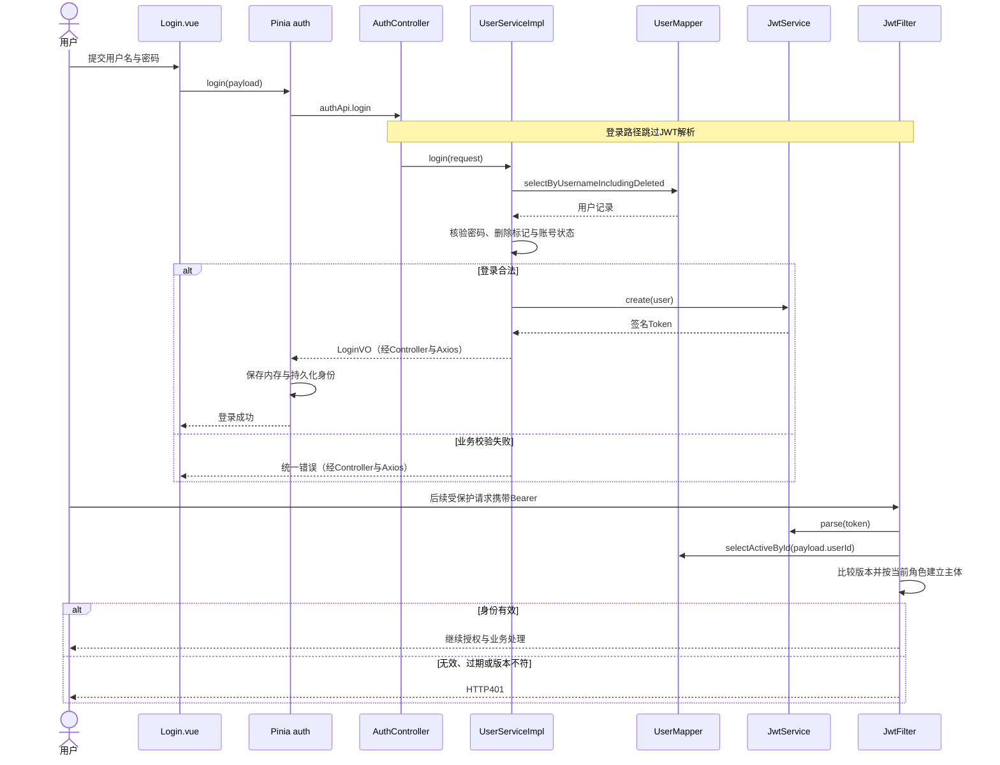
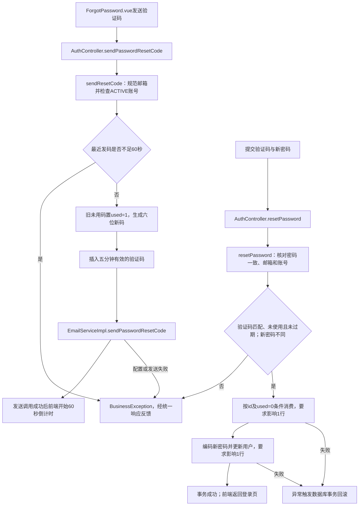
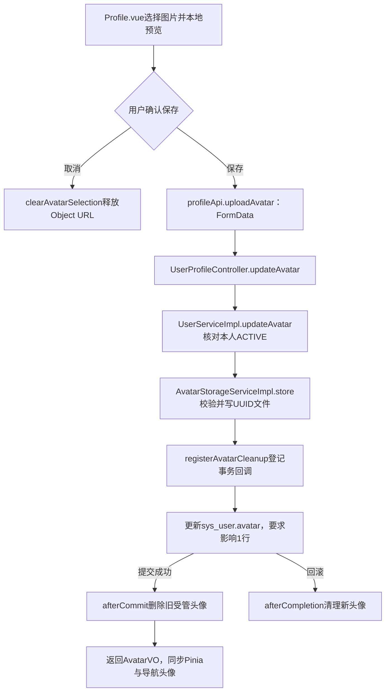
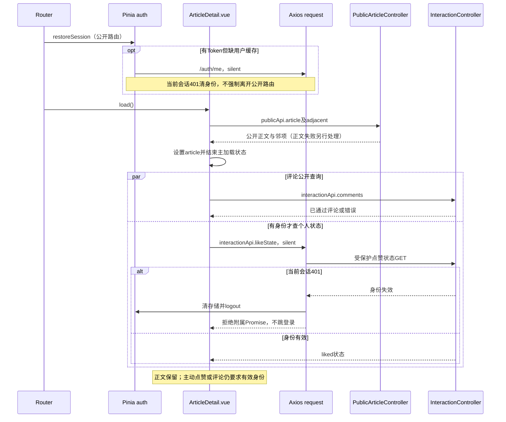
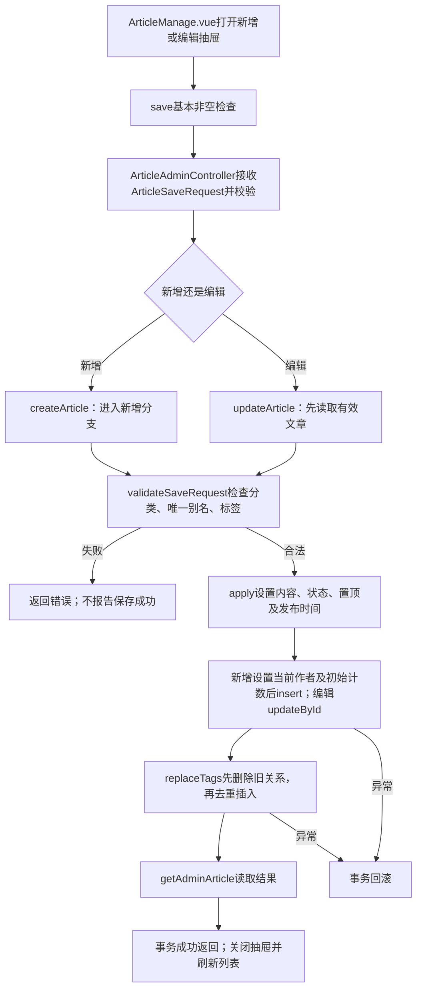
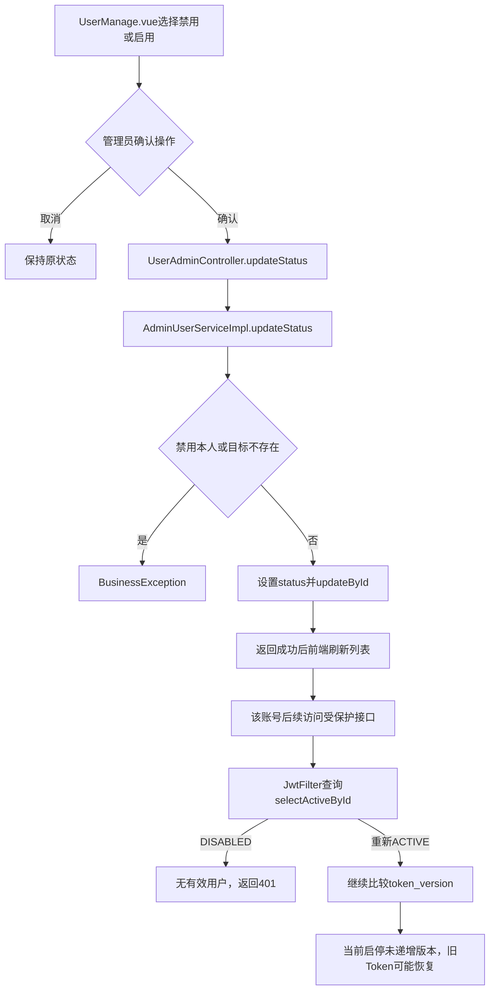
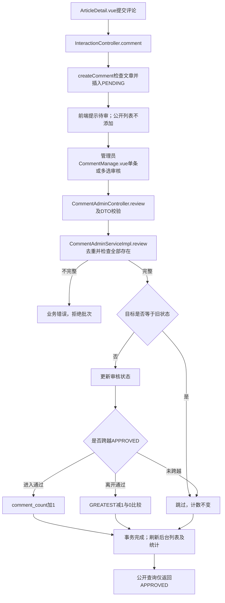

# 个人博客系统详细设计说明书

| 文档属性 | 内容 |
| --- | --- |
| 正式提交编号 | 15 |
| 文档版本 | v0.1，待审校稿 |
| 编写日期 | 2026年10月9日 |
| 需求依据 | BLOG-REQ-BL-001 / SRS v1.0.0 |
| 关联成果 | 第12份总体设计、第13份数据库设计、第14份接口设计，均为v0.1待审校稿 |
| 编写性质 | 基于现有实现的回顾性详细设计整理，区分代码现状、正式目标和待验证事项 |
| 本轮验证 | 源码阅读和文档静态检查；未运行功能、浏览器、数据库、邮件或性能测试 |

## 第一章 引言

### 1.1 编写目的与范围

本文说明个人博客系统各功能内部如何协作，重点描述页面状态、核心方法、数据读写、状态转换、权限判断及异常分支，为功能实现说明和后续测试设计提供依据。读者可据此理解从用户操作到持久化结果的业务链路，而不必将接口清单或数据库字段表重新拼接为设计正文。

本文覆盖用户认证、邮箱重置、个人资料、公开内容、互动、文章管理、分类标签、用户管理、审核、统计及配置十个功能模块。系统共用的访问控制和数据一致性机制另设章节。正式SRS的14个业务模块在此按处理链路聚合，不改变其编号、范围或优先级。

### 1.2 设计依据与权威性

| 资料 | 本文用途 |
| --- | --- |
| [正式提交整理计划](../课程设计正式提交文档整理计划.md) | 确认编号15、文档名称及逐份交付范围；其中旧盘点状态不作为本轮成果完成状态 |
| [第12份总体设计](12_个人博客系统总体设计说明书.md) | 复用总体分层及模块边界，不重复架构介绍 |
| [第13份数据库设计](13_个人博客系统数据库设计说明书.md) | 复用10表78字段、索引、外键与逻辑删除说明 |
| [第14份接口设计](14_个人博客系统接口设计说明书.md) | 复用53项接口、DTO/VO及错误契约，不重复完整接口清单 |
| [正式SRS](../../requirements/software-requirements-specification.md)、[追踪矩阵](../../requirements/requirements-traceability-matrix.md) | 确定需求目标、编号、验收关联和历史差异 |
| [需求基线登记](../../requirements/requirements-baseline-register.md) | 需求基线及批准范围来源 |
| [后端源码](../../../blog-server/src/main/java/com/example/blog/)、[前端源码](../../../blog-web/src/) | 当前方法、组件、状态及业务证据 |
| [数据库初始化脚本](../../../blog-server/src/main/resources/schema.sql) | 数据对象、唯一组合及物理外键依据 |
| [15.6-B实施记录](../../../skill/docs/15.6-B真实网站缺陷修复实施记录.md)、[回归报告](../../../skill/docs/15.6-B真实网站回归测试报告.md) | 前端公开阅读修复及隔离验证的历史证据 |

代码现状以本轮读取的工作区源码为准，目标以正式SRS为准。追踪矩阵和SRS含有早期阶段的“Skill尚未开发”“Git固化待执行”等历史文字，本文不据这些旧时点表述否定后续成果，也不擅自修改基线文件。需求已批准不代表实现或测试已通过。

### 1.3 表达约定

“当前实现”指能够定位的代码逻辑，不表示真实环境验证完成；“目标要求”指正式需求；“待验证”指需要运行证据才能判定的行为。未实现的目标不会画入当前实现流程图作为已有步骤。图中Mapper调用表示代码调用关系，并不表示本轮访问过数据库。

本期79项及BLOG-NF-012后续候选状态保持不变。本文不补充第三方登录、Token刷新、服务器主动注销、评论回复、评论留言删除或封面本地上传等不存在的能力。

## 第二章 公共处理机制与模块协作

### 2.1 处理职责

页面负责收集输入、调用API并更新显示；API封装表达HTTP请求；Axios负责统一响应解包和身份失败策略；Pinia维护当前身份。Controller接收参数、执行适用的Bean Validation并注入认证主体，Service完成业务判断和跨表操作，Mapper负责数据库访问，VO限制对外数据范围。

这不是所有功能都严格经过Service的理想化分层：当前分类维护、配置保存和部分统计在AdminController中直接调用Mapper；公开分类、标签与配置由PublicController直接查询。本文保留这些真实职责，不虚构CategoryService、SiteConfigService或DashboardService。

### 2.2 数据和异常约定

1. 常规业务结果用Result包装，成功业务码为0。Axios成功分支返回data，页面直接得到VO、数组或分页对象。
2. 主体ID及当前用户ID不同：资料、头像、密码及互动使用AuthPrincipal.id()，不接受客户端指定另一用户代为操作。
3. Article、Category、Tag、User、Comment、Message的deleted字段由@TableLogic参与常规查询和删除；验证码、配置与两张关联表不采用该机制。
4. UserMapper的IncludingDeleted查询和ArticleMapper的别名查询显式包含已逻辑删除记录，用于匹配数据库唯一约束，不等于允许这些对象登录或公开。
5. 业务异常主要返回HTTP400/业务码4000，字段校验和类型异常主要为4001，完整性错误为4002；401/403由安全层独立处理。未处理异常返回500及通用提示，不向客户端返回内部堆栈。
6. 文章不存在当前走BusinessException，通常为400而非自动404；静态资源缺失有独立404映射。具体契约引用第14份。

### 2.3 共用安全入口

SecurityConfig关闭基于Session的身份保存，采用STATELESS和JWT过滤。注册、登录、密码重置、公开API及头像读取允许匿名；后台API要求ADMIN，其他受保护业务要求认证。JwtFilter对公开路径跳过JWT解析，受保护请求解析签名与时效后读取当前ACTIVE且未删除用户，并比较token_version。

JWT中的role是签发声明，真正授权使用数据库当前role。前端菜单与路由只控制交互入口，不能代替服务端授权。本轮没有通过真实安全链验证这些规则。

## 第三章 用户注册、登录、退出与JWT认证详细设计

### 3.1 功能目标及组件关系

关联需求：BLOG-F-001、BLOG-F-002、BLOG-F-003、BLOG-F-004、BLOG-F-005；BLOG-BR-001、BLOG-BR-002、BLOG-BR-003、BLOG-BR-004、BLOG-BR-006；BLOG-NF-001、BLOG-NF-002。

前端入口/login实际加载views/admin/Login.vue，同时提供登录和注册页签，不是管理员专用登录页。authApi经Pinia actions调用AuthController；UserServiceImpl操作sys_user，JwtService负责签发与解析。登录后普通用户默认进入首页，管理员默认进入/admin；存在以/开头的redirect时优先使用该值，最终仍受路由守卫约束。

### 3.2 注册与登录算法

| 操作 | 当前核心步骤 | 数据及返回 |
| --- | --- | --- |
| register | Controller校验RegisterRequest；Service检查两次密码一致；trim用户名；查询含已删除记录的用户名和邮箱；BCrypt编码；服务器固定USER/ACTIVE、tokenVersion=0和deleted=0 | 事务插入sys_user，返回UserVO；不返回Token，不自动登录 |
| login | 校验LoginRequest；按请求用户名查询；拒绝不存在、已删或密码不匹配；再检查DISABLED/ACTIVE；调用JwtService.create | 返回LoginVO，其中有accessToken、tokenType、expiresIn和UserVO |
| getCurrentUser | 先由JWT过滤建立主体，再以主体ID调用selectActiveById | 返回本人UserVO，不含密码、状态版本或删除标记 |
| logout | Pinia清token/user并清除两项localStorage | 无服务端注销请求，不改数据库或token_version |

注册成功后Login.vue回填登录用户名、清空登录密码并切换页签。UserVO不返回密码；User实体也对password使用@JsonIgnore。登录错误密码和禁用状态目前为业务错误，不应统一写成HTTP401。

### 3.3 登录与后续认证流程

图15-1 用户登录与JWT身份认证时序图（当前代码）

### 3.4 身份恢复与路由决策

auth.restoreSession先从持久化读取身份；有Token且缺用户缓存，或保护路由要求force时调用/auth/me，使用authFailure:silent和refreshPermissions:false。身份读取成功后同步user缓存，并以Token前后是否相同防止旧结果覆盖新会话。

router.beforeEach进入保护页面时强制核实身份。401或已无身份则转登录；权限不足则回首页；网络异常无法核实保护身份时取消导航，而不是把网络失败当密码过期。公开页面允许恢复失败后继续访问；guestOnly页面在已登录时转首页或后台。

请求错误比较发起时authToken与当前Token，旧会话的延迟401/403不能清除新会话。401清理通过请求封装及Pinia回调共同完成；403刷新当前权限，失败则清用户角色缓存以收紧菜单，并在后台路径返回首页。

### 3.5 差异及验证边界

正式目标为三入口用户名先按既定trim口径处理、最多50个Unicode码点。当前注册和资料DTO最大50，但登录最大30且Service未trim；Java @Size不是码点计数。邮箱注册原值保存，与找回密码trim并小写化不一致，历史冲突尚需审计。

新密码目标为8—64个Unicode码点且UTF-8最多72字节，不静默截断；当前DTO未完整执行。已有哈希的登录验证兼容需要单独检查，不能把新设置限制直接套在旧账号登录前。本轮不更换编码器、不修改旧哈希，也不声称完成真实JWT或Unicode兼容验证。

## 第四章 忘记密码、邮箱验证码与密码重置详细设计

### 4.1 目标与模块

关联需求：BLOG-F-006、BLOG-F-007；BLOG-BR-003、BLOG-BR-007、BLOG-BR-008、BLOG-BR-009；BLOG-NF-001、BLOG-NF-006、BLOG-NF-007。

ForgotPassword.vue通过authApi调用AuthController.sendPasswordResetCode和resetPassword；PasswordResetServiceImpl协调UserMapper、EmailVerificationCodeMapper、PasswordEncoder及EmailServiceImpl。涉及sys_user和email_verification_code，通过邮箱建立业务联系，不存在验证码表到用户表的物理外键。

### 4.2 发码与消费逻辑

sendResetCode先trim并小写化邮箱，再检查注册用户、删除和ACTIVE状态。查询同邮箱同RESET_PASSWORD用途的最近记录；其createTime距离当前不足60秒则拒绝。将原未用码标used=1，以SecureRandom生成允许前导0的六位数字，设置五分钟expireTime，插入成功后调用邮件发送。

resetPassword先检查两次新密码相同，再核对邮箱和账号状态；查询匹配用途及验证码的最近记录，拒绝不存在、已用或到期，拒绝复用旧密码。使用id与used=0条件更新消费验证码，要求影响一行；然后编码新密码并更新用户，要求影响一行。该方法有事务，数据库更新失败应回滚消费与密码。

图15-2 邮箱验证码发送与密码重置流程图（当前代码）

### 4.3 前端与外部副作用

前端校验邮箱、六位码、密码长度及确认一致；发码成功后才开始倒计时，失败不伪造已发送。页面卸载清理定时器。重置成功提示后replace到/login；当前流程没有服务端主动注销其他设备。

发码事务内包含外部邮件调用。数据库回滚不能撤回已发送邮件；邮件调用返回也不能证明已进入收件箱。EmailServiceImpl在from未配置或MailException时抛业务异常；日志和收件证据含邮箱时应脱敏。

### 4.4 差异与待验证

当前resetPassword没有递增token_version，与两类改密都需废止旧Token的目标不符。限流采用先查询再写入，没有据此证明两个并发发送无法绕过窗口；条件消费提供单次使用基础，但仍需独立库回归。

正式验收需受控SMTP真实闭环，按批准观察窗口记录结果；无环境时写未执行或环境受限。新密码边界、历史邮箱规范化兼容、事务失败及旧Token失效未由本文验证，不新增发送队列或其他未批准机制。

## 第五章 用户资料、头像上传与密码修改详细设计

### 5.1 目标、入口与调用链

关联需求：BLOG-F-017、BLOG-F-020、BLOG-F-021、BLOG-F-022；BLOG-BR-002、BLOG-BR-003、BLOG-BR-009、BLOG-BR-023；BLOG-NF-001、BLOG-NF-004、BLOG-NF-006。

/profile加载Profile.vue，保护路由先核实身份。资料和头像通过Pinia actions更新本人资料；改密和喜欢列表通过profileApi调用。UserProfileController注入AuthPrincipal，UserServiceImpl处理本人更新，ArticleServiceImpl.pageLikedArticles处理喜欢列表。

### 5.2 资料及喜欢文章

updateProfile先selectActiveById，再trim用户名并查询含已删除账户的同名记录，排除本人后拒绝占用；同时设置username和nickname，要求updateById影响一行，返回UserVO。Pinia将结果同步到user和localStorage，导航与个人页由响应式状态更新；没有单独修改昵称或邮箱入口。

喜欢列表先按user_id读取blog_article_like的article_id集合，再分页查询其中未删除且PUBLISHED的文章，按发布时间降序组织ArticleSummaryVO。无关系返回空分页；草稿及已删文章不出现，但并不自动清理历史点赞关系。前端每页6条，复用ArticleCard跳转详情。

### 5.3 头像选择、存储与补偿

本地选择先验证扩展名、MIME及5MiB上限，以URL.createObjectURL预览；取消只释放预览和选择，不调用API。保存时构造含file的FormData，Axios移除手写Content-Type，让浏览器设置边界。

AvatarStorageServiceImpl独立检查非空、大小、扩展名、MIME及12字节内文件头的一致性。JPG/JPEG统一保存为jpg，PNG及WebP使用相应扩展，以UUID命名并检查规范化路径仍位于avatarRoot。该检查不是完整图片解码或恶意内容安全认证。

图15-3 头像上传与数据库事务补偿流程图（当前代码）

头像仅在sys_user保存/uploads/avatars/相对路径。删除旧文件限定前缀、UUID文件名、目录范围且排除符号链接；外部URL和非受管路径不删除。写入IOException会尝试清理新文件，删除失败记录日志。回调依赖事务同步处于启用状态；文件系统与数据库不是分布式原子事务，进程中断及删除失败可能遗留文件，待专项验证。

### 5.4 当前密码修改

changePassword检查当前ACTIVE用户、BCrypt旧密码、确认一致及新旧不能相同；设置新哈希并将tokenVersion按空值视0后加1，事务更新sys_user。前端成功后logout并转/login。与资料和头像不同，该方法未检查updateById影响行数，不能宣称所有未生效更新都返回失败。

密码校验目标与当前DTO差异见第三章；保存失败、文件补偿、静态头像访问及多设备旧Token的真实效果均待验证。

## 第六章 公开文章查询、筛选与详情阅读详细设计

### 6.1 目标与页面

关联需求：BLOG-F-008、BLOG-F-009、BLOG-F-010、BLOG-F-011、BLOG-F-012、BLOG-F-013、BLOG-F-014、BLOG-F-015；BLOG-BR-010、BLOG-BR-016、BLOG-BR-017；BLOG-NF-002、BLOG-NF-003、BLOG-NF-008。

Home.vue组合读取配置、最新及热门；ArticleList.vue搜索筛选并使用ArticleCard；ArticleDetail.vue展示正文及互动；About.vue展示配置；PublicLayout.vue负责公共导航及页脚。未知路由进入NotFound.vue，不存在对应的业务Controller接口。

PublicArticleController调用ArticleServiceImpl；公开分类标签及配置由PublicController直接访问对应Mapper。核心数据来自blog_article、blog_category、blog_tag、blog_article_tag及sys_user；配置另涉及blog_site_config。

### 6.2 查询组织算法

baseQuery在非空条件下进行标题LIKE、分类等值与状态等值查询。标签筛选先读取关联文章ID；无关联时添加1=0防止错误退化为查询全部。公开查询再强制PUBLISHED，逻辑删除由常规Mapper过滤。前端每页8条；Service将页码限制至少1、页大小限制1—100。

| 查询 | 当前排序或算法 | 设计边界 |
| --- | --- | --- |
| 公开列表 | isTop、publishedAt依次降序 | 未提供sort参数或排序下拉接口能力 |
| 最新/热门 | 最新按publishedAt；热门按viewCount、likeCount、publishedAt降序，limit限制1—20 | 首页分别请求5条最新、3条热门；featured虽有封装，已接入页面未调用 |
| 相邻文章 | 读取全部已发布文章按publishedAt升序，在内存找当前下标及前后项 | 未查到ID可返回空邻项；不是单条索引邻接查询 |
| 结果组织 | toSummary/toDetail分别查询分类、作者和tagsOf | 批量页面仍可能逐项访问Mapper，未完成性能测量 |

ArticleList从初始route.query建立本地状态，通过router.replace同步筛选与页码；缺少监听route.query并反向恢复的完整逻辑。浏览器前进后退恢复与稳定同值排序仍是目标差异，不能拿HTML原型的行为替代网站。

### 6.3 正文读取与计数

getPublicArticle先要求文章存在且PUBLISHED，再用数据库表达式view_count=view_count+1更新，在内存对象加1并转换详情VO。该方法有事务；后台getAdminArticle不加阅读量。阅读量是成功详情读取次数设计，不是IP去重访问人数；更新影响行数及并发删除边界待验证。

正文由marked解析后经DOMPurify.sanitize生成可展示HTML。作者不存在时VO采用“未知作者”，分类不可见时名称为空；停用但未删标签仍可能作为历史关联返回。净化措施不等于完成全站XSS验收。

### 6.4 公开阅读与自动身份请求隔离

图15-4 公开正文与自动点赞状态查询时序图（15.6-B后当前代码）

load以loadVersion隔离前后文章请求结果，点赞状态另检查发起时identityToken和当前身份，避免旧页面或旧会话响应覆盖。正文和邻项使用Promise.all，但邻项失败单独降级为空；主正文设置后loading先结束，不等身份请求。评论失败标记socialAvailable=false并显示加载失败，不伪造正常空评论。

likeState失败被局部捕获；仍登录但状态未知时按钮禁用并提示刷新，401清理身份后按游客交互。主动toggleLike及submitComment没有silent策略：无身份先去登录，已失效Token在接口401时清身份并跳登录，不能绕过服务端权限。主文章失败则提示并返回/articles，而不是留在伪造正文。

### 6.5 差异和证据范围

15.6-B已修改真实前端，历史证据为隔离自动化与浏览器模拟HTTP；不证明真实Spring Security、JWT签名及MySQL联调通过。列表请求失败当前缺少独立错误态，首页allSettled可把失败保留为空列表；公共配置加载失败采用页面默认资料。这些降级不能被解释为数据库真实空结果或新的保存默认协议。

## 第七章 点赞、评论与留言详细设计

### 7.1 目标和处理关系

关联需求：BLOG-F-016、BLOG-F-018、BLOG-F-019、BLOG-F-023、BLOG-F-024；BLOG-BR-005、BLOG-BR-018、BLOG-BR-019、BLOG-BR-020；BLOG-NF-002、BLOG-NF-007。

ArticleDetail.vue负责点赞和评论；Message.vue负责留言。interactionApi调用InteractionController，后者从主体取userId并传入InteractionServiceImpl。公开评论、公开留言无需登录；提交与点赞状态查询均受保护。内容DTO先检查非空且不超过500，Service再trim保存，不把500字校验误写为所有Unicode场景已完成。

### 7.2 点赞与取消

likeState检查文章PUBLISHED并统计article_id/user_id组合是否存在。like先检查同组合；存在直接返回，否则插入ArticleLike并用数据库表达式加like_count；捕获DuplicateKeyException后不重复计数。unlike按组合删除，只有影响行数大于0才对大于0的like_count减1。这两个写方法有事务。

blog_article_like联合主键是唯一性保障，取消为物理删除关系，不是删除文章。前端成功后本地翻转liked并调整显示计数；没有按服务器返回的最新计数重新读取，多个标签页、快速重复点击及点赞/取消交错仍需专项测试，不能从顺序幂等推断并发最终正确。

### 7.3 评论提交与公开

createComment先requirePublishedArticle，再写article_id、当前user_id、trim内容、PENDING和deleted=0，有事务。联合唯一约束限制同文章同用户同内容，重复键转为明确业务错误。提交成功后清输入并提示待审，不将新评论立即加入公开列表，也不立刻增加公开评论数。

approvedComments先检查文章有效，再只查APPROVED，按createdAt降序，结果为数组而非分页。公开列表不按用户当前ACTIVE过滤，因而禁用用户的历史已通过评论不会自动隐藏。没有嵌套回复、评论删除或评论图片上传流程。

### 7.4 留言提交与公开

approvedMessages只查APPROVED并分页，前端每页10条；createMessage写当前user_id、trim内容和PENDING。单次插入方法本身没有@Transactional，不能为其描述不存在的跨表事务。唯一约束为用户与内容永久组合，不因审核拒绝或时间经过而释放；重复提交不报告新增成功。

留言不关联文章，不增减文章评论计数。公开评论/留言VO以用户昵称和头像路径组织数据，前端当前展示首字占位头像，不将VO含avatar等同于所有公开列表已渲染图片。用户被逻辑删除时采用“已注销用户”占位。

### 7.5 异常与待验证

不存在或草稿文章拒绝互动；未认证由安全层401；重复内容走业务错误；超限由DTO拒绝。页面失败应保留输入并显示错误，不执行成功清空分支。关系与计数一致性、唯一约束在实际运行库是否存在、排序规则下“相同内容”的比较和并发竞争均待验证。

## 第八章 后台文章发布、编辑、删除与状态管理详细设计

### 8.1 目标及组件

关联需求：BLOG-F-026、BLOG-F-027、BLOG-F-028、BLOG-F-029、BLOG-F-030；BLOG-BR-010、BLOG-BR-011、BLOG-BR-012、BLOG-BR-013、BLOG-BR-014、BLOG-BR-015。

/admin/articles加载ArticleManage.vue。新增与编辑共用抽屉，open重置表单，编辑再读取完整详情并将tags转换为tagIds；save做基本非空检查后调用adminApi.saveArticle，按有无id选择新增或更新。成功关闭抽屉并刷新列表，失败提示且不执行成功分支；取消仅关闭抽屉。

ArticleAdminController调用ArticleServiceImpl的pageAdminArticles、getAdminArticle、createArticle、updateArticle和deleteArticle，后台由ADMIN权限统一保护，不限制管理员只能维护本人文章。

### 8.2 保存算法与验证

ArticleSaveRequest校验标题、别名、正文、分类ID及状态；slug限小写字母数字分段连字符且含已删记录唯一。validateSaveRequest检查分类存在、通过selectIdBySlugIncludingDeleted核对别名冲突，并检查去重后的标签是否全部存在且ACTIVE。

createArticle使用当前主体为authorId，初始化三项计数；updateArticle保留作者和计数。apply设置业务字段，将isTop等于1之外的值归0，并按下表处理publishedAt。replaceTags先删除当前文章全部标签关系，再按LinkedHashSet去重插入；tagIds为null也会清旧关系，不是“未传则保留”。

| 状态变化 | apply对publishedAt的处理 |
| --- | --- |
| 新建或草稿到PUBLISHED | 为空时设当前时间 |
| PUBLISHED持续编辑 | 保留已有发布时间 |
| 改为DRAFT | 清空发布时间 |
| 撤回后再发布 | 因时间已空重新设当前时间 |

图15-5 后台文章新增与编辑流程图（当前代码；字段校验失败在相应写入前拒绝）

### 8.3 删除与一致性

deleteArticle先读取有效文章，再按article_id物理清理blog_article_tag，最后对blog_article执行逻辑删除，方法有事务。评论和点赞关系保留；公开详情、列表、喜欢文章列表不再展示已删文章。逻辑删除不会触发数据库CASCADE，不能描述为评论点赞被外键自动清理。

数据涉及文章、分类、标签、作者及标签关联表。查询和返回可附加其他实体名称；保存主要写文章及标签关系。部分insert/update/delete没有检查影响行数；事务可以在异常时回滚，不代表无异常的0行写入已经被正确识别。

### 8.4 当前差异

分类只检查存在，停用分类可被新关联；标签要求全部ACTIVE，会拒绝保留原有停用标签，均不符合基线的“拒绝新关联、允许不变历史关联”。抽屉选项从后台全量分类标签载入，未过滤停用项。没有因停用自动删除关联的代码。

前端基本检查与后端详细校验层次不同，不能把前端有输入框写成已覆盖所有校验。文章封面为URL输入，无本地封面上传；正文textarea不是新增富文本编辑器。发布撤回时序、关联替换事务、写入异常和已删文章互动历史需独立库验证。

## 第九章 分类和标签管理详细设计

### 9.1 目标及真实分层

关联需求：BLOG-F-011、BLOG-F-031、BLOG-F-032；BLOG-BR-011、BLOG-BR-014、BLOG-BR-015。

SystemManage.vue的分类、标签是页签及编辑对话框，不是独立路由。分类由AdminController直接使用CategoryMapper和ArticleMapper；标签由TagAdminController调用TagAdminServiceImpl，再使用TagMapper与ArticleTagMapper。涉及blog_category、blog_tag、blog_article及blog_article_tag。

### 9.2 分类处理

category将sortOrder缺失值设0，status只有INACTIVE保存停用，其余值含null均归ACTIVE。CategoryRequest只对name设置NotBlank，没有完整长度和状态枚举约束；前端会检查name.trim非空，但保存值并不因此由后端统一trim。

新增插入，修改先查存在再更新；deleteCategory先统计未逻辑删除文章引用，有引用拒绝，否则调用逻辑删除。当前删除未先检查分类存在，也未检查删除行数，可能对不存在对象报告成功，与正式失败反馈目标存在差异。

### 9.3 标签处理

TagRequest具有名称、别名、描述长度和状态约束。validateUnique按trim后的名称或别名查询其他有效标签；apply规范首尾空格并默认ACTIVE。create/update/delete有事务；删除先检查存在，再按关系表检查引用，有引用拒绝并建议停用。

标签逻辑删除仍占用数据库唯一值；Service常规查重不包含已删记录，因此可能由数据库完整性错误兜底，而不是始终返回同一业务查重文案。公开筛选项只返回ACTIVE；历史文章关联的展示与新增资格应分别判断。

### 9.4 停用关联的目标设计边界

正式要求是比较保存前后关联集合：不变的历史停用关联可保留，新加入的停用关联拒绝，不能自动删历史。当前ArticleServiceImpl尚未执行这一区分，本文仅描述必要的目标判断，不指定已经实现的差集方法或锁策略。分类标签删除与引用检查竞争、重复唯一值、0行写入和历史停用编辑均待验证。

## 第十章 后台用户管理、角色与启停详细设计

### 10.1 目标与入口

关联需求：BLOG-F-033、BLOG-F-034、BLOG-F-035；BLOG-F-005；BLOG-BR-004、BLOG-BR-005、BLOG-BR-006；BLOG-NF-002。

/admin/users加载UserManage.vue；UserAdminController调用AdminUserServiceImpl.page、count、updateRole及updateStatus，使用UserMapper操作sys_user。keyword支持username、nickname、email的OR匹配，分页1—100并按createdAt降序；当前没有角色或状态筛选参数。

### 10.2 角色与状态更新

页面以确认框防止误操作；角色选择受控显示，不在请求前直接修改row.role。服务端禁止修改当前登录账号角色，禁止禁用本人；先查目标用户存在，再设置角色或状态并updateById。DTO只允许USER/ADMIN及ACTIVE/DISABLED，当前没有“最后一个管理员”新增规则或用户删除接口。

图15-6 用户禁用、启用与后续JWT判断流程图（当前代码及明确风险）

### 10.3 权限生效与历史数据

JwtFilter使用当前数据库角色，所以角色调整影响后续鉴权，不仅依赖旧Token中的role。前端每次保护导航核实身份，403时刷新权限缓存；不承诺取消已完成鉴权的在途操作或跨设备实时推送。

禁用不删除评论、留言、点赞；公开历史内容仍按审核状态展示。正式目标要求禁用前Token在启用后永久失效，重新登录取新Token；当前updateStatus不更新版本，只在禁用期间靠状态拒绝，存在启用后恢复风险。该方法未检查更新行数，且没有独立@Transactional，不应描述为多项身份状态原子变更已实现。上述行为待真实安全链和独立数据验证。

## 第十一章 后台评论与留言审核详细设计

### 11.1 目标及查询关系

关联需求：BLOG-F-036、BLOG-F-037、BLOG-F-038、BLOG-F-039；BLOG-BR-005、BLOG-BR-019、BLOG-BR-020、BLOG-BR-021、BLOG-BR-022；BLOG-NF-007。

CommentManage.vue和MessageManage.vue分别经adminApi调用CommentAdminController及MessageAdminController，对应CommentAdminServiceImpl和MessageAdminServiceImpl。评论列表跨文章汇总，toVO关联文章标题和用户；留言无文章字段。支持审核状态和内容关键词，不支持articleId筛选。

列表与统计通过Promise.all取得，成功后清理当前页选择；失败保留错误提示。Controller默认PENDING，Service在status含非空白文本时过滤；缺省、空字符串与“全部”实际绑定关系须集成核验，不假定传空即查全状态。

### 11.2 批量审核算法

CommentReviewRequest和MessageReviewRequest限制原始列表1—100项、元素非null，目标仅APPROVED/REJECTED。Service先LinkedHashSet去重，再批量查询；数量不符则整批拒绝，不能静默跳过无效ID。

两类review方法有事务。相同目标状态跳过；不同状态更新。评论跨越APPROVED边界时维护文章comment_count，留言只更新自身状态，不维护文章计数。

图15-7 评论提交与审核计数流程图（当前代码；数据库异常由事务处理）

### 11.3 状态变化与异常

| 旧状态 | 目标 | 评论计数处理 | 留言处理 |
| --- | --- | --- | --- |
| PENDING或REJECTED | APPROVED | 加1 | 改为APPROVED |
| APPROVED | REJECTED | 减1且不低于0 | 改为REJECTED |
| 与目标相同 | 相同状态 | 跳过，不重复计数 | 跳过 |
| 任意 | PENDING | 审核DTO不接受 | 审核DTO不接受 |

查询的total/pending/approved/rejected是多次计数结果，不承诺同一快照下绝对一致。toVO在文章逻辑删除后显示“文章已删除”，用户不可见时显示注销占位；用户禁用并不会使其变为已删除。

审核状态先读再改，没有以旧状态为条件更新或显式锁；两请求同时读取同一旧值可能重复计数，不能因为@Transactional就称并发正确。updateById和计数更新未逐一检查影响行数；已删文章计数更新被逻辑过滤时的处理待验证。评论留言删除未纳入当前接口与基线，不在本文添加删除流程。

## 第十二章 后台数据概览与站点配置详细设计

### 12.1 数据概览目标与实现

关联需求：BLOG-F-025；BLOG-NF-008、BLOG-NF-009、BLOG-NF-010、BLOG-NF-014。

/admin加载AdminDashboard.vue，使用ECharts。页面并行读取overview、trend、userStats及commentStats；AdminController提供文章总数、分类数、发布数和草稿数及趋势，用户和评论数分别来自相应管理Service，不虚构overview含完整四卡片字段。

trend以LocalDate.now生成最近七天日期，逐日按当前PUBLISHED且DATE(published_at)匹配计数，返回对应dates/counts。这反映当前发布记录，不是不可变历史发布事件；撤回会从趋势统计中消失，再发布使用新时间。图表挂载后初始化、窗口resize调整、卸载dispose。

当前失败时卡片仍可能保留初始0；partial提示还将接口失败描述为“尚未接入”，与已有接口事实及正式失败反馈目标不符。趋势失败降级空数组，未独立标未知。应区分正常0、加载及失败，但本文未修复、不执行性能测量。

### 12.2 配置目标、字段及入口

关联需求：BLOG-F-008、BLOG-F-014、BLOG-F-040；BLOG-BR-024；BLOG-NF-005、BLOG-NF-010、BLOG-NF-014。

SystemManage.vue配置页签读取SiteConfig实体列表并转换为响应式键值对象；saveConfig将整个对象传给AdminController.saveConfigs。PublicController.siteConfig读表转Map，PublicLayout、Home及About消费展示，联系邮箱不是SMTP登录账号。

| 已批准业务键 | 目标处理与校验（不是当前已实现） |
| --- | --- |
| siteName | 现有trim口径去首尾空白后必填，1—50个Unicode码点；拒绝null及纯空白 |
| siteSubtitle | 不自动trim，允许空字符串，最多100个Unicode码点，拒绝null |
| homeIntro | 不自动trim，允许空字符串，最多500个Unicode码点，拒绝null |
| aboutContent | 不自动trim，允许空字符串，最多5000个Unicode码点，拒绝null |
| email | 不自动trim，允许空字符串；非空须合法邮箱，最多254个Unicode码点，拒绝null |

正式保存协议为一个或多个白名单项的部分更新；缺失键保留旧值，显式空字符串按字段规则保存，空对象、未知键、null或非法值拒绝；批次全部成功或全部回滚。初始化默认值与运行保存分离，不用默认值覆盖合法空字符串，不擅自修复历史不合规值。

### 12.3 当前读写算法与差异

saveConfigs当前遍历Map：按configKey查记录；缺失时先创建key/description，再设置value更新；所有项循环结束返回成功。该方法没有字段DTO校验、白名单、空对象拒绝、事务注解或写入行数检查。已有行的缺失键不进入循环，但这不能证明完整目标协议和原子性已经满足；未知键当前可能创建，异常时可能留下部分修改。

PublicController读取全部配置而非仅五键；config_value在SQL允许NULL，转Map遇到空值的异常风险需验证。后台读取列表也会把未知键载入config对象，虽只有五个输入框，保存仍可能提交额外属性。因此输入框数量不是白名单安全保障，禁止在该表存入内部秘密。

目标详细处理应先完成键与全部字段校验，再在事务内执行授权更新并判断实际写入结果；同值幂等成功不能机械按0行判失败。这里是待实现的设计边界，不虚构已存在的Service或具体错误文案。数据库回滚、历史数据、未知键和null响应均待授权验证。

## 第十三章 数据一致性、事务与关系表使用约束

### 13.1 写入边界汇总

| 业务 | 当前事务及一致性机制 | 未证明的边界 |
| --- | --- | --- |
| 注册、资料、头像、登录态改密 | UserServiceImpl相应写方法@Transactional；资料/头像检查更新一行 | 注册插入及改密部分结果未核对；头像文件不属于DB事务 |
| 发码、邮箱重置 | PasswordResetServiceImpl两方法@Transactional；验证码条件消费 | 发码查询竞争、外部邮件不可回滚、旧Token版本未更新 |
| 文章详情、创建、编辑、删除 | ArticleServiceImpl相应方法@Transactional；SQL增量和关联替换 | 0行写入、同值排序、关联竞争及历史兼容 |
| 点赞、取消、评论提交 | InteractionServiceImpl对应方法@Transactional；联合主键/唯一约束 | 交错竞争及最终计数尚未实测 |
| 留言提交 | 单条insert，无方法事务注解 | 不应虚构跨表事务或事务回滚测试 |
| 评论及留言审核、标签维护 | Service写方法@Transactional | 先读后写竞争和影响行数仍待验证 |
| 用户角色/状态、分类及配置 | 当前没有上述Service批次事务保障；部分直接Controller写Mapper | 配置原子性未满足，更新失败可能未被识别 |

存在@Transactional不等于获得跨文件系统、SMTP或全部并发顺序的原子性。本文未发现用于这些业务的显式行锁或通用乐观锁；token_version只作身份令牌版本，不是所有记录的乐观锁字段。

### 13.2 两张联合主键表的限制

blog_article_tag主键为(article_id, tag_id)，blog_article_like主键为(article_id, user_id)。实体ArticleTag和ArticleLike没有独立id及@TableId，继承BaseMapper不能被解释为框架提供了完整联合主键单ID操作。

当前代码使用Wrapper按articleId清关系，或按articleId/userId组合查删；新增用insert，唯一性由SQL联合主键兜底。不得将selectById、updateById或deleteById套用到不存在的关系id；未来按关系更新需明确全部键的条件或专门SQL，不能只用其中一个字段替代主键。MyBatis Plus启动映射提示与具体生成SQL仍需运行核验，本轮不据静态代码宣称全部映射执行正常。

### 13.3 逻辑删除与冗余计数

逻辑删除不触发外键CASCADE，也不释放username、email、slug或评论留言唯一组合。文章删除明确清标签关系，保留评论/点赞；标签引用删除检查与分类有效文章引用检查因此具有不同数据范围，不能互相套用。

like_count目标应与最终点赞关系数一致，comment_count目标应与有效APPROVED评论数一致，不能只保证非负就称正确。第13份已记录种子文章评论数与待审样例的静态差异，本文不自动纠正数据，也不把初始化计数视为可信测试基准。独立库测试应先核验夹具，再比较操作前后不变量。

## 第十四章 需求承接、源码索引与验证限制

### 14.1 功能需求覆盖索引

| 本文模块 | 正式功能需求编号 |
| --- | --- |
| 第三章认证 | BLOG-F-001、BLOG-F-002、BLOG-F-003、BLOG-F-004、BLOG-F-005 |
| 第四章邮箱重置 | BLOG-F-006、BLOG-F-007 |
| 第五章个人中心 | BLOG-F-017、BLOG-F-020、BLOG-F-021、BLOG-F-022 |
| 第六章公开内容 | BLOG-F-008、BLOG-F-009、BLOG-F-010、BLOG-F-011、BLOG-F-012、BLOG-F-013、BLOG-F-014、BLOG-F-015 |
| 第七章互动 | BLOG-F-016、BLOG-F-018、BLOG-F-019、BLOG-F-023、BLOG-F-024 |
| 第八章文章管理 | BLOG-F-026、BLOG-F-027、BLOG-F-028、BLOG-F-029、BLOG-F-030 |
| 第九章分类标签 | BLOG-F-031、BLOG-F-032 |
| 第十章用户管理 | BLOG-F-033、BLOG-F-034、BLOG-F-035 |
| 第十一章审核 | BLOG-F-036、BLOG-F-037、BLOG-F-038、BLOG-F-039 |
| 第十二章概览及配置 | BLOG-F-025、BLOG-F-040 |

40项功能需求均有承接位置，非功能及业务规则按相关模块引用；文档覆盖率不是实现完成率或测试通过率。本期桌面范围不增加390px专项验收，不重新调整需求优先级。

### 14.2 主要源码索引

下列链接定位模块，正文方法名用于进一步检索；Mapper、Entity、DTO、VO完整字段分别参见第13、14份，不再重复78字段或53接口。

| 模块 | 主要前端证据 | 主要后端证据 |
| --- | --- | --- |
| 注册与身份 | [Login.vue](../../../blog-web/src/views/admin/Login.vue)、[auth.js](../../../blog-web/src/store/auth.js)、[路由](../../../blog-web/src/router/index.js) | [AuthController](../../../blog-server/src/main/java/com/example/blog/controller/AuthController.java)、[UserServiceImpl](../../../blog-server/src/main/java/com/example/blog/service/impl/UserServiceImpl.java)、[UserMapper](../../../blog-server/src/main/java/com/example/blog/mapper/UserMapper.java) |
| JWT及异常 | [request.js](../../../blog-web/src/utils/request.js)、[token.js](../../../blog-web/src/utils/token.js) | [SecurityConfig](../../../blog-server/src/main/java/com/example/blog/security/SecurityConfig.java)、[JwtFilter](../../../blog-server/src/main/java/com/example/blog/security/JwtFilter.java)、[JwtService](../../../blog-server/src/main/java/com/example/blog/security/JwtService.java)、[异常处理](../../../blog-server/src/main/java/com/example/blog/config/GlobalExceptionHandler.java) |
| 邮箱重置 | [ForgotPassword.vue](../../../blog-web/src/views/public/ForgotPassword.vue)、[authApi](../../../blog-web/src/api/auth.js) | [PasswordResetServiceImpl](../../../blog-server/src/main/java/com/example/blog/service/impl/PasswordResetServiceImpl.java)、[EmailServiceImpl](../../../blog-server/src/main/java/com/example/blog/service/impl/EmailServiceImpl.java) |
| 个人中心及头像 | [Profile.vue](../../../blog-web/src/views/public/Profile.vue)、[profileApi](../../../blog-web/src/api/profile.js) | [UserProfileController](../../../blog-server/src/main/java/com/example/blog/controller/UserProfileController.java)、[AvatarStorageServiceImpl](../../../blog-server/src/main/java/com/example/blog/service/impl/AvatarStorageServiceImpl.java)、[WebConfig](../../../blog-server/src/main/java/com/example/blog/config/WebConfig.java) |
| 公开文章 | [ArticleList.vue](../../../blog-web/src/views/public/ArticleList.vue)、[ArticleDetail.vue](../../../blog-web/src/views/public/ArticleDetail.vue)、[ArticleCard.vue](../../../blog-web/src/components/ArticleCard.vue) | [PublicArticleController](../../../blog-server/src/main/java/com/example/blog/controller/PublicArticleController.java)、[ArticleServiceImpl](../../../blog-server/src/main/java/com/example/blog/service/impl/ArticleServiceImpl.java)、[ArticleMapper](../../../blog-server/src/main/java/com/example/blog/mapper/ArticleMapper.java) |
| 公开信息 | [Home.vue](../../../blog-web/src/views/public/Home.vue)、[About.vue](../../../blog-web/src/views/public/About.vue)、[PublicLayout.vue](../../../blog-web/src/layouts/PublicLayout.vue) | [PublicController](../../../blog-server/src/main/java/com/example/blog/controller/PublicController.java) |
| 点赞评论留言 | [Message.vue](../../../blog-web/src/views/public/Message.vue)、[blog.js](../../../blog-web/src/api/blog.js) | [InteractionController](../../../blog-server/src/main/java/com/example/blog/controller/InteractionController.java)、[InteractionServiceImpl](../../../blog-server/src/main/java/com/example/blog/service/impl/InteractionServiceImpl.java)、[ArticleLike](../../../blog-server/src/main/java/com/example/blog/entity/ArticleLike.java) |
| 后台文章及关联 | [ArticleManage.vue](../../../blog-web/src/views/admin/ArticleManage.vue) | [ArticleAdminController](../../../blog-server/src/main/java/com/example/blog/controller/ArticleAdminController.java)、[ArticleTag](../../../blog-server/src/main/java/com/example/blog/entity/ArticleTag.java) |
| 分类标签配置 | [SystemManage.vue](../../../blog-web/src/views/admin/SystemManage.vue) | [AdminController](../../../blog-server/src/main/java/com/example/blog/controller/AdminController.java)、[TagAdminController](../../../blog-server/src/main/java/com/example/blog/controller/TagAdminController.java)、[TagAdminServiceImpl](../../../blog-server/src/main/java/com/example/blog/service/impl/TagAdminServiceImpl.java) |
| 用户管理 | [UserManage.vue](../../../blog-web/src/views/admin/UserManage.vue) | [UserAdminController](../../../blog-server/src/main/java/com/example/blog/controller/UserAdminController.java)、[AdminUserServiceImpl](../../../blog-server/src/main/java/com/example/blog/service/impl/AdminUserServiceImpl.java) |
| 审核 | [CommentManage.vue](../../../blog-web/src/views/admin/CommentManage.vue)、[MessageManage.vue](../../../blog-web/src/views/admin/MessageManage.vue) | [CommentAdminServiceImpl](../../../blog-server/src/main/java/com/example/blog/service/impl/CommentAdminServiceImpl.java)、[MessageAdminServiceImpl](../../../blog-server/src/main/java/com/example/blog/service/impl/MessageAdminServiceImpl.java) |
| 后台布局与统计 | [AdminLayout.vue](../../../blog-web/src/layouts/AdminLayout.vue)、[AdminDashboard.vue](../../../blog-web/src/views/admin/AdminDashboard.vue) | AdminController.overview/trend及用户、评论统计Service |

### 14.3 后续验证关注点

| 验证对象 | 需要验证的结果 | 当前证据与状态 |
| --- | --- | --- |
| 身份边界 | 三入口用户名、邮箱规范化、新密码码点/字节、旧哈希兼容 | 静态差异已记录；本轮未执行 |
| 安全链 | 公开无效JWT不阻断、主动保护401、USER后台403、当前角色生效 | 有代码；真实Spring Security与数据库联调未由本文验证 |
| 失效路径 | 当前密码、邮箱重置、禁用再启用后的多个旧Token | 部分版本更新缺口；待实现/回归 |
| 公开页面 | 筛选URL历史、正文与附属401隔离、评论失败、稳定排序 | 15.6-B仅提供指定隔离验证，其他目标不视为已修复 |
| 文章及关联 | 草稿/发布/撤回时间、逻辑删除、原停用关联、新停用关联 | 有处理基础和明确差异；独立库待验证 |
| 互动及审核 | 永久唯一、点赞幂等、评论状态与计数、合法批次回滚 | 需独立库；已批准最小竞争2并发每场景10轮，不等同高并发认证 |
| 头像 | 真实multipart、边界格式、取消、静态读取、提交/回滚清理 | 有代码及既有单元线索；本文未上传文件 |
| 配置统计 | 五键、部分更新、空字符串/null/空对象、整批回滚、失败不当作0 | 当前尚未完整满足目标 |
| 邮件与数据环境 | 真实收件、旧库升级、新库种子计数、文件与数据库恢复 | 需受控环境与授权，不以Mock或脚本文本冒充运行通过 |

现有后端测试类及前端public-reading.test.mjs可为后续用例提供线索；本文没有执行或增加测试。15.6-B原15组计划中14组隔离执行通过、1组后端安全链未执行，另有1组相邻自动化通过；浏览器模拟HTTP记录为6类。只引用其既有范围，不将15.5的HTML原型回归合并为真实网站测试，不声称全站79项验收完成。

### 14.4 静态检查与交付结论

本文以真实类、方法、组件、数据对象为依据，按10个模块说明处理步骤、权限校验、状态变化、事务和异常。流程图共7幅，其中2幅时序图、5幅流程图。Mermaid使用常见语法，结构检查不等同于各Markdown客户端的实际渲染验证；未生成截图或伪造运行图。

已知实现差异与第12—14份保持一致，并细化用户名/密码、邮箱重置版本、用户启停、停用关联、配置事务、联合主键和冗余计数问题。无法仅凭代码确定的序列化、运行库约束、并发、文件异常及邮件投递均保留待验证。

本轮只新增本文，未修改前后端源码、SQL、数据库、正式需求、Skill、原型或其他文档，未运行系统测试或Git暂存、提交、推送。本文可进入用户审校，仍为v0.1；编号16功能实现说明书须待下一步明确指令。

---

**版本记录：**2026年10月9日形成v0.1待审校稿，基于当前源码、正式需求及已有过程证据进行回顾性设计整理；不新增审批、基线或测试通过记录。

