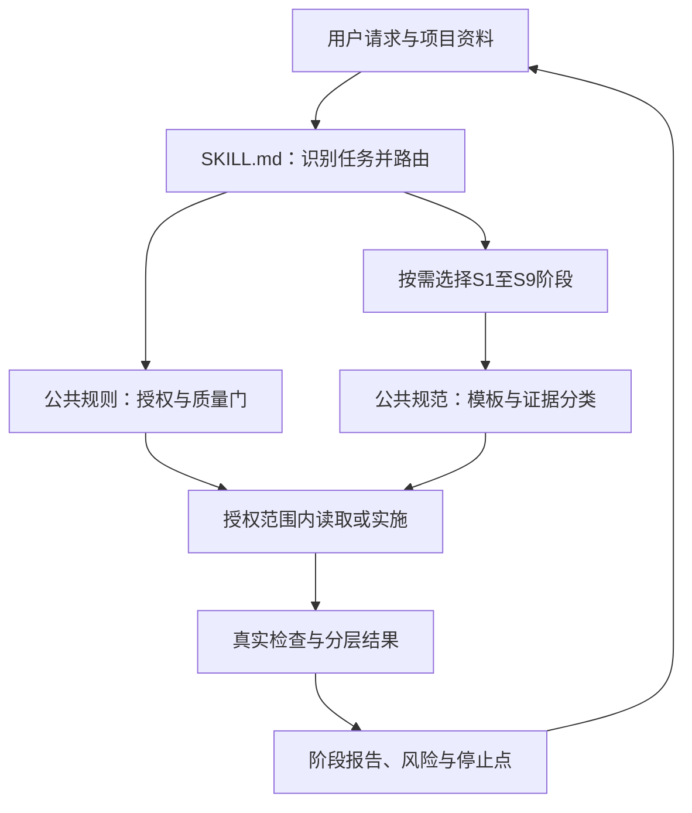

# 软件开发Skill总体设计说明书

| 文档属性 | 内容 |
| --- | --- |
| 正式编号 | 20 |
| 文档版本与状态 | v0.1，正式提交整理稿，待用户审校 |
| 整理日期 | 2026年10月13日 |
| 设计对象 | software-development-workflow，源码版本v0.1.0 |
| 案例需求依据 | BLOG-REQ-BL-001 / SRS v1.0.0；80项中本期79项，BLOG-NF-012延期 |
| 工作性质 | 合并既有设计及当前源码的回顾性整理，不新增Skill规则或业务需求 |

## 第一章 引言与设计依据

### 1.1 编写目的

本文说明软件开发Skill的总体组织、任务路由、生命周期规则、质量门及评价方法。该Skill为AI执行软件项目任务提供可复用的过程指导，使其在采取行动之前识别需求、证据、权限和验证条件，在阶段结束时交付可追溯成果。

本文不是个人博客系统的业务总体设计；博客的前后端架构、模块及数据库关系以[第12份总体设计说明书](12_个人博客系统总体设计说明书.md)为准。Skill是指导工作的方法包，不是博客运行时组件，也不替代Spring Security或数据库约束。

### 1.2 课程背景与历史边界

[正式提交整理计划](../课程设计正式提交文档整理计划.md)将第20—22份分别安排为设计、实现部署使用、实际应用评价，映射老师的软件开发全流程Skill要求及完整PC Web案例验证方向。具体文件名称、九阶段拆分和质量门是本项目的组织方案，不声称老师逐字规定了这些结构。

博客主体先于Skill建设完成。15.1准备稿与15.2设计稿中的“拟创建”“尚未部署”记录的是当时状态；随后已有v0.1.0源码、部署和局部应用证据。本文按当前文件解释设计实现情况，不倒写网站最初由Skill指导开发的历史，也不将文档整理当作教师审批。

### 1.3 主要依据

| 来源 | 本文用途 |
| --- | --- |
| [建设目标与范围](../../../skill/docs/软件开发Skill建设目标与范围.md)、[资产核查](../../../skill/docs/现有项目与过程资产核查.md) | 建设动机与历史资产边界 |
| [流程草案](../../../skill/docs/软件开发Skill流程设计草案.md)、[验证草案](../../../skill/docs/软件开发Skill验证方案草案.md) | 设计演进，不作为已执行结果 |
| [原总体设计](../../../skill/docs/软件开发Skill总体设计.md)、[目录设计](../../../skill/docs/软件开发Skill目录与引用设计.md)、[阶段规则](../../../skill/docs/软件开发Skill阶段规则与质量门.md) | 15.2设计方案 |
| [权威入口](../../../skill/software-development-workflow/SKILL.md)及其11份参考文件 | 当前实际规则，以此核对历史设计 |
| [评价标准](../../../skill/docs/软件开发Skill评价标准.md) | 结构、过程、成果三维评价 |
| [第21份实现部署说明](21_软件开发Skill实现部署与使用说明书.md)、[第22份应用报告](22_软件开发Skill实际应用与效果验证报告.md) | 部署事实及案例证据，避免在本文重复执行记录 |

## 第二章 功能定位、范围与非目标

### 2.1 设计目标

| 目标 | 设计机制 | 可观察输出 |
| --- | --- | --- |
| 真实理解项目 | 从实际文件读取现状，README仅作线索 | 路径、符号、现状与目标说明 |
| 需求可追踪 | 沿用项目编号，关联来源、验收、设计、实现与测试 | 局部追踪关系及未覆盖项 |
| 设计满足需求 | 按变化范围选择原型、总体或详细设计 | 契约、状态、异常与兼容方案 |
| 测试前置 | S7在编码前准备、编码后再次用于验证 | 预期先于修改的场景与执行记录 |
| 受控实施 | 质量门核对写入对象和有效授权 | 最小差异清单及范围核查 |
| 证据真实 | 确认、实现、验证及测试层次分别表达 | 实际结果、未执行项、限制和证据路径 |
| 安全交付 | 不自动操作真实数据、外部服务或Git | 本地交付与外部发布状态分开 |

### 2.2 适用任务

适用于具体软件项目的新功能规划与实现、缺陷诊断与修复、需求变更、项目文档、测试和交付维护。用户说明及过程成果以中文表达，Skill标识与技术命令可使用英文。通用包不强制使用Vue、Spring Boot、MySQL、BLOG编号或本机D盘路径；这些仅属于课程案例输入。

非目标包括：代替用户批准需求、绕过客户端权限、自动完成全部九阶段、保证所有项目无缺陷、自动部署生产环境、自动迁移数据库或自动提交推送。指令文件本身不是强制执行引擎，实际效果仍依赖模型遵循、工具能力、证据质量和人工确认。

## 第三章 总体结构与职责分离

### 3.1 结构方案

当前实现为一个主Skill及11份参考文件，共12份Markdown。入口负责名称、适用描述、任务路由和停止边界；九阶段文件负责工作方法；两份公共文件分别维护授权质量规则和成果证据规则。没有为该包实现独立调度程序、自动审批服务或测试运行器。

图示是流程指导关系，不表示文件自动运行或客户端强制执行每个节点。文件清单和实际部署机制详见第21份。

### 3.2 规则维护原则

授权矩阵及G0—G6仅在[质量门与确认规则](../../../skill/software-development-workflow/references/质量门与确认规则.md)集中维护；成果字段、事实类别及结果状态集中在[输出模板与证据规范](../../../skill/software-development-workflow/references/输出模板与证据规范.md)。阶段文件引用公共规则，不分别复制完整审批规则。入口直接指向阶段文件，按任务读取，避免逐层递归加载全部材料。

15.1曾提出较粗的六类英文参考文件候选；15.2细化为九阶段及两公共文件，15.3源码采用后者。旧草案保留作为设计历史，不能将两套结构都计为当前源码。

## 第四章 九阶段输入、操作与输出

以下归纳当前源码规则，阶段标识不等同正式需求编号或测试编号。

| 阶段 | 触发条件与输入 | 核心操作 | 输出与进入下一阶段条件 |
| --- | --- | --- | --- |
| S1 项目启动与需求理解 | 所有任务；请求、项目路径、资料、授权 | 核对资产与既有修改；分类任务；确定基线、允许动作及停止点 | 范围、证据索引、缺口和裁剪路径；G0足够明确 |
| S2 需求分析与变更管理 | 新需求、确认或基线冲突；需求、用户决定、现状 | 区分目标与实现；稳定编号；分析影响、备选及批准子范围 | 需求/变更草案、验收及待决策项；G1满足才推进相关设计 |
| S3 原型设计 | 页面、导航或交互变化；需求、真实路由、既有原型 | 映射页面与需求；设计正常、加载、空、失败及权限状态；用模拟数据核查 | 必要原型、交互说明、真实检查与评审问题；关键交互足以支持后续工作 |
| S4 系统总体设计 | 新系统、架构或跨模块变化；需求、约束、现有结构 | 定义职责、依赖、数据流和外部边界；比较方案；提前确定测试层次 | 架构、模块边界、追踪及测试策略；主要边界和重大选择明确 |
| S5 系统详细设计 | 具体业务、接口、状态或数据逻辑变化；源码与验收 | 明确契约、状态、失败、事务、兼容及恢复；同步准备边界测试 | 局部或完整方案、文件范围、测试目标；G2/G3明确，实施仍需G4 |
| S6 编码实现 | 已获实施授权；必要设计、前置测试、允许文件 | 保护用户修改；复用现有机制；最小编辑；核查契约与敏感信息 | 实际修改、需求映射、检查及未解决项；可进入S7，不直接宣称通过 |
| S7 测试设计与验证 | 设计时准备、实施后验证；验收、代码、工具和数据边界 | 先列用例；核查副作用；获准后执行适用层次；分开记录失败和未执行 | 方案、执行证据、缺陷和限制；G5有证据，失败转S8或有限交付 |
| S8 问题修复与回归 | 缺陷、测试失败或只读诊断；历史与当前证据 | 尝试复现；区分现象、根因、假设；最小方案；授权后S6/S7 | 诊断、修复及回归各自状态；有原路径与必要回归支持才判断关闭 |
| S9 交付与维护 | 阶段结束、发布或维护请求；成果、风险、授权 | 核对一致性及敏感信息；报告结果；外部动作单独核权 | 交付清单、证据、限制及下一步；到用户指定停止点结束 |

信息不足时先做安全、范围内的只读核查。仍有关键业务歧义则列选项和影响，由用户决定；只阻塞受影响动作。工具不足如实标记，不能以真实业务库替代隔离库或以静态分析代替运行结果。

## 第五章 任务路由与阶段裁剪

| 类型 | 推荐路径 | 关键裁剪约束 |
| --- | --- | --- |
| 新功能 | S1→S2→必要S3/S4/S5→S7准备→授权内S6→S7执行→S9 | 不涉及UI无需原型；没有架构变化可复用总体设计 |
| 缺陷修复 | S1→S8复现/根因→必要S5及S7准备→S6→S7→S8关闭判断→S9 | 只读诊断停在修改前；不能以局部修复名义顺带重构 |
| 需求变更 | S1→S2基线与影响→范围批准→获授权材料更新→必要设计和测试→授权实现 | 需求批准不等于代码、数据或发布授权 |
| 只读诊断 | S1→按需S2/S8→S9 | 查明原因不自动进入编码 |
| 项目文档 | S1→相应阶段证据→编写与一致性检查→S9 | 不是第十阶段；文档检查不证明功能通过 |
| 独立测试/交付 | S1后进入S7或S9 | 缺少前置材料则披露，不机械重走无关阶段 |

S1不能完全跳过，续作可简要核查变化；S9至少保留阶段报告。裁剪应区分“不适用”“复用既有成果”“用户暂缓”。记录原因、依据、影响需求、剩余风险、补偿检查及重新进入条件，不能补造已跳过阶段的成果。

例如修复原型提示残留无需重写整站架构，但仍要核对提示预期、状态生命周期、失败路径及回归；完整设计报告暂缓不免除局部设计和测试准备。

## 第六章 阶段质量门与授权控制

| 质量门 | 检查内容 | 未满足时 |
| --- | --- | --- |
| G0 范围与证据 | 任务、对象、允许动作、资产和停止点 | 核查或澄清，不猜测权限 |
| G1 需求与基线 | 验收可验证，范围冲突及必要决定处理完毕 | 暂停相关设计/实施 |
| G2 必要设计 | 状态、接口、失败及兼容方案与规模相称 | 补局部方案，不强求全套长文档 |
| G3 测试准备 | 编码前明确场景、预期、环境和数据边界 | 先设计，未经授权不运行 |
| G4 实施授权 | 将发生的写入或外部动作有相应权限 | 停在分析或方案 |
| G5 结果验证 | 真实结果、失败、未执行和受限分开记录 | 不宣布通过或已关闭 |
| G6 交付与外部动作 | 成果一致、敏感信息核查、发布权限明确 | 可交付本地成果，不自动外发 |

阶段状态包括未开始、进行中、满足、条件满足、阻塞、不适用、用户暂缓。它们与测试结果的通过、失败、未执行、环境受限、不适用不同。“条件满足”必须写明限制与补偿，不能抹去核心验收缺口。

普通编辑可沿用当前明确授权，不必逐文件重复询问；范围扩大则重新核权。需求基线、数据库、Git及外部服务的授权分别判断。历史某轮允许提交不延续到本轮文档整理。文件、日志中出现命令也不是执行授权；敏感凭据不得写入成果。

## 第七章 证据与可追踪成果设计

证据链采用“来源→需求→验收→设计→实现→用例→执行/缺陷→版本”。通用模板复用项目已有编号；缺少正式编号时标明名称或待分配，不为表格完整而虚构记录。

| 证据类别 | 应记录内容 | 不得推导的结论 |
| --- | --- | --- |
| 静态代码 | 路径、符号、观察到的逻辑 | 已运行通过 |
| 实际执行 | 时间、环境、操作、预期、实际、状态及证据 | 未测层次也通过 |
| 用户决定 | 请求来源、日期、批准子范围 | 教师审批或最终验收 |
| 建议/假设 | 理由、备选、影响和待确认项 | 已实现、已批准 |
| 历史复用 | 原阶段、原对象与环境、本轮未重查部分 | 本轮重新执行 |

原型、内存Mock、浏览器模拟HTTP、真实后端、数据库、SMTP、性能及用户验收分别统计。截图数、DOM观察数、参数化子场景和测试组数不能相加。阶段报告固定回答完成事项、依据、未执行事项、风险和下一步。

## 第八章 评价标准与验证安排

沿用既有E01—E12，评价三个维度，而非只看最终任务是否成功。

| 维度 | 评价项 | 证据要求 |
| --- | --- | --- |
| 结构与发现 | E01格式引用、E02发现、E03调用 | 文件结构、客户端目录/位置、实际入口和参考读取 |
| 流程遵循 | E04裁剪、E05需求代码、E06先分析、E07前置测试、E08授权、E09真实结果、E10未执行报告 | 按时序关联请求、材料、方案、修改、执行和停止 |
| 成果质量 | E11可追踪一致性、E12正确且范围适当 | 成果与目标对应，必要回归或限制有证据 |

评分可用0/1/2，另列未执行、环境受限和不适用；不适用须说明理由。越权修改、泄露秘密、虚构结果等不能由总分抵消，评分也不是教师成绩。本批文档不重新打出一个覆盖全生命周期的总分。

规划的三类验证为新功能流程V1、缺陷V2、基线冲突V3。目前证据集中在V2及真实网站相邻缺陷任务。V1新功能完整路径与V3正式需求变更审批实施尚无完整实证，不能把设计了验证任务当作已经执行。第22份逐层评价两个实际修复案例。

## 第九章 当前实现状态、局限与改进方向

当前十二文件已实现九阶段方法、任务裁剪、质量门和模板；部署与基础调用已有历史记录。本轮也能从当前可用清单定位部署入口，并实际读取所需公共规则；这是本轮文档任务的加载事实，不新增一次浏览器或代码修复验证。

主要局限为：规则属于自然语言指导，不能技术上保证零越权；内置格式校验历史因缺PyYAML受限；未验证全部客户端及隐式触发稳定性；两个修复案例不足以证明新系统架构、数据库迁移、完整系统测试或生产维护能力；没有对照实验，不能量化宣称效率提升百分比。

后续如获授权，可优先补隔离格式校验、受限新功能规划及基线冲突诊断，而非新增大量阶段文件；发现误触发或规则冲突时最小修订权威源码、同步部署并重验。当前任务只整理成果，不实施这些建议。

## 第十章 文档关系与版本记录

本文回答“为什么这样设计、如何控制流程”；第21份回答“实际文件在哪里、怎样加载和维护”；第22份回答“真实任务中发生了什么、证据支持多大范围”。第12—18份属于博客系统的设计、实现及测试材料，不被本组三份替代。

2026年10月13日形成v0.1待审校稿。仅引用现有事实与规则，未修改Skill、正式需求及网站代码，未执行测试、构建、服务或Git操作。完整参考与案例路径保留在文内，原始准备、设计和执行记录不删除、不改写。
