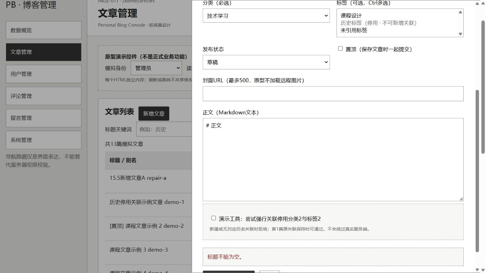
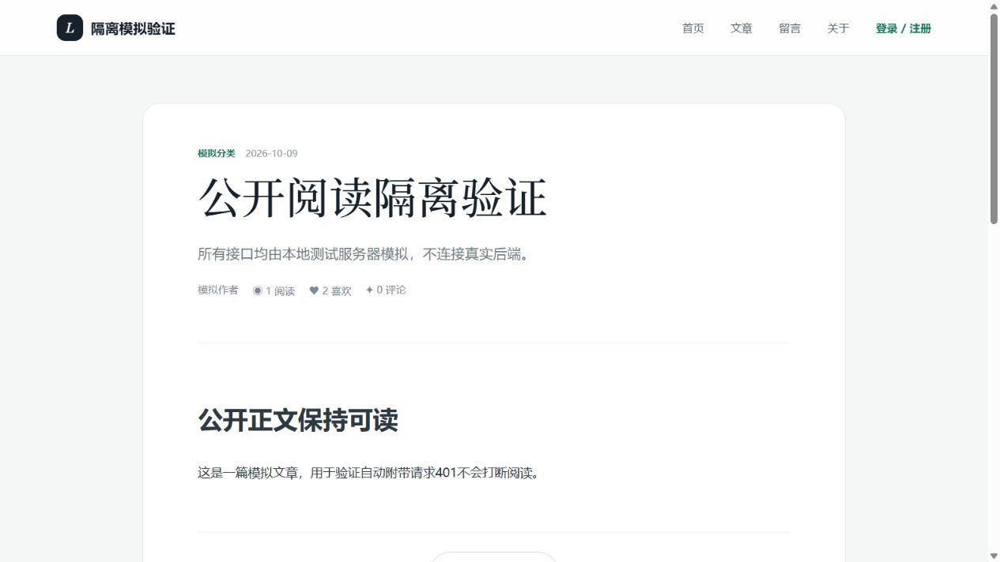

# 软件开发Skill实际应用与效果验证报告

| 文档属性 | 内容 |
| --- | --- |
| 正式编号 | 22 |
| 文档版本与状态 | v0.1，正式提交整理稿，待用户审校 |
| 整理日期 | 2026年10月13日 |
| 验证对象 | software-development-workflow v0.1.0在两个局部缺陷案例中的应用 |
| 历史执行日期 | 主要诊断及修复记录为2026年10月9日；本轮只读复核，不重新执行 |
| 案例层次 | 15.5独立HTML原型；15.6-B真实Vue前端的隔离自动化及模拟HTTP浏览器验证 |
| 结论边界 | 有限案例的流程与成果证据，不代表全生命周期、真实后端联调或课程验收全部通过 |

## 第一章 目的、依据与评价方法

### 1.1 报告目的

本文按[课程提交计划](../课程设计正式提交文档整理计划.md)合并既有诊断、修复和测试记录，回答Skill是否真实加载、如何指导工作、成果有什么证据以及结论适用到哪里。[第20份](20_软件开发Skill总体设计说明书.md)说明设计，[第21份](21_软件开发Skill实现部署与使用说明书.md)说明实现部署，本文不重复整套规则或全部原始测试步骤。

博客主要功能先于Skill完成。两个案例是Skill创建后的真实后续修复，不构成“整站最初由Skill开发”的证据；后补正式说明书也不等于早期就存在完整设计与测试报告。

### 1.2 评价与证据分层

采用[既有评价标准](../../../skill/docs/软件开发Skill评价标准.md)的结构、流程遵循、成果质量三个维度。发现与调用需要清单、位置及实际读取证据，不能由文件复制或回答风格推断；修复有效需要真实修改和适用回归，不能仅由代码写入推断。

| 证据层次 | 主要材料 | 可支持范围 |
| --- | --- | --- |
| 历史调用摘要 | 各阶段Skill流程记录、15.4-A会话索引 | 当时发现、入口读取、参考选择与停止行为；不是完整导出的客户端内部日志 |
| 静态实现 | 当前HTML、六份前端源码、测试脚本 | 当前逻辑与历史方案可对应，不代表本轮运行 |
| 历史动态结果 | 浏览器操作表、DOM观察、TAP、JSON、服务日志及截图 | 各自对象和环境下已记录的结果 |
| 本轮核对 | 文件读取、数量/摘要/链接及表格检查 | 正式稿可追溯性，不计为新功能测试 |

未取得的内部日志、浏览器精确内核版本、教师评分或用户最终验收均不补造。

## 第二章 应用时间线与授权分段

| 阶段 | 真实任务与产出 | 实施边界 |
| --- | --- | --- |
| 15.1—15.2 | 目标、流程、结构、质量门及评价设计 | 当时是计划，尚非已调用包 |
| 15.3—15.4-A | v0.1.0十二文件、部署摘要、新会话基础调用 | 内置格式校验缺PyYAML；基础调用不证明完整修复 |
| 15.4-B | 原型缺陷实际复现、根因、最小方案及R01—R12设计 | 只诊断，未修改原型 |
| 15.5 | 获授权实施三行原型状态处理，执行12组回归 | 只限HTML原型及记录 |
| 15.6-A | 网站公开阅读静态诊断、六文件方案、A01—A15设计 | 未动态复现、未编码、未运行测试 |
| 15.6-B | 获授权动态模拟复现、真实前端修改、隔离及浏览器验证 | 不改后端、SQL、基线或Skill，不连接真实业务数据 |
| 本轮第23步 | 三份正式Skill文档合并 | 不重新执行案例，不把旧结果变成本轮结果 |

两轮实施均采用S1→S8证据及根因→必要S5与S7前置设计→G4授权→S6实施→S7验证→S8关闭判断→S9交付。没有机械重做原型设计或全站架构；已经存在的需求被复核，不需为缺陷修复新增需求基线。

## 第三章 案例一：HTML原型旧成功提示残留

### 3.1 对象、要求与真实复现

对象为[后台文章管理原型](../../prototype-design/后台文章管理原型.html)中的PROTO-ISSUE-001。关联BLOG-F-027文章新增编辑及BLOG-NF-010准确反馈；BLOG-NF-014为相关异常要求。目标是避免本次失败与上次成功语义并存，不改变真实Vue文章管理或后端业务。

[15.4-B诊断](../../../skill/docs/15.4-B真实缺陷诊断记录.md)记录内置浏览器实际操作：首次编辑成功→新增空表单校验失败→再次编辑模拟保存失败。失败时抽屉`articleErrors`更新，但主页面`feedback`仍保留旧成功文本。证据包含D01—D04观察和3张历史截图；不是仅根据早期问题清单猜测根因。

根因是两处提示独立，`openArticle()`未清主反馈，`saveArticle()`错误分支更新抽屉后提前返回。现有渲染和关闭逻辑不负责清主反馈。这是提示生命周期缺口，证据不支持将其描述为真实网络请求失败或异步竞争。

### 3.2 Skill调用与编码前准备

[15.5 Skill记录](../../../skill/docs/15.5软件开发Skill实际修复验证报告.md)记载当时可用清单含部署包，实际读取入口以及S1、S5、S6、S7、S8、S9、质量门和证据规范8份参考。编码前重读[15.4-B最小方案与12组回归设计](../../../skill/docs/15.4-B最小修复方案与回归测试设计.md)，文件摘要与诊断阶段一致。

15.5复用了15.4-B的修改前真实复现证据，没有再运行一遍修改前浏览器复现；不能将这一复用写成15.5又新增一次复现。用户15.5请求提供实施授权，与15.4-B只读授权分开记录。

### 3.3 实际最小修改

[实施记录](../../../skill/docs/15.5原型缺陷修复实施记录.md)及当前源码对应三处新增处理：

| 符号/时机 | 修改 | 保持不变 |
| --- | --- | --- |
| `openArticle()`入口 | `note('')`清除旧主反馈 | 表单绑定、历史分类标签关联 |
| `saveArticle()`通过guard后 | 清主反馈和抽屉错误，再执行校验 | 错误先返回，不写模拟数据 |
| 文章抽屉close事件 | 清除抽屉错误 | 保存成功原有关闭→渲染→成功反馈顺序 |

没有重写全部关闭按钮，没有定时无差别清理提示，没有修改其他原型或Vue代码。历史行位置为100、113、192，可通过函数与事件定位避免后续行号变化误读。

## 第四章 案例一回归结果与关闭边界

### 4.1 历史环境与分组结果

2026年10月9日使用Codex内置浏览器、1280×720视口，临时静态服务仅绑定127.0.0.1、提供原型目录，端口63482。真实点击、填写、选择、Escape及刷新配合DOM观察；没有通过调用内部函数伪造点击，也没有真实数据库写入。

| 组号 | 场景 | 历史结果 |
| --- | --- | --- |
| R01 | 首次新增成功及列表计数 | 通过 |
| R02 | 成功后空标题 | 通过，当前错误可见且无旧成功 |
| R03 | 空正文、非法/重复别名、超长标题 | 通过，4个隔离子场景不额外计组 |
| R04 | 成功后模拟保存失败 | 通过，原标题和计数不变 |
| R05 | 新增/编辑取消、关闭、Escape及重开 | 通过 |
| R06 | 连续两次成功 | 通过 |
| R07 | 新增与编辑分支切换 | 通过，复用同轮部分证据，不另计测试次数 |
| R08 | 发布更新及失败不更新列表 | 通过 |
| R09 | 筛选与分页保持 | 通过 |
| R10 | 保留历史停用关联、拒绝新关联 | 通过，仅原型规则 |
| R11 | 冲突反馈 | 通过 |
| R12 | 普通用户、未登录、失效、禁用、撤销角色 | 通过，仅原型入口限制 |

合计12组执行、12通过、0失败、0未执行、0环境受限；41次状态观察不是41个用例。原路径复验和读取/删除相邻检查作为补充证据，不加入12组分母。详细步骤及时间以[原回归报告](../../../skill/docs/15.5原型缺陷回归测试报告.md)为准。

### 4.2 图像证据与限制

图1复用15.5真实浏览器截图，内容为HTML内存模拟，不是Vue网站运行截图。完整[10张JPG证据](../../../skill/docs/evidence/15.5/)与报告相互定位，另有[模拟失败](../../../skill/docs/evidence/15.5/03-模拟失败无旧成功.jpg)及[原路径复验](../../../skill/docs/evidence/15.5/09-原复现路径校验失败.jpg)。本轮没有新拍或替换图片。

原问题在所测原型范围已解决，[问题清单](../../prototype-design/原型问题清单.md)保留历史失败并追加关闭依据。没有完成Chrome/Edge双浏览器、批准桌面双视口、全部其他原型、真实JWT、数据库或SMTP验证。原型的停用关联模拟通过不代表网站后端相应差异已修复。

## 第五章 案例二：真实Vue网站公开阅读中断

### 5.1 15.6-A静态诊断与需求依据

[15.6-A诊断](../../../skill/docs/15.6-A真实网站需求差异诊断记录.md)依据SRS核对BLOG-F-003、BLOG-F-005、BLOG-F-012、BLOG-F-016、BLOG-NF-002、BLOG-BR-004，评论回归关联BLOG-F-019。要求公开正文不被失效身份的附属查询打断，主动保护操作仍鉴权，401清理失效身份，403按权限处理。

当时静态识别两条路径：缓存身份下自动likeState查询401；仅残留Token时路由恢复`/auth/me`401。统一拦截器先执行登录导航，页面catch无法撤销；只清localStorage还可能留下Pinia身份。该阶段没有运行测试，不能称当时动态复现成功。[最小方案及A01—A15](../../../skill/docs/15.6-A最小修改方案与测试设计.md)先于后续业务修改形成。

### 5.2 15.6-B动态确认

15.6-B先新增隔离执行器，在修改前源码上运行；真实Axios、Pinia和Vue响应式结合VM，替代网络、路由容器及UI，不挂载DOM。结果见[修复前JSON](../../../skill/docs/evidence/15.6-B/修复前模拟复现记录.json)：两条路径都跳`/login`，like401路径虽清存储但Pinia仍认证。这是内存模拟动态复现，不是修复前浏览器或真实JWT过期实验。

确认根因是401处理缺少请求上下文、身份清理未统一，以及公开导航会话恢复触发同类副作用。后端公开放行与受保护认证规则不需要因此放宽。静默策略只抑制自动附带查询导航，不吞错误、不开放本人数据。

### 5.3 实际修改的六份源码

| 文件 | 关键修改与作用 |
| --- | --- |
| [请求处理request.js](../../../blog-web/src/utils/request.js) | `setAuthFailureHandlers`回调、请求身份快照；当前会话401同步清理；`authFailure: silent`不导航但继续reject；403刷新权限；旧会话延迟错误不清新登录 |
| [auth API](../../../blog-web/src/api/auth.js) | `getCurrentUser(config)`允许恢复查询传入处理策略，接口仍受保护 |
| [blog API](../../../blog-web/src/api/blog.js) | 自动`likeState`携带silent；主动点赞、取消、评论保留原鉴权及默认策略 |
| [auth Store](../../../blog-web/src/store/auth.js) | 回调复用logout；恢复支持force核实；角色刷新；响应校验所属会话；网络错误不假装账号失效 |
| [Router](../../../blog-web/src/router/index.js) | 受保护导航强制核实；401登录、403回首页、网络无法核实则取消；公开恢复错误不打断公开导航 |
| [ArticleDetail.vue](../../../blog-web/src/views/public/ArticleDetail.vue) | 正文就绪解除遮罩；评论和本人状态附带读取；未知点赞状态单独表达；跨文章/会话晚响应隔离；评论失败不冒充空列表 |

请求层不直接导入Store，使用回调避免循环依赖。正常公开数据接口未改；后端JWT、安全配置、数据库和正式基线未改。主动操作在本地身份已清理时可以由页面引导登录，不必机械要求再发一次HTTP请求取得401；身份仍存在但服务端拒绝时则走真实请求失败处理。此解释与第18份BLOG-TC-SEC-002的三类判据一致。

## 第六章 案例二测试数量、证据与限制

### 6.1 计量口径

| 层次 | 计划或集合 | 历史结果 | 不得误算 |
| --- | --- | --- | --- |
| 原A01—A15 | 15组编码前设计 | 14组隔离执行通过，A14后端安全链1组未执行，0失败 | 不是原15组全通过 |
| 相邻回归 | 额外1组 | 正常登录退出、旧延迟401、保护导航网络失败通过 | 不替代A14 |
| Node自动化 | 前述14组加额外1组形成脚本15个子测试 | TAP：15通过、0失败 | 与前两行是同一批结果，不再次相加 |
| 浏览器模拟HTTP | B01—B06共6类 | 最终6类通过；两条核心路径又复核 | 不与Node合成21个新用例，不是全部A组E2E |
| 生产构建 | 一份最终构建记录 | 2245模块、14.34秒，历史记录退出0 | 不是性能、安全或联调验收 |

原计划A01游客、A02有效身份、A03—A06失效身份缓存组合、A07附属401、A08初始化状态、A09保护导航、A10同步清理、A11主动拒绝、A12正常互动、A13权限纠正、A15附属故障/非法主目标为隔离通过；A14未执行。结果只覆盖[回归报告](../../../skill/docs/15.6-B真实网站回归测试报告.md)列明断言。

### 6.2 执行资产与真实日志

| 文件 | 实际用途与历史证据 |
| --- | --- |
| [public-reading.test.mjs](../../../blog-web/tests/public-reading.test.mjs) | Node内置test、VM、真实源码与内存Axios adapter；不挂载DOM、不连数据库 |
| [mock-reading-server.mjs](../../../blog-web/tests/mock-reading-server.mjs) | 独立Vite配置，`configFile:false`、空proxy、127.0.0.1:18765及strictPort；拦截api/uploads，不回落真实后端 |
| [隔离TAP](../../../skill/docs/evidence/15.6-B/修复后隔离自动化测试.txt) | 末尾tests15、pass15、fail0 |
| [修复后状态观察](../../../skill/docs/evidence/15.6-B/修复后状态观察.txt) | 两路径redirects为空；like路径正文存在、存储清理且Pinia不再认证 |
| [最终构建](../../../skill/docs/evidence/15.6-B/最终前端构建.txt) | 构建成功；Element Plus/ECharts大于500kB告警保留 |
| [模拟HTTP日志](../../../skill/docs/evidence/15.6-B/最终浏览器模拟接口记录.txt) | public200、like401、me401对应观察，不含真实凭据 |

历史环境记录为Windows、Node.js v22.14.0、Vite v5.4.21、Codex内置浏览器；本轮没有探测运行环境或执行脚本。`expired`、`invalid`等是模拟夹具标签，不是实际JWT密码学证明。脚本及六份前端当前本地存在；本轮禁止Git，未重新核对它们是否已进入远程提交，不能把本地可读取等同远程附件已齐全。

### 6.3 六类浏览器检查与截图

| 类别 | 历史观察 | 证据 |
| --- | --- | --- |
| B01 缓存失效身份 | 附带like401后留详情、正文与游客入口可见 | [最终截图](../../../skill/docs/evidence/15.6-B/最终版本_缓存失效Token公开阅读.png) |
| B02 仅残留Token | me401后正文正常，不跳登录 | [最终截图](../../../skill/docs/evidence/15.6-B/最终版本_仅Token恢复401公开阅读.png) |
| B03 游客主动点赞 | 引导登录 | [截图](../../../skill/docs/evidence/15.6-B/浏览器_游客主动点赞要求登录.png) |
| B04 有效点赞切换 | 计数2→1→2 | 原报告AX操作观察，无独立计数截图 |
| B05 有效评论 | 最终待审提示、输入清空 | [截图](../../../skill/docs/evidence/15.6-B/浏览器_有效身份评论模拟成功.png) |
| B06 受保护个人中心 | 失效身份进入登录 | [截图](../../../skill/docs/evidence/15.6-B/浏览器_失效身份访问个人中心要求登录.png) |

图2来自真实Vue模板的历史浏览器截图，但接口为本地模拟；不是HTML原型，也不是Spring Boot/MySQL联调截图。完整证据目录有7张PNG、4份TXT、1份JSON，共12文件；截图张数与测试组数分开。

历史首次`--test`运行遇spawn EPERM，改直接运行同一node:test脚本后取得TAP；构建及服务启动也曾受权限限制，获工具审批后完成。评论浏览器首试夹具缺少POST响应导致404，页面正确报错并保留输入；补夹具后重测成功。不得把它改写成首次全部通过，也不能把夹具缺项归为网站业务缺陷。

### 6.4 关闭判断

前端公开阅读两条中断路径在隔离范围已修复并验证；仍未验证A14完整安全链、真实JWT过期/无效签名/禁用状态、MySQL写入及事务、SMTP、完整Chrome/Edge双视口及全站联调。新增保护导航核实会产生查询，附带状态未知时存在明确降级；这些仍需真实环境验收，不扩大本次结论。

## 第七章 Skill流程遵循的综合评价

依据各轮[15.4-B流程记录](../../../skill/docs/15.4-B软件开发Skill流程验证报告.md)、[15.6-A流程记录](../../../skill/docs/15.6-A软件开发Skill流程验证记录.md)、15.5及[15.6-B应用记录](../../../skill/docs/15.6-B软件开发Skill实际应用验证报告.md)，本报告作定性汇总，不生成教师分数。

| 评价项 | 两案例证据 | 结论边界 |
| --- | --- | --- |
| E01结构引用 | 所需入口、8份实施参考可读；源码/副本有摘要 | 支持本任务结构，内置格式校验未通过执行 |
| E02发现、E03调用 | 当前清单与实际入口/参考读取；15.4-A另有独立会话索引 | 有真实加载依据；没有新增内部调用日志 |
| E04识别裁剪 | 只读阶段不进S6，局部修复不重做全架构 | 支持这些任务的裁剪，不证明所有任务分类稳定 |
| E05读取需求与代码 | 原型F-027/NF-010；网站F-003/F-005等与当前源码 | 不是仅凭问题描述或README |
| E06先分析 | 原型动态诊断后修复；网站静态诊断后模拟动态确认 | 历史与本轮复用分开 |
| E07测试前置 | R01—R12及A01—A15先于实施 | 不倒推整站初始开发已有测试设计 |
| E08授权 | 诊断先停止，后续明确授权才改原型或六份前端 | 需求批准未被当作数据库/Git权限 |
| E09真实结果 | 失败输入、EPERM、夹具404、最终通过及层次均保留 | 未隐藏限制，未模拟全部安全链通过 |
| E10未执行报告 | 明确A14、真实库/邮件、兼容性等 | 不能在汇总中删除未执行项 |
| E11可追踪 | 需求→方案→文件→R/A/B→报告与截图 | 原报告为权威细节，正式稿不重编历史ID |
| E12成果 | 原型反馈生命周期修复、网站401上下文及状态同步 | 支持局部质量，不是课程整体合格结论 |

Skill的实际作用体现在使工作保留需求依据、实施前测试、最小修改、分阶段授权与证据分类。没有“不使用Skill”的对照组，不能据此证明因果上的提效比例、开发时间缩短值或缺陷率改善百分比。

## 第八章 已验证与未验证能力边界

| 能力/阶段 | 已有支持 | 尚未建立的证据 |
| --- | --- | --- |
| S1理解与范围 | 两对象、基线和不同授权范围可识别 | 任意新项目均正确理解 |
| S2需求/变更 | 复核既有目标，识别不需改基线 | 正式变更申请、批准、实施、版本闭环；V3仍不能称完成 |
| S3原型 | 复用已有原型并修复局部反馈 | 从零原型设计到正式评审全路径 |
| S4总体设计 | 局部任务复用架构，不机械重写 | 新系统总体架构方案实证 |
| S5详细设计 | 提示生命周期、401上下文与失败契约 | 全站详细设计均经运行验证 |
| S6编码 | 一份HTML三行修改、六份真实前端修改 | 后端、迁移或全栈新功能交付 |
| S7测试 | 前置设计及规定层次的实际执行 | 完整安全链、MySQL、SMTP、性能与全站验收 |
| S8修复 | 复现、根因、最小实现、回归与限定关闭 | 全部缺陷类别或全部并发情形 |
| S9交付维护 | 本地记录、风险和临时资源清理 | 生产发布、恢复、长期维护效果 |

九阶段均有源码规则，不能表述为九阶段均有完整项目实证。V1新功能规划至交付和V3基线冲突流程仍可作为后续授权验证建议，不在本轮执行，也不为凑材料另增阶段。

## 第九章 与正式测试材料的一致性

[第16份功能实现](16_个人博客系统功能实现说明书.md)记录相同六文件及修复边界；[第17份测试计划](17_个人博客系统软件测试计划.md)区分既有证据和待测层次；[第18份用例矩阵](18_个人博客系统软件测试用例与需求覆盖矩阵.md)用BLOG-TC-REG-001索引原型12组、REG-002索引前端隔离、REG-003索引模拟HTTP浏览器。这三个REG是历史包索引，不是本轮新增三个执行通过。

第18份99条记录中96条为新用例、3条为历史索引；新用例设计覆盖80项需求不等于80项验收通过。本报告不改变其编号、覆盖或执行状态，也不把局部案例成功解释为其他用户名长度、密码字节边界、重置/禁用后旧Token、停用关联、配置校验事务等已知差异已解决。第12—15份博客设计与接口说明仍是业务结构依据，本报告只讨论Skill如何处理指定缺陷。

## 第十章 结论、证据保留与版本记录

现有证据支持software-development-workflow v0.1.0在两个后续局部任务中实际加载并指导分析、设计、授权实施和回归；支持原型缺陷限定关闭与真实Vue前端隔离修复有效。不支持“Skill从零开发整个博客”“全部九阶段已验证”“全站真实联调通过”或“教师已审批”。

原型案例保留10张回归JPG及前序3张诊断JPG；网站案例保留7张PNG和5份文本/结构化证据。本文复用2张图作说明，不复制或生成图片；完整执行步骤、时间和历史限制仍在原报告。无法导出的会话工具轨迹仅以已存索引说明，不虚构新日志。

2026年10月13日形成v0.1待审校稿。本轮新增第20—22三文档，读取案例脚本但不执行，不运行测试、构建或服务，不修改源码、数据库、Skill、SRS或旧文档，不执行Git。后续建议先审校三份正式稿；真实联调或其他验证须另行授权，本轮到此停止。
