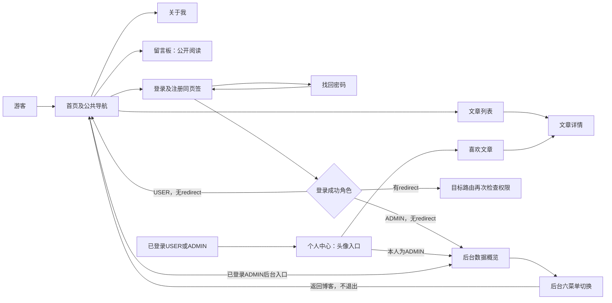
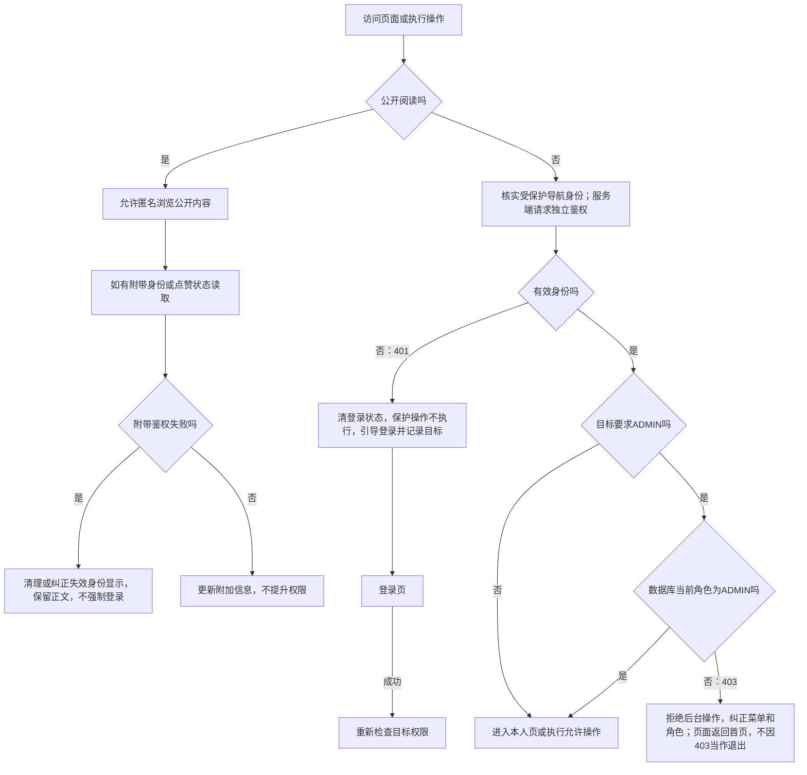
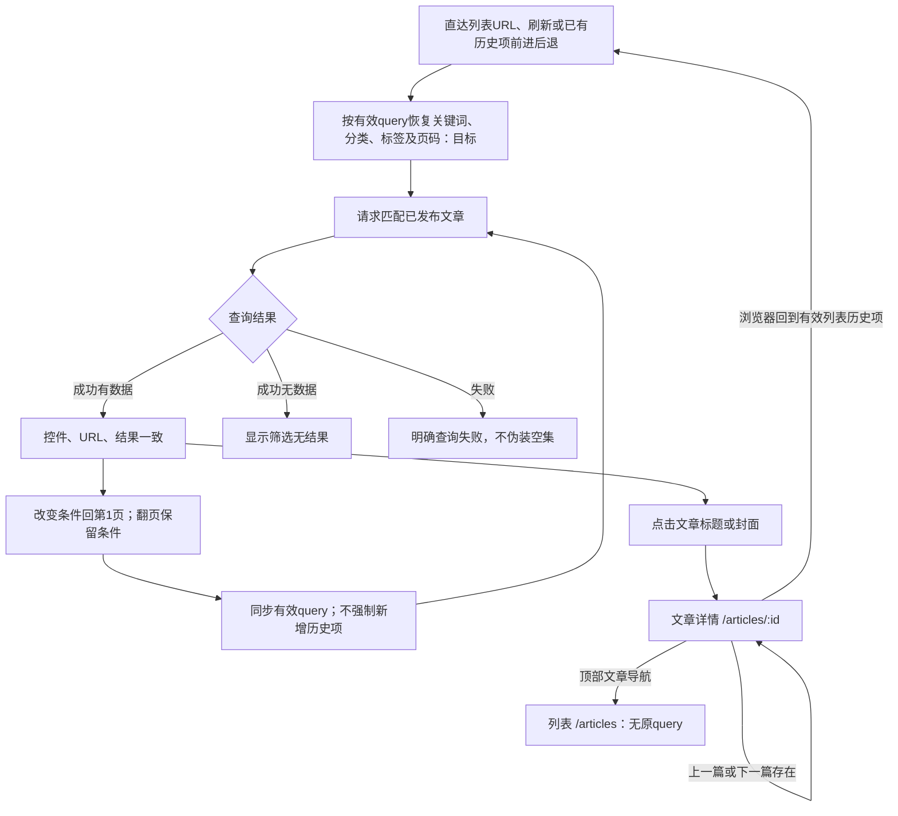

# 页面导航与跳转流程设计

版本：v0.1（14.2导航设计稿，待用户检查）  
日期：2026-10-08  
依据：BLOG-REQ-BL-001 / SRS v1.0.0

## 1. 依据与符号

页面编号沿用[清单](page-inventory.md)，需求关联见[映射](page-requirement-mapping.md)和[正式SRS](../requirements/software-requirements-specification.md)。路由、PublicLayout、AdminLayout、Login、Profile、ArticleList、ArticleDetail及Axios/Pinia为静态证据。站点分类见[站点地图](site-map.md)，访问边界见[权限矩阵](navigation-permission-matrix.md)。

“现状”指代码可定位行为，“目标”指已批准但尚需实现/核实的要求，“建议”指待用户确认的UI细节。以下流程不等于运行记录，未进行功能、浏览器或原型评审测试。

## 2. 页面跳转关系表

| 起始页面 | 触发操作 | 目标页面/状态 | 前置条件 | 未满足条件时的行为 | 关联需求 | 当前实现与目标 |
| --- | --- | --- | --- | --- | --- | --- |
| 公共布局下各页 | 点击品牌/首页 | PAGE-001 `/` | 无 | 无身份亦可浏览 | BLOG-F-008 | 现状已有 |
| 首页 | 浏览文章/查看全部；文章卡封面或标题 | PAGE-002 `/articles`；PAGE-003 `/articles/{id}` | 文章为有效公开记录 | 详情错误提示后转列表 | BLOG-F-008、BLOG-F-009、BLOG-F-012 | 现状已有；不是点击分类标签跳转 |
| 文章列表 | 卡片封面/标题 | PAGE-003 `/articles/{id}` | 有效文章ID | 详情失败提示后转`/articles` | BLOG-F-010、BLOG-F-012 | 现状已有 |
| 文章详情 | 顶部“文章”导航 | PAGE-002 `/articles` | 无 | 无身份可用 | BLOG-F-008、BLOG-F-010 | 现状没有独立返回列表按钮；该导航不携带原筛选query |
| 文章详情 | 浏览器后退/前进 | 浏览器已有历史目标 | 历史项存在 | 没有历史项不保证能返回特定列表 | BLOG-F-010 | 目标是有效查询历史恢复；不要求每次筛选新增历史项 |
| 文章详情 | 上一篇/下一篇 | PAGE-003的新ID | 对应相邻文章存在 | 对应链接不呈现 | BLOG-F-013 | 现状已有；按ID变化加载 |
| 公共布局 | 关于、留言 | PAGE-004 `/about`、PAGE-005 `/message` | 无 | 游客可读 | BLOG-F-014、BLOG-F-023 | 现状已有 |
| 详情/留言板 | 未登录点喜欢、发表评论或发布留言 | PAGE-006 `/login?redirect=原fullPath` | 有效身份才能执行互动 | 先登录，不执行匿名写入 | BLOG-F-005、BLOG-F-016、BLOG-F-019、BLOG-F-024 | 无Token路径已有；残留Token失效处理仍有差异 |
| 公共布局 | 登录/注册 | PAGE-006 `/login` | 客户端未登录 | guestOnly把已登录USER转首页、ADMIN转后台 | BLOG-F-001、BLOG-F-002 | 现状判断依赖缓存，不能等同实时验证 |
| 登录页 | 登录成功 | redirect；否则ADMIN `/admin`，USER `/` | 后端验证成功 | 错误/禁用留表单并提示 | BLOG-F-002、BLOG-F-005 | 现状redirect仅字符串以`/`开头；目标仍须通过目标路由权限，不可视作完整安全校验 |
| 登录页注册页签 | 注册成功 | 同PAGE-006登录页签 | 注册校验及业务成功 | 留注册状态提示错误 | BLOG-F-001 | 不自动登录；填注册用户名、清登录密码，非独立注册成功页 |
| 登录页 | 忘记密码 | PAGE-007 `/forgot-password` | 未登录入口 | 已登录按guestOnly重定向 | BLOG-F-006 | 现状已有 |
| 找回密码 | 发码；返回登录；重置成功 | 原页60秒倒计时；PAGE-006 `/login` | 邮箱及重置验证通过 | 失败留原页，不开始成功倒计时/不跳转 | BLOG-F-006、BLOG-F-007 | 现状成功重置用replace；旧Token失效仍需后端补齐 |
| 公共布局 | 点击用户头像 | PAGE-008 `/profile` | USER/ADMIN有效身份 | 无Token转带redirect登录 | BLOG-F-003、BLOG-F-005、BLOG-F-020 | 入口已有；目标进入保护路由须核实身份，不只看缓存 |
| 个人中心 | 喜欢文章卡片 | PAGE-003 `/articles/{id}` | 喜欢列表返回有效公开文章 | 查询失败须提示，空集与失败分开 | BLOG-F-017 | 现状已有 |
| 个人中心 | 修改密码成功 | PAGE-006 `/login` | 当前密码与新设置合法，更新成功 | 留页提示失败 | BLOG-F-022、BLOG-BR-009 | 现状清本地登录、replace登录；后端已加版本但仍待验收 |
| 个人中心 | 退出登录 | PAGE-001 `/` | 本地登录状态可清除 | 已无缓存仍可清除 | BLOG-F-004 | 现状与目标一致；无服务器注销请求 |
| ADMIN前台/个人中心 | 管理后台/进入管理后台 | PAGE-010 `/admin` | 有效ADMIN | 游客登录，USER路由返回首页/API403 | BLOG-F-005、BLOG-BR-006 | 现状入口及限制已有；保护导航身份核实待改进 |
| 后台任一页 | 点击六项菜单 | PAGE-010—015对应路由 | 当前有效ADMIN | 未登录401/登录；非ADMIN403/首页 | BLOG-F-005、BLOG-F-025、BLOG-F-026、BLOG-F-033、BLOG-F-036、BLOG-F-038、BLOG-F-040 | 共享侧栏已有，服务端最终授权 |
| 数据概览 | 开始写文章 | PAGE-011 `/admin/articles` | ADMIN | 按后台保护规则处理 | BLOG-F-025、BLOG-F-027 | 只进入管理页，不直接自动开新增抽屉 |
| 评论管理 | 点击所属文章标题 | PAGE-003，新窗口 | 文章仍可公开 | 若草稿/已删，公开详情拒绝并反馈 | BLOG-F-036、BLOG-F-012 | 不绕过文章公开范围；留言管理无此入口 |
| 文章管理/系统管理 | 新建、编辑、页签切换 | 同路由抽屉/弹窗/页签 | ADMIN及相应数据可读 | 失败反馈，不伪装成功 | BLOG-F-027、BLOG-F-031、BLOG-F-032、BLOG-F-040 | 局部操作，不是新增路由跳转 |
| 后台任一页 | 右上返回博客；退出登录 | PAGE-001 `/`；PAGE-006 `/login` | 返回公开无需身份；退出清本地 | 已失效仍可回公开页 | BLOG-F-004、BLOG-F-008 | 返回博客不退出；退出与个人中心跳转不同 |
| 任意未知前端地址 | 路由未命中 | PAGE-009通配404 | 无其他路由匹配 | 提供返回首页 | BLOG-F-015 | 无新增`/404`路由；文章ID不存在是业务错误，不是路由404 |

## 3. 角色正常导航流程

下图概括已有入口，不绘制所有重复菜单。条件“已登录/ADMIN”在目标设计中必须是有效且经必要核实的身份，不能仅由缓存推定。

建议图名：**图14-2 角色入口与主要页面导航图**。注册成功只切登录页签；不由注册直接沿登录成功分支跳转。

## 4. 登录、退出与访问保护

以下是**基线目标流程，部分待开发**，关联BLOG-F-003/004/005、BLOG-NF-002/006及BLOG-BR-004/009。仅处理导航与身份边界，不授权新增注销接口。

现状差异：restoreSession在缓存用户与Token俱在时不会查询me；保护路由缺少始终核实；Axios任何受保护请求401均assign登录，使公开详情自动likeState失败也跳登录；403目前仅返回错误，未统一纠正角色/菜单。后续设计需按请求目的区分自动附带读取与用户主动互动，不能通过匿名放行受保护接口解决。

退出有两个已存在路径：个人中心`auth.logout → replace('/')`；后台`auth.logout → push('/login')`。均清本地Token与用户状态，不撤销服务器令牌。本期禁用永久废除旧Token、两种改密旧Token失效是独立安全目标，不等于需要新增服务器主动退出接口。

## 5. 文章筛选、详情与历史导航

当前ArticleList初始化读取`page/categoryId/tagId/keyword`，控件变化用replace写query，搜索回第1页。仅监听本地page/categoryId/tagId，不监听route.query；历史切换同组件可能无法同步。目标允许继续replace，不要求每次点击形成历史项。

建议图名：**图14-3 文章查询状态与详情导航流程图**。无匹配与失败应分开，当前列表缺少局部错误显示路径；评论请求失败被转为空数组的状态也需区分。非法/多值query纠正策略、越界页处理和异步结果竞争控制为后续设计细节，不在本轮擅加业务要求。

## 6. 待完善与不扩围事项

账号页目前只有登录→找回→返回登录的显式路径，无直接“返回博客”链接；浏览器历史/地址访问公开页面仍可用。补一个返回博客链接属于UI建议，待确认后实施，不称已经存在。详情若新增带query返回按钮亦需另确认，不将Q07误读为必须新增按钮。

公开页自动请求的401、缓存角色及降权403菜单纠正、历史query回填、加载/空/失败区分均为已批准目标的实施差异。没有新增管理员登录页、注册页路由、403独立页面、分类/标签页或回收站。图示及表格是设计材料，不是测试通过记录。
