# 网站整体结构与站点地图

版本：v0.1（14.2结构设计稿，待用户检查）  
日期：2026-10-08  
依据：BLOG-REQ-BL-001、SRS v1.0.0、需求标签requirements-v1.0.0

## 1. 设计依据与口径

参照[页面清单](page-inventory.md)、[页面与需求映射](page-requirement-mapping.md)、[原型计划](prototype-design-plan.md)、[SRS](../requirements/software-requirements-specification.md)、[角色流程](../requirements/roles-and-business-flows.md)、[需求追踪矩阵](../requirements/requirements-traceability-matrix.md)及[基线登记](../requirements/requirements-baseline-register.md)。当前路由以[router/index.js](../../blog-web/src/router/index.js)为事实依据。

本轮是既有网站实现之后补充的信息架构设计，不是开发前已完成原型的历史记录。已有结构与目标交互分别标注；未进行浏览器测试或原型评审。沿用14.1的PAGE编号，不能按本轮列举顺序重新编号：404仍为PAGE-009，数据概览仍为PAGE-010。

统计范围为15个末级路由页面：公开内容5、账号及个人中心3、后台6、通用状态1。两个父布局、页签、抽屉、弹窗和复用卡片不计为独立页面。

## 2. 页面分类与实际布局

| 分组 | 页面编号、名称及真实路径 | 实际容器及访问条件 |
| --- | --- | --- |
| 公开前台 | PAGE-001 首页 `/`；PAGE-002 文章列表 `/articles`；PAGE-003 详情 `/articles/:id`；PAGE-004 关于我 `/about`；PAGE-005 留言板 `/message` | PublicLayout；匿名可阅读，点赞/评论/留言提交仍需有效身份 |
| 账号及个人中心 | PAGE-006 登录/注册 `/login`；PAGE-007 找回密码 `/forgot-password`；PAGE-008 个人主页 `/profile` | 前两页为独立全屏账号页，guestOnly；个人主页使用PublicLayout，requiresAuth |
| 管理后台 | PAGE-010 数据概览 `/admin`；PAGE-011 文章 `/admin/articles`；PAGE-012 用户 `/admin/users`；PAGE-013 评论 `/admin/comments`；PAGE-014 留言 `/admin/messages`；PAGE-015 系统 `/admin/settings` | AdminLayout；requiresAuth且ADMIN |
| 通用状态 | PAGE-009 页面不存在 `/:pathMatch(.*)*` | PublicLayout内的通配404；不是独立`/404`路径 |

账号中心是信息分类，不是名为“账号中心”的父路由。详情虽然通常从列表进入，在Vue路由树中仍与列表同属PublicLayout子路由，不是ArticleList组件内部的嵌套页。

## 3. 完整站点地图

下图实线仅表示信息分类和包含关系，不表示点击后必然跳转。公共入口和页面间操作关系另见[导航设计](navigation-flow.md)。共15个带PAGE编号的页面节点，其他节点不是页面。

```mermaid
flowchart TB
  ROOT["个人博客系统：PC Web"]
  subgraph PUB["公开前台：PublicLayout"]
    GP["公开内容分组"]
    P001["PAGE-001 首页 /"]
    P002["PAGE-002 文章列表 /articles"]
    P003["PAGE-003 文章详情 /articles/:id"]
    P004["PAGE-004 关于我 /about"]
    P005["PAGE-005 留言板 /message"]
    GP --- P001
    GP --- P002
    GP --- P003
    GP --- P004
    GP --- P005
  end
  subgraph ACC["账号及个人中心：逻辑分类"]
    GA["账号与本人功能分组"]
    P006["PAGE-006 登录及注册 /login；独立账号页"]
    P007["PAGE-007 找回密码 /forgot-password；独立账号页"]
    P008["PAGE-008 个人主页 /profile；PublicLayout；需登录"]
    GA --- P006
    GA --- P007
    GA --- P008
  end
  subgraph ADM["管理后台：AdminLayout；ADMIN"]
    GM["后台公共入口 /admin"]
    P010["PAGE-010 数据概览 /admin"]
    P011["PAGE-011 文章管理 /admin/articles"]
    P012["PAGE-012 用户管理 /admin/users"]
    P013["PAGE-013 评论管理 /admin/comments"]
    P014["PAGE-014 留言管理 /admin/messages"]
    P015["PAGE-015 系统管理 /admin/settings"]
    GM --- P010
    GM --- P011
    GM --- P012
    GM --- P013
    GM --- P014
    GM --- P015
  end
  subgraph STA["通用状态：PublicLayout"]
    GS["状态页面分组"]
    P009["PAGE-009 404 /:pathMatch(.*)*"]
    GS --- P009
  end
  ROOT --- GP
  ROOT --- GA
  ROOT --- GM
  ROOT --- GS
```

建议图名：**图14-1 个人博客系统站点结构图**。`GM`是公共入口说明，不是新增的第16页；`/admin`的默认子页面即数据概览。

## 4. 公共入口与局部功能层级

后台没有独立管理员登录页，复用PAGE-006。当前ADMIN可从前台顶部“管理后台”、个人中心“进入管理后台”到`/admin`，或在无redirect的登录成功后进入后台。普通用户不显示上述入口，直接访问仍由路由和服务器分别检查权限。

| 局部层级 | 所属页面 | 处理方式 |
| --- | --- | --- |
| 登录、注册页签 | PAGE-006 | 同路由切换；注册成功返回登录页签，不自动登录 |
| 新增、编辑文章抽屉 | PAGE-011 | 共用文章表单；无`/admin/articles/create`或编辑独立路由 |
| 分类、标签、站点配置页签 | PAGE-015 | 同路由内部切换；无独立分类/标签管理路由 |
| 分类/标签编辑、删除确认 | PAGE-015 | 弹窗/确认框，不新增页面 |
| 头像选择、预览、保存或取消 | PAGE-008 | 局部状态；不新增上传页 |
| 文章卡片、相邻导航、评论区 | 多页复用/PAGE-003 | 局部组件与区域；不新增评论详情页 |

## 5. 未接入组件核查

已读取三个文件，并在`blog-web/src/`中检索组件名及导入路径；未发现其他源码引用。结论范围是当前源码静态检查，不是运行时测试或Git历史考证。

| 文件 | 实际用途 | 历史遗留判断 | 本期原型范围 |
| --- | --- | --- | --- |
| [PlaceholderView.vue](../../blog-web/src/views/PlaceholderView.vue) | 读取路由标题，显示“页面将在后续开发阶段实现” | 未接入的占位组件；符合历史占位特征，具体产生时间未核实 | 不纳入，保留文件 |
| [public/Articles.vue](../../blog-web/src/views/public/Articles.vue) | 较简化文章列表、分类选择和分页，复用ArticleCard | 与现行ArticleList功能重叠，可视为旧列表实现；不声称已查历史版本 | 不纳入，现行PAGE-002用ArticleList |
| [admin/Dashboard.vue](../../blog-web/src/views/admin/Dashboard.vue) | 旧统计卡及ECharts发布趋势 | 与AdminDashboard重叠的旧概览实现 | 不纳入，现行PAGE-010用AdminDashboard |

## 6. 当前结构与目标结构差异

现有15个路由足以承载本期功能，不新增概念模块路由，也不删除旧组件。差异主要是导航状态和错误处理，不是缺少整组页面：保护导航未总核实缓存身份；详情附带401可能离开公开文章；列表未监听query回填；统计失败可显示0；账号页没有直接返回首页链接。

前三类身份/历史同步与失败表达按正式需求列为待开发目标，细节见配套文档。账号页增加“返回博客”仅是待确认UI建议，不以本轮设计替用户批准新入口。系统管理、头像等页面结构已存在，字段/权限/事务一致性仍需设计和验证。

本期以1366×768、1920×1080桌面为准。BLOG-NF-012窄屏专项后续处理，既有响应式仍保留。不绘制全部页面高保真图，不声称原型已评审。
