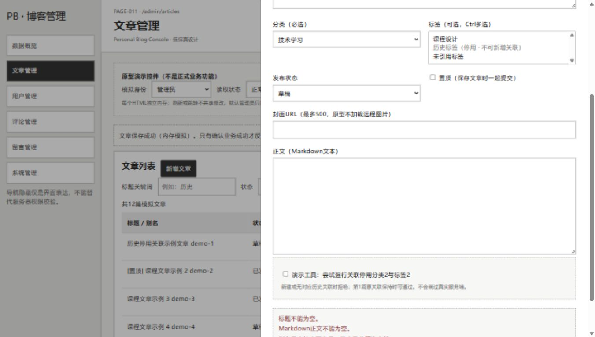

# 原型问题清单

日期：2026-10-09；最初阶段：14.6-A，以下原始观察与证据保留。14.6-A当时未修复任何HTML或JavaScript；本文件在15.5追加授权修复及回归结论，不代表真实Vue/后端存在同一问题。

## 1. 已复现问题

| 字段 | 内容 |
| --- | --- |
| 问题编号 | PROTO-ISSUE-001，对应检查X01 |
| 所属原型 | 后台文章管理原型.html |
| 描述 | 上一轮文章保存成功提示在后续新增校验失败或模拟保存失败时仍保留，页面同时存在旧成功提示与本轮错误 |
| 严重程度 | 中：反馈易产生歧义；未发现失败导致模拟数据实际写入 |
| 复现步骤 | 刷新；编辑第1篇历史关联文章；保持原值保存成功；点击新增文章；不填写标题、正文、别名直接保存；观察抽屉错误和背后主页面提示。另可取消后将写入结果设为“失败 / 整批回滚”，编辑并修改标题再保存 |
| 预期 | 新操作开始时清除或明确标识旧结果；本轮失败只呈现与本次操作对应的失败反馈，原数据不变 |
| 实际 | 抽屉提示标题/正文/别名错误或模拟保存失败；主页面仍显示“文章保存成功（内存模拟）”；总数仍12，失败编辑未改变原标题 |
| 执行时间 | 2026-10-09 13:53:00复现；13:53:17再次观察保存失败场景 |
| 证据 | [真实截图](screenshots/问题-旧成功提示残留.jpg)；验证记录X01、I17、I44 |
| 建议 | 在14.6-B中于打开新编辑操作、提交及校验失败时重置旧反馈；保证当前结果与当前操作绑定，复验成功→失败、成功→取消等路径 |
| 当前状态 | 已解决（2026-10-09，15.5授权修复及原型浏览器回归）；14.6-A当时为已复现、待修复，原始失败记录保留 |

浏览器DOM同时记录的关键文本：

```text
status: 文章保存成功（内存模拟）。只有确认业务成功才反馈；未请求后端。
dialog: 新增编辑文章抽屉
alert: 标题不能为空。 Markdown正文不能为空。 别名只支持小写字母、数字及分隔连字符。
```



## 2. 观察限制，不作为已复现缺陷

| 项目 | 状态与说明 |
| --- | --- |
| Chrome/Edge兼容性 | 工具未提供对应会话，尚未验证；不能判断兼容失败 |
| 1366px精确CSS宽度 | 设为1366×768时DOM报告innerWidth 1367；属于测量/工具舍入限制，未发现原型横向溢出，不直接判定页面缺陷 |
| 全量边界与导航组合 | 未穷举；按人工指南补充，不能据此声称无缺陷 |
| Console/资源 | 已捕获的error日志为空，本地服务已观察请求为200/304；未导出完整Network/HAR，不等于完整网络审计 |
| 评论/留言删除入口 | 用户已确认不纳入当前基线原型；仅保留范围说明，不登记为漏做删除 |
| 跨HTML模拟状态不共享 | 已有说明明确各文件独立内存，刷新复原；不是登录/数据库持久化缺陷 |
| 尚未制作的页面 | 首页、关于、公开留言板等部分入口只显示目标说明；不得误报为真实网站404 |

## 3. 关闭条件

经用户授权修复后，真实浏览器复验PROTOTYPE问题的复现路径，保留失败记录及修复后证据，确认原数据仍不变且旧成功提示不再混淆本轮结果。未经复验不得写“已解决”；本轮没有正式原型评审批准或系统验收结论。

## 4. 15.5修复与关闭记录（2026-10-09）

用户在15.5请求明确授权仅修复后台文章管理HTML提示状态、执行回归并更新本清单。实际在openArticle打开新操作时清理主反馈，在saveArticle通过guard后清理本轮反馈，并在articleDrawer关闭时清理抽屉错误；原有成功保存流程、校验和权限逻辑保持。

18:32—18:35使用Codex内置浏览器及127.0.0.1临时原型服务执行R01—R12全部12组，结果12通过、0失败、0未执行、0环境受限。另复验原空表单与模拟失败两条路径：主feedback为空、当前抽屉错误正确、原数据保持。筛选、分页、历史停用关联、新关联拒绝、取消/关闭/Escape及相邻删除反馈未发现所测回退。Console捕获warn/error为空。

据此仅关闭PROTO-ISSUE-001这一HTML原型缺陷。未验证Chrome/Edge双浏览器或真实网站，未据此完成正式原型评审或课程验收。历史X01失败与旧截图不删除、不改成当时通过。

记录：[实施记录](../../skill/docs/15.5原型缺陷修复实施记录.md)、[回归报告](../../skill/docs/15.5原型缺陷回归测试报告.md)、[Skill流程验证](../../skill/docs/15.5软件开发Skill实际修复验证报告.md)。

修复后真实证据：[空标题校验](../../skill/docs/evidence/15.5/02-空标题无旧成功.jpg)、[模拟失败](../../skill/docs/evidence/15.5/03-模拟失败无旧成功.jpg)、[原复现路径](../../skill/docs/evidence/15.5/09-原复现路径校验失败.jpg)。
